# Geometric algorithms — what happens inside the operations

> **Week 10** — part 1 of the [Algorithms section](/Lecture/Algorithms/README.md)
> (W10 geometric · W11 simulation · W12 optimization and learning). Also a
> reference from Week 05 on, and a source of project directions.
>
> ```bash
> uv run pytest Lecture/Algorithms/geometric/tests -v      # 48 property tests
> uv run Lecture/Algorithms/geometric/figures/make_figures.py
> ```

Weeks 05–06 *called* operations (`subdivided`, `smooth_centroid`,
`shortest_path`, `dual`). Here they are written from scratch in
[`tutorials/`](tutorials/): plain Python on the COMPAS `Mesh`, 30–100 lines each.

**Why rewrite a library?** You will ship the library version, or an AI's. The
hard part is knowing whether an implementation is *right*, so the tests in
[`tests/test_algorithms.py`](tests/test_algorithms.py) matter most. Several are
**theorems** used as exact checks (Gauss–Bonnet, Euler, the empty circle): they
hold for every input, including ones you never thought of. That is *test
properties, not pictures* ([Testing geometry](/Lecture/Lecture_12/README.md#part-a--testing-week-10),
this week's other half) at full strength. Figures are drawn by the same code
([`figures/make_figures.py`](figures/make_figures.py)).

| # | Algorithm | Built on (from Weeks 05–06) | The test that keeps it honest |
| - | --------- | --------------------------- | ----------------------------- |
| 1 | [Smoothing](#1-smoothing-laplacian-and-taubin) | `vertex_neighbors`, fixed vertices | size before/after; fixed vertices do not move |
| 2 | [Curvature](#2-curvature-the-angle-defect) | `vertex_faces`, face angles, `euler()` | **Gauss–Bonnet**: Σ defects = 2π·χ |
| 3 | [Geodesic distance](#3-geodesic-distance-on-the-surface-not-through-the-air) | Dijkstra (W06) on mesh edges | never shorter than a straight line |
| 4 | [Subdivision](#4-subdivision-catmull-clark-by-hand) | faces, edges, halfedges → a new topology | V′ = V + E + F; χ unchanged; matches COMPAS |
| 5 | [Planar panels](#5-planar-panels) | per-face best-fit planes, averaging | flatness drops 10×; fixed vertices stay |
| 6 | [Contouring](#6-contouring-slicing-a-mesh-with-planes) | triangles, **edge keys** to chain segments | every point at height *h*; closed loops close |
| 7 | [Delaunay & Voronoi](#7-delaunay-and-its-dual-voronoi) | `vertex_faces(ordered=True)`, the dual | **empty circle**; cell corners nearest their site |
| 8 | [Convex hull](#8-convex-hull-the-rubber-band) | sorting + one cross product | every point left of every edge; agrees with COMPAS |
| 9 | [Nearest neighbours](#9-nearest-neighbours-the-cost-of-the-obvious) | a dictionary of grid cells (W04) | identical answers to brute force; timing |
| 10 | [Lloyd relaxation](#10-lloyd-relaxation-even-but-not-regular) | Voronoi (§7), centroids | energy never increases; closest pair grows |
| 11 | [Library tour](#11-library-tour-compas_cgal) | — | — |

---

## 1. Smoothing: Laplacian and Taubin

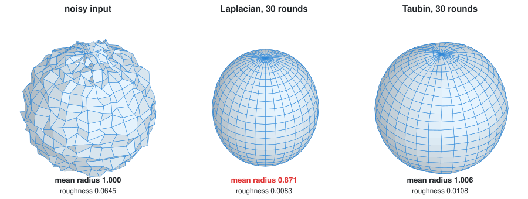

Move every vertex a step toward the average of its neighbours:

```python
c = mean(neighbours of v)
v = v + w * (c - v)          # w = 0.5
```

**Laplacian smoothing** removes noise and **shrinks**: on a curved surface each
vertex sits outside its neighbours' average. After 30 rounds the sphere loses
13% of its radius. **Taubin** (1995) follows each step with a slightly larger
one back (`w = -0.53`): noise is damped by both, size is restored.

Compute **all** new positions from the **old** ones, then write. Updating in
place makes the result depend on loop order: subtly lopsided smoothing.

📄 [`tutorials/smoothing.py`](tutorials/smoothing.py) · tests: roughness goes down; fixed
vertices and topology unchanged; input not modified; Laplacian shrinks a sphere
by > 5% and Taubin by less than a third of that.
**Library:** `mesh.smooth_centroid()`, `mesh.smooth_area()`.

## 2. Curvature: the angle defect

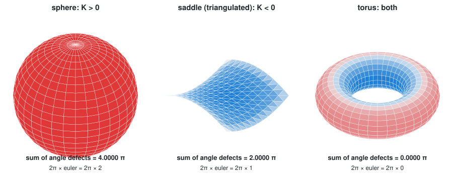

Sum the face angles at a vertex: 2π on a flat sheet, 270° at a cube corner
(closes in), more than 360° on a saddle (ruffles). The shortfall is the **angle
defect**, discrete Gaussian curvature:

```python
K(v) = 2π - sum(face_angle(f, v) for f in mesh.vertex_faces(v))
```

The sign matters: **K > 0** (domes) and **K < 0** (saddles, hypars) are stiff
shells needing doubly-curved cladding; **K = 0** (cylinders, cones) unrolls flat
and can be built from bent sheet.

**Gauss–Bonnet as a test.** On any closed mesh the defects sum to exactly
`2π × euler`: 4π sphere-like, 0 for a torus. Measured angles equal a count of
elements, for every input. Break it and you have a bug.

> 🔍 **Found while writing the tests.** A hypar meshed along its rulings has
> twisted quads whose angles still sum to *exactly* 2π: K = 0 on a curved
> surface. The angle defect only sees curvature through **planar** faces;
> triangulate first. `test_saddle_curvature_is_negative_once_triangulated`
> pins it down.

📄 [`tutorials/curvature.py`](tutorials/curvature.py) · tests: Gauss–Bonnet on a box, a sphere, a torus,
and an open surface; zero inside a flat grid; average K ≈ 1/r² on a sphere.
**Library:** `mesh.vertex_curvature()`.

## 3. Geodesic distance: on the surface, not through the air

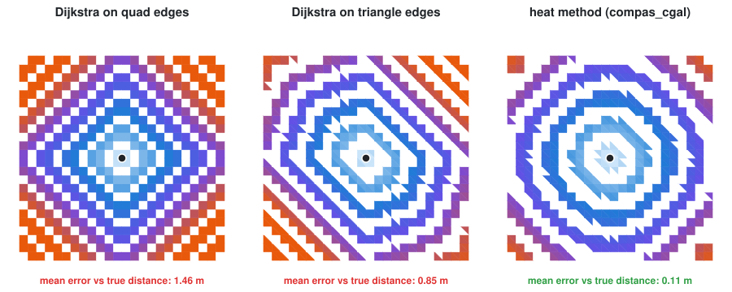

Distance *walking on the roof* routes cables, paths and patterns. The obvious
answer is Week 06: Dijkstra on edge lengths. On a flat sheet the truth is
circles, but edge paths turn only at vertices, so they zig-zag:

- on **quads**, it measures taxicab distance |dx| + |dy|: diamonds, up to 41% too far
- on **triangles**, there is one more direction, but only one diagonal, so the
  fronts stretch along it
- the **heat method** (Crane et al., 2013) crosses faces instead of following edges

The mean errors on the figure are 1.46 m, 0.85 m and 0.11 m.

The module's most useful lesson: **a correct algorithm can answer a different
question from yours.** Dijkstra returns the exact shortest path *along edges*,
not *on the surface*. A test pins the taxicab result so nobody confuses them.

📄 [`tutorials/geodesics.py`](tutorials/geodesics.py) · tests: never shorter than the straight line;
exactly taxicab on a grid; the heat method beats it on a known case; bad source → `ValueError`.
**Library:** `compas_cgal.geodesics.heat_geodesic_distances`, `geodesic_isolines`.

## 4. Subdivision: Catmull–Clark by hand

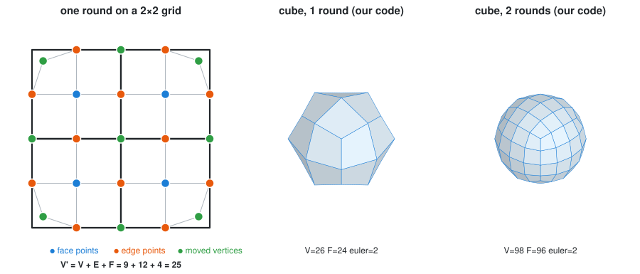

Writing `subdivided("catmullclark")` once is the clearest exercise in building a
**new topology** from an old one, with three dictionaries keyed as in Week 05:

1. `face_point[f]`: the centroid of each face
2. `edge_point[(u, v)]`: the average of the edge's ends and its two face points (midpoint on the boundary)
3. `vertex_point[v]`: the old vertex pulled toward its neighbourhood, `(F + 2R + (n − 3)P) / n`
4. each n-sided face becomes n quads: `[vertex, edge point, face point, previous edge point]`

Tests: every face a quad; **V′ = V + E + F**; **Euler unchanged**; and every
position identical to COMPAS's on a cube, so the formulas, not just the counts,
are right. The grid's corners get cut off: plain Catmull–Clark has no corner
rule (exercise 2).

📄 [`tutorials/subdivision.py`](tutorials/subdivision.py) ·
**Library:** `mesh.subdivided(scheme)` with `"catmullclark"`, `"loop"`, `"doosabin"`, `"quad"`, `"tri"`, …

## 5. Planar panels

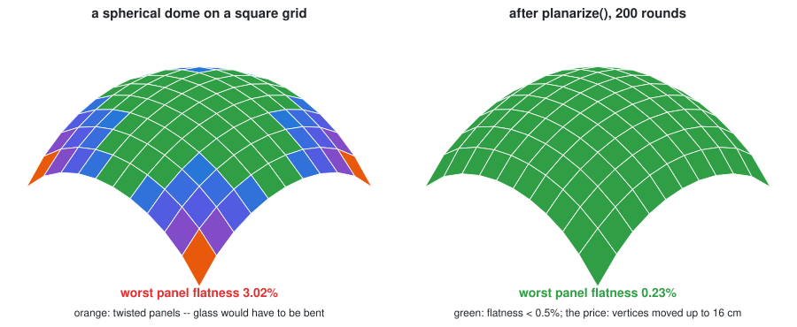

Curved roofs are built from **flat** glass, sheet and timber. Triangles are
flat; quads on a doubly-curved surface generally aren't. A twisted panel must be
cold-bent (~1–2% for glass), hot-bent (expensive) or split (twice the joints).

**Measure:** flatness = distance between the diagonals / their mean length. The
dome reaches 3%. **Fix** by projection (a simple Kangaroo/Evolute):

```
repeat:
    for each face: fit a plane to its corners, project them onto it
    for each vertex: move to the average of where its faces asked it to go
```

Each vertex averages what its four faces want. After 200 rounds every panel is
under 0.5%, **at a price: vertices moved up to 16 cm.** Flatness versus fidelity
is a design negotiation; never report one without the other.

📄 [`tutorials/planarity.py`](tutorials/planarity.py) · tests: flat grid → 0; triangles → 0; flatness
drops at least 10×; fixed vertices stay; pentagons → `ValueError`.
**Library:** `mesh.face_flatness()` (normalised by edge length, not diagonals: check
which definition a number uses before comparing it).

## 6. Contouring: slicing a mesh with planes

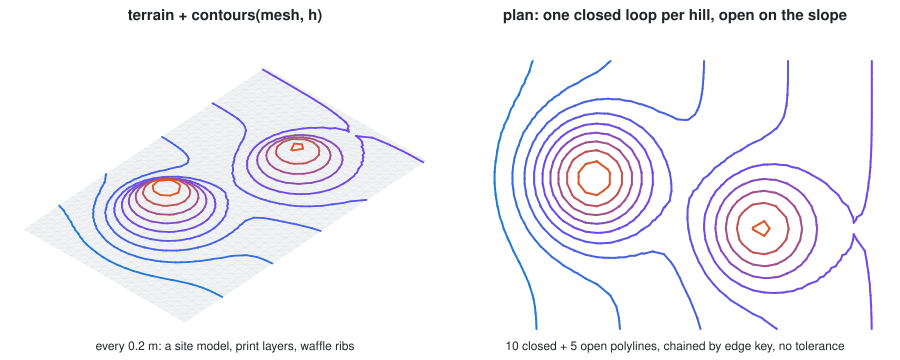

Cardboard site models, 3D-print layers, waffle ribs and CNC paths are one
algorithm:

```
for every triangle and every height h:
    an edge with one end above h and one below is crossed -- interpolate the point
    a triangle is crossed by 0 or 2 edges -> 0 or 1 segment
```

Two segments connect exactly when they cross **the same mesh edge**, so they
chain by edge key (integers) rather than by matching float endpoints. Loops come
back closed, lines open, nothing to tune: 10 closed, 5 open in the figure.
Quads can be crossed on all four edges (ambiguous), so `contours()` raises on
them.

📄 [`tutorials/contouring.py`](tutorials/contouring.py) · tests: every point at height h; a sphere
cut at the equator → one closed loop ≈ 2π long; a slope → one open line;
two hills → two loops; quads → `ValueError`.
**Library:** `compas_cgal.slicer.slice_mesh`, `compas_cgal.isolines.isolines`.

## 7. Delaunay, and its dual: Voronoi

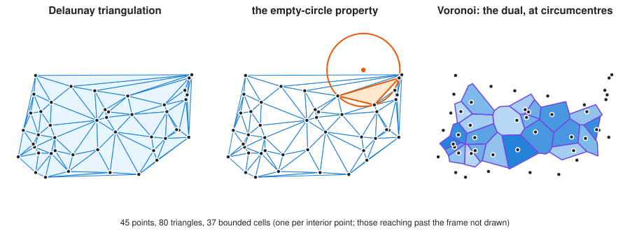

**Delaunay**: triangles whose circumcircles contain no other point, the
"fattest" triangulation, under terrains, scans and FE meshes. The **empty
circle** is also its test.

**Voronoi**: each point's region of closest approach (service areas, cellular
facades). It is the **dual** of Delaunay (Week 05 §9):

| Delaunay | Voronoi |
| -------- | ------- |
| triangle | vertex, at the triangle's **circumcentre** |
| interior vertex | cell: the circumcentres of the triangles around it, in order |

`mesh.dual()` with circumcentres instead of centroids *is* Voronoi; topology
comes free from `vertex_faces(v, ordered=True)`. Hull cells reach far out
(unbounded in theory); clip them to a site boundary.

📄 [`tutorials/voronoi.py`](tutorials/voronoi.py) · tests: empty circle for every triangle;
circumcentre equidistant; every cell corner at least as close to its own site
as to any other; one cell per interior point; collinear points → `ValueError`.
**Library:** `compas.geometry.delaunay_triangulation` (used here), and
`compas_cgal.triangulation` for constrained Delaunay (plans with holes).
COMPAS 2 has no Voronoi function of its own: these twenty lines *are* it.

## 8. Convex hull: the rubber band

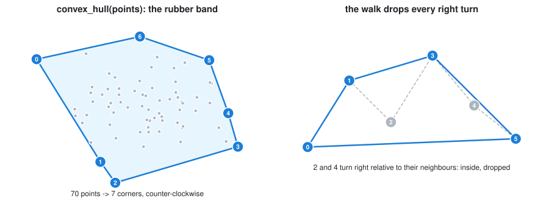

A rubber band around nails: the **convex hull**. Column footprints, survey
outlines, cheap bounds, and the start of Delaunay.

**Monotone chain** (Andrew): sort by x, walk left to right, drop the middle of
any three points that turn *right* (or go straight); walk back for the upper
half. "Turns right" is one cross product's sign.

**Cost:** O(n log n), all in the sort. Trying every pair as an edge is O(n³), a
billion tests for 1,000 points. *How* you compute decides whether you can.

📄 [`tutorials/convex_hull.py`](tutorials/convex_hull.py) · tests: every point left of every edge;
counter-clockwise and convex; agrees with `compas.geometry.convex_hull_xy`; collinear points → `ValueError`.
Also: the Graham scan step by step in [`Lecture_08/notebooks/02_convex_hull_2d.ipynb`](/Lecture/Lecture_08/notebooks/02_convex_hull_2d.ipynb).

## 9. Nearest neighbours: the cost of the obvious

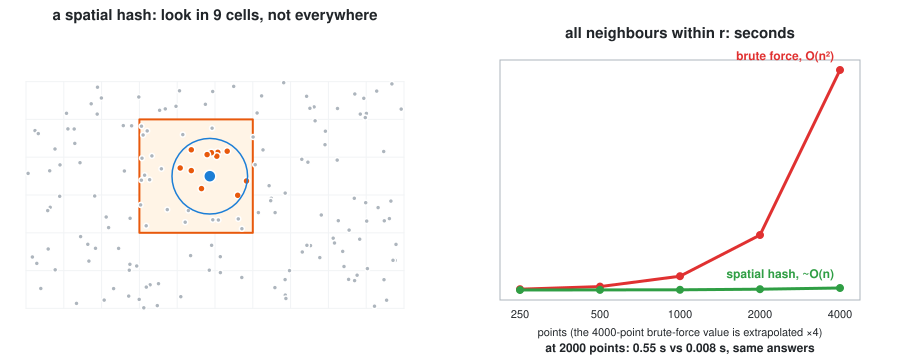

Neighbour queries ("within 1 m?", "which boids can I see?") are the inner loop
of simulation, scanning and clustering; their cost decides instant vs hang.

**Brute force** is O(n²). A **spatial hash** keys points by
`(floor(x / r), floor(y / r))` in a dictionary (Week 04); anything within *r* is
in the 9 surrounding cells. At 2,000 points: over half a second vs under 10 ms,
**identical answers** (the tests check that). `within()` raises if the radius
exceeds the cell size, rather than silently missing neighbours.

📄 [`tutorials/nearest.py`](tutorials/nearest.py) · tests: same results as brute force, including
negative coordinates and points exactly on cell edges; too-large radius → `ValueError`.
**Library:** `compas.geometry.KDTree`, better for uneven spreads and "k nearest" queries.

## 10. Lloyd relaxation: even, but not regular

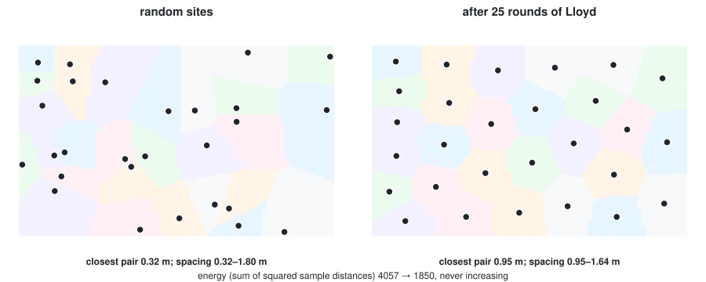

Random points clump; perforations, columns and skylights want **irregular but
even**. Lloyd: compute each point's Voronoi cell (§7), move it to the
**centroid**, repeat. The closest pair goes from 0.32 m to 0.95 m.

Cells are **sampled** (grid points to nearest site), so any site shape works
without clipping. This is *exactly* k-means, on a site instead of data
([W12](/Lecture/Algorithms/learning/README.md)). Guarantee and test: the energy
**never increases**.

📄 [`tutorials/lloyd.py`](tutorials/lloyd.py) · tests: energy never increases; the closest pair moves apart
and spacing evens out; sites stay on the site.

## 11. Library tour: compas_cgal

Some algorithms are too long to write in a week. [CGAL](https://www.cgal.org)
is the standard C++ geometry library; `compas_cgal` (installed) wraps it. The
most architectural:

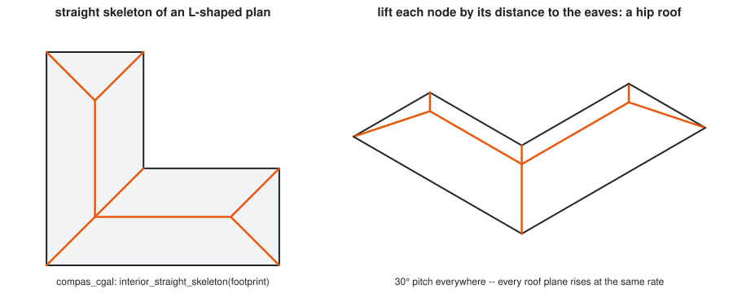

**Straight skeleton → hip roof.** Shrink a footprint inward at equal speed; the
corners trace the *straight skeleton*. Lift each node by its distance to the
eaves: a constant-pitch hip roof for any footprint:

```python
from compas_cgal.straight_skeleton_2 import interior_straight_skeleton
graph = interior_straight_skeleton(footprint)     # a COMPAS Graph (Week 06!)
```

| Module | What it does | Typical use |
| ------ | ------------ | ----------- |
| `booleans` | union / difference / intersection of closed meshes | massing, cutting openings |
| `meshing.trimesh_remesh` | even out triangle sizes | before simulation or fabrication |
| `slicer.slice_mesh` | robust contouring (§6) | 3D printing, waffle structures |
| `reconstruction` | outlier removal, normals, Poisson surface | full 3D scans (W05 §12) |
| `geodesics` | heat-method distances and isolines (§3) | patterns, paths on surfaces |
| `skeletonization` | the medial "stick figure" of a closed mesh | structure for organic forms |
| `straight_skeleton_2` | skeletons and offsets of polygons | roofs, setbacks, inset paths |
| `triangulation` | constrained / conforming Delaunay | meshing a plan with holes |

Worked scripts in [`Lecture_05/mesh_cgal/`](/Lecture/Lecture_05/mesh_cgal/):
`01_remesh.py`, `03_delaunay_with_holes.py`, `04_booleans.py`, `07_slice_for_printing.py`;
for points, the convex hull notebooks in [`Lecture_08/notebooks/`](/Lecture/Lecture_08/notebooks/).

---

## Exercises: extend one

Pick one. **Write the test first**, and say in one sentence which property it
checks and why it must hold.

1. **Loop subdivision** for triangle meshes. Test: V′ = V + E, every face a
   triangle, χ unchanged.
2. **A corner rule** for `catmull_clark` that keeps the corners of an open grid
   in place. Test: corner vertices do not move.
3. **Mean curvature** with the cotangent Laplacian. Test: ≈ 1/r on a sphere,
   ≈ 0 on a minimal surface.
4. **Planarize with closeness**: add a pull back toward the original surface
   and plot flatness against drift as you vary its weight. That trade-off curve
   is a design tool.
5. **Waffle structure**: contour a shell in x and in y, then cut half-depth slots
   where ribs cross. Test: every slot pair adds up to the full rib depth.
6. **Clip Voronoi cells** to a site boundary polygon, so the hull cells become
   usable panels.
7. **Have an AI assistant write one of these**, then run the tests here against
   it. Which property fails first? (Week 13 in miniature.)

## Self-test

1. Why does Laplacian smoothing shrink a closed surface, and what does Taubin change?
2. State Gauss–Bonnet in one line. Why is it a better test than comparing against a picture?
3. Dijkstra on mesh edges returns 11.3 m between two points of a flat sheet 8 m apart. Bug, or answer to a different question?
4. Why does `contours()` chain segments by edge key rather than by matching endpoints?
5. What one change turns `mesh.dual()` into a Voronoi diagram?
6. Planarization brought every panel under 0.5%. What else must you report?
