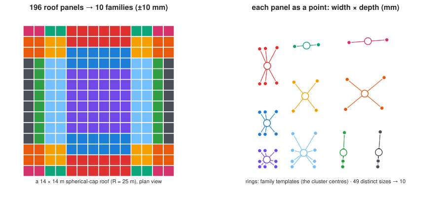
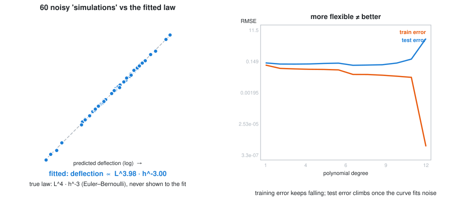

# Learning from data: clustering and regression

> **Week 12**, alongside [optimization](/Lecture/Algorithms/optimization/README.md):
> part 3 of the [Algorithms section](/Lecture/Algorithms/README.md).
>
> ```bash
> uv run pytest Lecture/Algorithms/learning/tests -v      # 11 tests
> uv run Lecture/Algorithms/learning/figures/make_figures.py
> ```

"Machine learning" in design practice is mostly two humble things: **grouping**
(which of these hundreds of things are really the same?) and **predicting**
(what will this cost, weigh or deflect, without computing it the slow way?).
This page writes both from scratch in numpy, a few dozen lines each, on
architectural problems, so that the library versions stop being magic.

One rule runs through both halves: **test a learning method where you already
know the answer.** Plant clusters and check they are found; generate data from
a physical law and check the law comes back. A method that cannot recover a
known answer will not find an unknown one either.

For trained models as design *ingredients* (diffusion rendering, CLIP image
search), see the optional [AI in design](/Lecture/Lecture_10/README.md) page.

---

## 1. Clustering: how many different panels does the roof need?



A shallow spherical roof on a 1 m grid has 196 panels, in 49 distinct sizes
(symmetry repeats the rest). Making 49 kinds of panel means 49 templates or
jigs. One kind is impossible. The fabricator's question: **what is the fewest
families of panel, if each panel may deviate from its family template by at
most a tolerance?**

That is clustering, and **k-means** is the algorithm. It is Lloyd's algorithm
([W10 §10](/Lecture/Algorithms/geometric/README.md#10-lloyd-relaxation-even-but-not-regular)),
run on panels instead of on a site:

1. **assign** every panel to its nearest family template;
2. **update** every template to the mean of its panels;
3. repeat until nothing moves.

Each panel is described by **features**: numbers we chose to measure, here its
width and depth. Choosing features is the modelling decision. The algorithm
cannot tell you whether you measured the right thing; a twisted panel with the
right side lengths would fool this one.

What the tests pin down:

- **Inertia never increases** within a run, so k-means always stops. It stops at
  a *local* optimum that depends on the start, so we use careful starts
  (k-means++) and keep the best of several.
- **More clusters always fit better.** So "the best k" is not a statistics
  question. It is the tolerance question: `families_needed()` returns the
  smallest k whose worst panel is within tolerance. At ±10 mm this roof needs
  **10 families**, at ±20 mm only 4. That trade-off is a conversation with the
  fabricator, and the code makes it a one-line experiment.

📄 [`tutorials/kmeans.py`](tutorials/kmeans.py)

## 2. Regression: rediscovering the beam law



A structural engineer has run 60 simulations of timber beams with different
spans *L* and depths *h*, and recorded each mid-span deflection. Can we predict
the next beam without another simulation? That is a **surrogate model**, the
most common machine learning in engineering design.

We happen to know the true law: deflection ∝ *L*⁴ *h*⁻³ (Euler–Bernoulli).
Take logs and it is a straight line,

```
log(deflection) = c + 4·log(L) − 3·log(h)
```

so ordinary least squares on log-features (`np.linalg.lstsq`) should **recover
the exponents from noisy data alone**. It finds *L*^3.98 · *h*^-3.00. The test
checks both within ±0.15, and checks predictions on beams held back from the
fit. Trying a method where the answer is known is the most honest way to learn
what it does.

### The warning: more flexible is not better

Fit polynomials of rising degree to 18 noisy samples of a smooth curve. Error
on the points you fitted (training error) keeps falling, and at degree 12 the
curve passes through every training point. Error on points held back (test
error) does not follow: once the curve starts fitting the *noise*, it climbs.
The model has memorised instead of learned.

The only defence is to **keep data back and test on it** (`split()`). It is
Week 10's lesson again: you do not grade your own homework, and a model does
not get to grade itself on data it has already seen.

📄 [`tutorials/regression.py`](tutorials/regression.py)

---

## Exercises

1. **A better feature.** Add panel *twist* (the diagonal-distance flatness from
   [W10 §5](/Lecture/Algorithms/geometric/README.md#5-planar-panels)) as a third
   feature. Does the family count change at ±10 mm? Which panels move family?
2. **Elbow vs tolerance.** Plot inertia against k (the textbook "elbow") next to
   `families_needed` at 5, 10 and 20 mm. Which would you show a fabricator, and why?
3. **A surrogate you can't write down.** Use the Week 05 truss analysis
   (`structural_analysis.py`) as the "expensive simulation": sample rise and
   grid density, fit max displacement. How many samples until test R² > 0.95?
4. **Have an AI write k-means for you**, then run these tests against it. Which
   property fails first?

## Self-test

1. Why does k-means always stop, and why might two runs stop in different places?
2. Inertia always falls as k grows. So how do you choose k for a roof?
3. Why fit `log(deflection)` instead of `deflection`?
4. A degree-12 polynomial has the lowest training error. Why is it the worst model?
5. What is the minimum evidence you'd want before trusting a surrogate model in a design decision?
