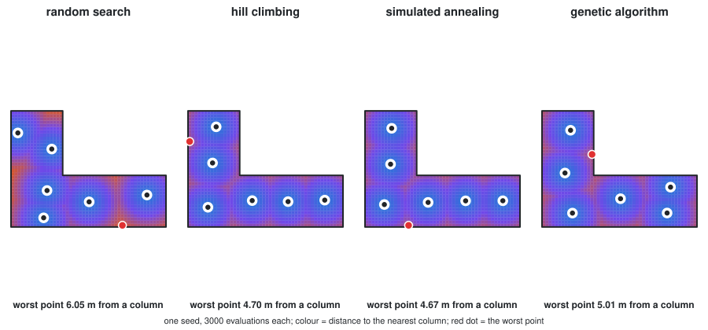
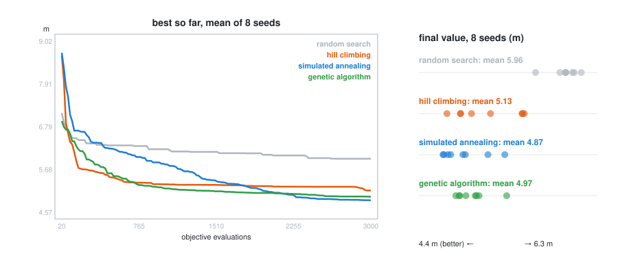

# Optimization: letting the computer choose

> **Week 12**, part 3 of the [Algorithms section](/Lecture/Algorithms/README.md)
> (W10 geometric · W11 simulation · W12 optimization and learning), shared
> with [learning](/Lecture/Algorithms/learning/README.md).
>
> ```bash
> uv run Lecture/Algorithms/optimization/tutorials/search.py      # the comparison, ~10 s
> uv run pytest Lecture/Algorithms/optimization/tests -v          # 20 tests
> uv run Lecture/Algorithms/optimization/figures/make_figures.py
> ```

## 1. The idea

So far you have *generated* geometry. Optimization *chooses* geometry: you
describe what "good" means as a number, and an algorithm searches for the
inputs that make that number best.

Three ingredients, and naming them is most of the work:

- **Variables** — what you are allowed to change (beam width, column spacing,
  panel angle).
- **Objective** — the single number to minimise or maximise (weight, cost,
  deflection, daylight).
- **Constraints** — what must stay true regardless (deflection < 5 mm,
  every part fits on the sheet, cost < budget).

If you cannot write the objective as a function that returns one number, you
cannot optimise yet — you are still deciding what you actually want. That is
the same lesson as the executable spec in Week 10, wearing engineering clothes.

## 2. Optimization *is* the dual-mode architecture

This is why the topic sits here and not in a vacuum. An objective function is a
**pure core function**: numbers in, one number out, no viewer, no files. The
optimiser calls it thousands of times, so it *must* be pure and fast — any
printing, drawing, or file IO inside it would be a disaster.

```python
def beam_weight(width, height):
    """Pure: dimensions in, one number out. The optimiser calls this a lot."""
    return width * height * LENGTH * DENSITY
```

Everything you learned in Week 09 about keeping the core clean pays off
directly here. The optimiser is just a very persistent caller.

## 3. Four searches, written from scratch

Before reaching for a library, write the search yourself once. The problem:
**place 6 columns in an L-shaped plan so that no point of the floor is far
from a column**. The objective is the largest distance from any floor point to
its nearest column, a stand-in for the longest span the slab has to make.

```python
def objective(layout):           # 12 numbers in, one number out: pure
    d = distances(floor_samples, columns(layout))
    return d.min(axis=1).max()   # worst point's distance to its nearest column
```

It is cheap to evaluate, impossible to solve with calculus (that `max` of
`min`s is jagged), and full of local optima, which is exactly what these
algorithms are for.



| Method | Idea | Weakness |
| --- | --- | --- |
| **random search** | try random layouts, keep the best | blind: the baseline every other method must beat |
| **hill climbing** | nudge one column; keep the move only if it helps | greedy: stops at the first local optimum |
| **simulated annealing** | ... but *sometimes* accept a worse move, less often as the "temperature" falls | needs a cooling schedule, which is a tuning decision |
| **genetic algorithm** | a population of layouts; good ones breed (swap columns) and mutate (nudge) | many parameters; slow to get started |

### The comparison has rules

Two rules make the comparison honest, and both are enforced in code:

1. **The same budget.** Every method gets 3,000 objective evaluations. A
   `Budget` object counts every call and raises when the budget is spent, so no
   method can quietly cheat by evaluating more. A test checks it with
   `monkeypatch`.
2. **Several seeds.** A random method run once is an anecdote. Each method runs
   with 8 seeds, and we compare the spread, not one lucky number.



On this problem simulated annealing has the best mean (4.87 m), the genetic
algorithm is close (4.97 m), hill climbing gets stuck (5.13 m) with a wide
spread, and random search trails (5.96 m). Note hill climbing's curve: the
fastest start, then flat, which is the local-optimum trap drawn as a line.
**None of this generalises.** On another problem, with another budget, the
order can change. What generalises is the procedure: same budget, several
seeds, and look at the spread.

📄 [`tutorials/search.py`](tutorials/search.py) · tests: budgets respected; columns stay inside the
plan; the reported value is the real objective of the reported layout; best-so-far never gets
worse; reproducible per seed; every guided method beats random search on average.

## 4. With libraries

Run them from the repo root:

```bash
uv run Lecture/Algorithms/optimization/01_beam_optimization_scipy.py
uv run Lecture/Algorithms/optimization/02_beam_optimization_pymoo.py     # needs pymoo, see Setup
```

### `01_beam_optimization_scipy.py` — one objective

Find the lightest rectangular beam that carries a 500 kg load without
deflecting more than 5 mm.

- **Library**: `scipy.optimize` (standard scientific Python)
- **Method**: SLSQP (Sequential Least SQuares Programming)
- **Shape**: one objective, one answer

### `02_beam_optimization_pymoo.py` — competing objectives

Real design rarely has one goal. Here, *light* and *stiff* pull against each
other: the lightest beam is floppy, the stiffest is heavy. There is no single
winner — there is a **Pareto front** of the best available compromises, and
choosing among them is a design decision the maths deliberately leaves to you.

- **Library**: `pymoo` (multi-objective optimization)
- **Method**: NSGA-II (a genetic algorithm)

> The takeaway is not the algorithm. It is that "optimal" is only meaningful
> once you have said *optimal for what*, and that when goals conflict the
> computer hands the trade-off back to you rather than resolving it.

## 5. Setup

The from-scratch tutorials (§3) need nothing beyond the course environment.
`scipy` is already installed (COMPAS depends on it). `pymoo` and `matplotlib`
are not: to run the library examples, add them to your own project only.

```bash
uv add pymoo matplotlib
uv run Lecture/Algorithms/optimization/02_beam_optimization_pymoo.py
```

(These are not in the default `uv.lock` because they are optional — `uv add`
records them in `pyproject.toml`. Commit that change only if your project uses
them.)

## Using it in a final project

The cleanest way to make optimization part of a project:

1. Write your objective as a pure function in your **core** layer.
2. Let the optimiser find the best variables (this replaces you turning
   sliders by hand).
3. Feed those variables back into your normal geometry core to build the
   winning design, and save it as your **artifact**.

The optimiser chooses the numbers; your tested core turns them into geometry.
Same architecture, one new caller.
