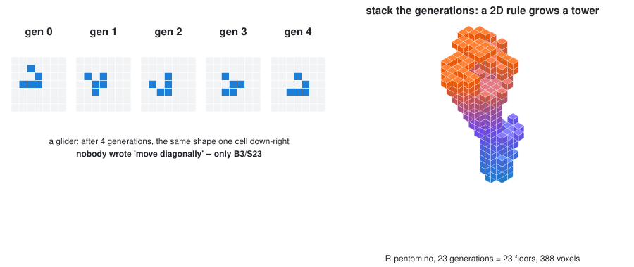
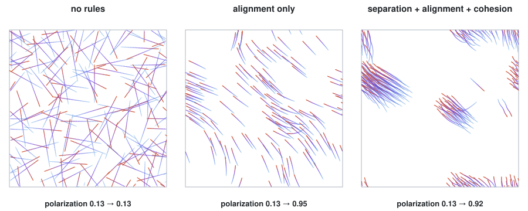
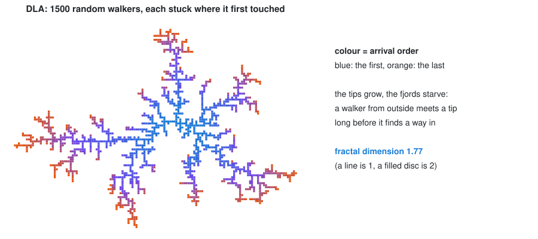

# Simulation: global form from local rules

> **Week 11**, part 2 of the [Algorithms section](/Lecture/Algorithms/README.md)
> (W10 geometric · W11 simulation · W12 optimization and learning).
>
> ```bash
> uv run pytest Lecture/Algorithms/simulation/tests -v      # 17 tests
> uv run Lecture/Algorithms/simulation/figures/make_figures.py
> ```

Everything so far has been **explicit**: you wrote down the geometry, or the
rule that generates it directly. This week the rules are **local**: each cell,
agent or particle reacts only to what is next to it. The form is something
nobody wrote down. It *emerges* from many small decisions, and you find out what
a rule does by running it.

That is exciting for design (flocking, growth and self-organisation produce
forms you would not have drawn) and dangerous for engineering (you cannot read
the outcome off the code). So every tutorial here comes with tests built like
experiments:

| Kind of test | Example |
| --- | --- |
| a **known case** with a known outcome | a blinker blinks with period 2; a glider moves one cell diagonally every 4 generations |
| an **invariant** that must hold at every step | boid speeds stay within limits; every DLA cell touches an earlier one |
| a **measured trend**, averaged over runs | alignment raises flock polarization, on average over seeds |

The last row matters. A random simulation run once is an anecdote. In the boids
test, single runs ranged from 0.17 to 0.91; only the average is evidence.

The agent-based examples from Week 07 (ants laying pheromone trails, drones
chasing targets, in [`/Lecture/Lecture_07/abm_examples/`](/Lecture/Lecture_07/abm_examples/))
are the object-oriented versions of the same idea. Here the state lives in
**numpy arrays** instead of one object per agent, which is how simulations get
fast enough to be design tools.

---

## 1. Cellular automata: a rule with no geometry in it



A grid of cells, alive or dead. Each generation, each cell counts its 8
neighbours. Conway's Game of Life is the rule **B3/S23**: a dead cell with 3
live neighbours is *born*, and a live cell with 2 or 3 *survives*. That is the
whole program. Still lifes, oscillators, and gliders that crawl across the grid
forever all come out of it.

**Stack the generations** (generation *t* becomes floor *t*) and a 2D rule grows
a 3D form. That is the root of a long line of "evolutionary architecture"
experiments, and an easy final-project starting point: change the rule (B36/S23,
B3678/S34678 …), and the tower changes character.

Two implementation choices, both pinned by tests:

- **Counting neighbours is eight shifted copies of the array added together.**
  There is no Python loop over cells, so a 500×500 grid runs as fast as a
  50×50 one did in a loop.
- **`step()` returns a new grid.** Updating cells one by one in place lets
  later cells see their neighbours' *next* state, the same order bug as in
  [Laplacian smoothing](/Lecture/Algorithms/geometric/README.md#1-smoothing-laplacian-and-taubin).
- **The border is dead, not wrapped around.** That is a decision, and the test
  `test_the_border_is_dead_not_wrapped` states it. Change it on purpose, never
  by accident.

📄 [`tutorials/cellular_automata.py`](tutorials/cellular_automata.py)

## 2. Boids: flocking from three rules



Craig Reynolds (1987): each boid sees only neighbours within a radius, and
steers by **separation** (away from those too close), **alignment** (toward
their average heading) and **cohesion** (toward their average position). No
boid knows there is a flock, yet a flock forms. Swap birds for people and you
have the core of crowd and egress simulation. Swap them for robots and you
have swarm construction.

Two things make it a tool rather than a screensaver, and both are algorithms:

- **Neighbour search.** "Who is within *r*?" for every boid, every step, is the
  O(n²) problem from
  [W10 §9](/Lecture/Algorithms/geometric/README.md#9-nearest-neighbours-the-cost-of-the-obvious).
  `boids.py` uses the spatial hash, and a test checks it against brute force.
- **Measurement.** `polarization()` turns "it looks like flocking" into a
  number: the length of the average heading, 0 for random and 1 for all
  parallel. With no rules it does not move. With alignment it climbs.

📄 [`tutorials/boids.py`](tutorials/boids.py)

## 3. Diffusion-limited aggregation: growth by random walk



One fixed seed cell. Release a particle; it wanders at random until it touches
the cluster, and sticks. Release the next. The result branches like coral, frost
or a river delta, because a walker coming from outside meets a **tip** long
before it finds a way into a fjord, so tips grow and fjords starve.

**Fractal dimension** measures how branchy it is: how fast mass grows with
radius. A line has dimension 1 and a filled disc 2. This cluster measures 1.77,
and the test requires a value clearly between the two.

Two engineering details decide whether this takes a second or an hour, and
neither changes the result: walkers are **launched on a circle just outside the
cluster** (not anywhere on a huge grid), and a walker that strays too far is
**killed and relaunched**. Knowing which shortcuts are safe, because they do
not change the statistics, is most of the craft of simulation.

📄 [`tutorials/dla.py`](tutorials/dla.py)

---

## Exercises

Write the test first. For a random process, say how many seeds it averages over.

1. **Your own rule.** Find a life-like rule (Bxx/Syy) whose stacked tower stays
   inside a 20×20 footprint for 40 floors without dying out. Test both facts.
2. **Obstacles.** Add walls to `boids.py` (a fourth steering term, away from the
   nearest wall point). Test that no boid ever crosses one.
3. **Egress.** Boids with a goal: a fourth rule toward an exit. Measure the
   evacuation time for one exit and for two, over 10 seeds. Compare with the
   Week 06 escape-distance graph: where do they disagree, and why?
4. **Biased DLA.** Make walkers drift downward (like rain) or stick only from
   above. How does the fractal dimension change? Predict before running.
5. **Into geometry.** Turn the DLA cluster into a COMPAS `Graph` (cells = nodes,
   stuck-to = edges). It is a tree, as in Week 06 §5. Pipe-sweep its edges for a
   branching structure.

## Self-test

1. Why must `step()` compute the whole new grid before writing any of it?
2. The boids test averages polarization over four seeds. Why not use one?
3. What makes neighbour search, not the steering rules, the expensive part of boids?
4. Why do DLA tips grow faster than fjords?
5. Launching DLA walkers near the cluster makes it much faster. Why does it not change the shape?
