# Week 05 — Mesh: a real geometric data structure

> Self-contained. `uv run check.py 05` when you are ready.
>
> Every figure is drawn from a real COMPAS mesh by
> [`figures/make_figures.py`](figures/make_figures.py): the numbers in the
> pictures are the numbers the code gives you.

Last week you built geometry one object at a time. A facade, shell, terrain or
3D print is one connected surface, and most questions about it are about
*connections*: what is next to this panel, where the edge is, what holds it up.

A **mesh** is the data structure for that, and where Week 04's dictionaries do
real work: every vertex, edge and face carries a dictionary of your data. Next
week: **graphs**, a mesh with the faces taken away.

---

## 1. Why a mesh is not a list of triangles

A list of triangles, each with three points, draws correctly and is useless
for everything else.

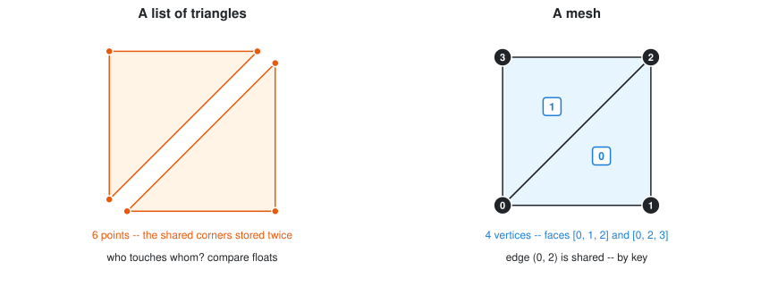

Left: the triangles only *look* connected. Shared corners are stored twice,
so "do these touch?" means comparing floats with `==` (Week 02: don't).
Right: each corner is stored **once** under an integer **key**, and each face
is a list of keys. Faces 0 and 1 share edge `(0, 2)` because both contain `0`
and `2`. No floats compared.

The whole week builds on this: **faces refer to vertices by key.** So:

- **Neighbours are lookups, not searches.** "What touches this face?" is a
  dictionary lookup.
- **Move a vertex and every face that uses it follows.** You never rebuild
  faces to change the shape (section 9).
- **Every element has a stable identity** you can attach data to (section 7).

## 2. Anatomy: vertices, faces, edges

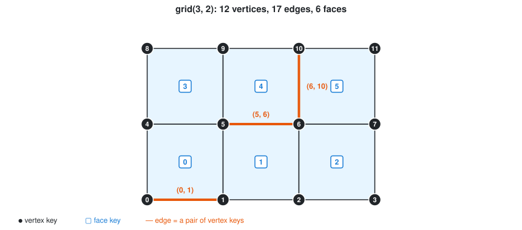

| Element | What it is | Identified by |
| ------- | ---------- | ------------- |
| **vertex** | a point | an integer key: `0`, `1`, `2`, … |
| **face** | an ordered cycle of vertex keys | an integer key, its own numbering |
| **edge** | two vertices that are next to each other in some face | the pair `(u, v)` |

Edges are *derived* from faces: if `5` follows `6` in some face, `(5, 6)` is
an edge. The edge count (17 here) is a consequence of the faces, not an input.

### Making one from scratch

```python
from compas.datastructures import Mesh

mesh = Mesh()
a = mesh.add_vertex(x=0, y=0, z=0)     # returns its key: 0
b = mesh.add_vertex(x=1, y=0, z=0)     # 1
c = mesh.add_vertex(x=1, y=1, z=0)     # 2
d = mesh.add_vertex(x=0, y=1, z=0)     # 3

f = mesh.add_face([a, b, c, d])        # vertex keys, in order around the face
```

Build faces from the keys `add_vertex` returns; don't assume `0, 1, 2, …`
(deleted keys are not reused). The same mesh from plain lists, as most file
formats store it:

```python
vertices = [[0, 0, 0], [1, 0, 0], [1, 1, 0], [0, 1, 0]]
faces = [[0, 1, 2, 3]]
mesh = Mesh.from_vertices_and_faces(vertices, faces)
```

### Ready-made constructors

```python
from compas.geometry import Box

Mesh.from_meshgrid(dx=10, nx=10, dy=5, ny=5)   # a flat grid of quads
Mesh.from_polyhedron(6)                         # a cube (4, 6, 8, 12, 20 work)
Mesh.from_shape(Box(1, 2, 3))                   # any COMPAS shape
Mesh.from_polygons([[[0,0,0],[1,0,0],[1,1,0]]]) # from point lists, shared corners merged
Mesh.from_obj("model.obj")                      # from a file (also .ply, .stl, .off)
```

> 💡 `Mesh.from_meshgrid` numbers vertices **y-fastest**; the figure (and
> checkpoint 1) number them **x-fastest**. Keys are labels, not positions:
> never compute a location from a key.

📄 `mesh_examples/501_mesh.py`, `502_mesh_from_scratch.py`, `503_mesh_constructor.py`,
`504_mesh_from_file.py`

## 3. Face order defines the normal

The order of a face's vertices decides which way it *points*.

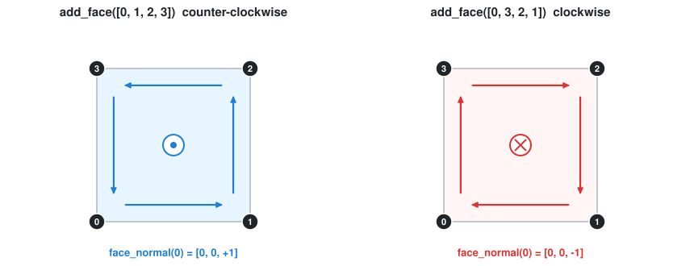

**Counter-clockwise** seen from where you stand → the normal points **at
you** (right-hand rule).

> ⚠️ **Inconsistent winding is a silent bug.** It looks fine on screen and
> breaks shading, offsetting, thickening, booleans and 3D printing.
> `mesh.unify_cycles()` makes every face agree with its neighbours.

```python
mesh.face_normal(f)      # unit vector, from the winding
mesh.flip_cycles()       # reverse every face: the whole mesh turns inside out
mesh.unify_cycles()      # make all faces consistent with each other
```

📄 `mesh_examples/510_mesh_face_normal.py`, `511_mesh_face_normal_pattern.py`

## 4. Under the hood: halfedges

Each edge is stored as **two halfedges**, one per direction, each remembering
the face on its left. That is how "which face is across this edge?" is instant.

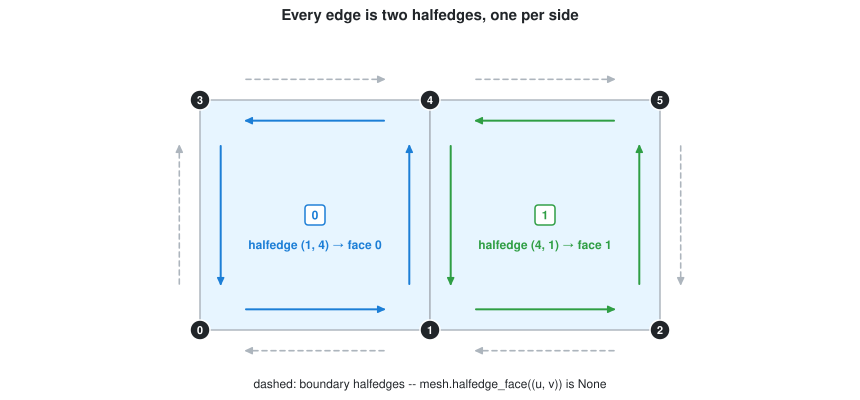

The shared edge between vertices 1 and 4 is two halfedges:

- `(1, 4)` runs up the right side of face 0, so `halfedge_face((1, 4))` is `0`
- `(4, 1)` runs down the left side of face 1, so `halfedge_face((4, 1))` is `1`

On the **boundary** the outer halfedge has no face. That is how COMPAS knows
where the boundary is:

```python
mesh.halfedge_face((1, 0))    # 0    -- the inner side of the bottom edge
mesh.halfedge_face((0, 1))    # None -- the outer side: boundary
```

You will rarely call these yourself, but they explain why topology queries are
fast and why winding must be consistent: two neighbours wound oppositely would
claim the same halfedge. Internally `mesh.halfedge[u][v] = face`, a Week 04
nested dictionary.

## 5. Getting around

### Counting and looping

```python
mesh.number_of_vertices()
mesh.number_of_edges()
mesh.number_of_faces()

for v in mesh.vertices():           # vertex keys
    x, y, z = mesh.vertex_coordinates(v)

for f in mesh.faces():              # face keys
    mesh.face_vertices(f)           # [keys] in winding order

for u, v in mesh.edges():           # each edge once, as a (u, v) pair
    mesh.edge_length((u, v))
```

### Geometry of each element

```python
mesh.vertex_point(v)        # a compas Point
mesh.vertex_normal(v)       # average of the surrounding face normals

mesh.face_centroid(f)
mesh.face_normal(f)
mesh.face_area(f)
mesh.face_polygon(f)        # a compas Polygon

mesh.edge_midpoint((u, v))
mesh.edge_vector((u, v))
mesh.edge_line((u, v))      # a compas Line
```

📄 `mesh_examples/506_access_mesh_v_f_e.py`

## 6. Topology: asking about neighbours

This is the part a list of triangles cannot do at all.

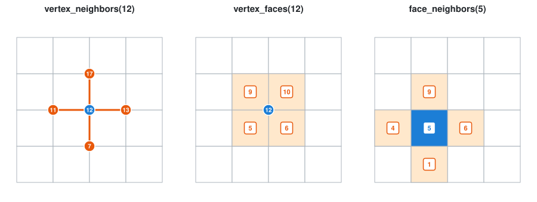

```python
mesh.vertex_neighbors(12)    # [7, 11, 13, 17] -- one edge away
mesh.vertex_faces(12)        # [6, 5, 10, 9]   -- faces that use vertex 12
mesh.face_neighbors(5)       # [1, 6, 9, 4]    -- faces sharing an edge with 5
mesh.vertex_degree(12)       # 4               -- number of neighbours
```

The diagonal corners of vertex 12 are **not** neighbours: they share a face,
not an edge. "Next to" always means "connected by an edge".

### The boundary

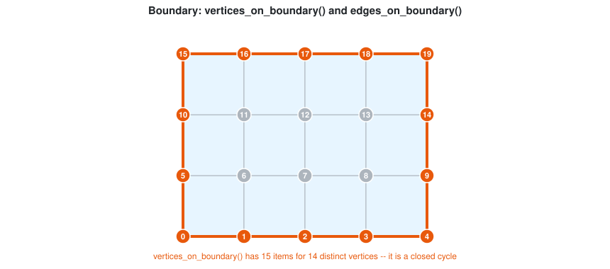

```python
mesh.is_vertex_on_boundary(v)    # True / False
mesh.is_edge_on_boundary((u, v))
mesh.vertices_on_boundary()      # the boundary as an ordered loop
mesh.edges_on_boundary()
mesh.faces_on_boundary()
```

> ⚠️ **`vertices_on_boundary()` is a closed loop**: the first vertex repeats
> at the end, 15 items for 14 vertices. Count with `len(set(...))` or
> `is_vertex_on_boundary` (checkpoint 2 checks this).

Boundaries are where designs meet the world: supports, edge beams, where a shell
lands. Checkpoint 5 tags them.

📄 `mesh_examples/507_mesh_topology.py`, `509_mesh_info_vertices_on_boundary.py`,
`mesh_examples_advanced/508_mesh_info_vertex_degree.py`

### Loops and strips

On a quad mesh, two queries follow the grain: a row of panels, a line of ribs,
a seam to cut.

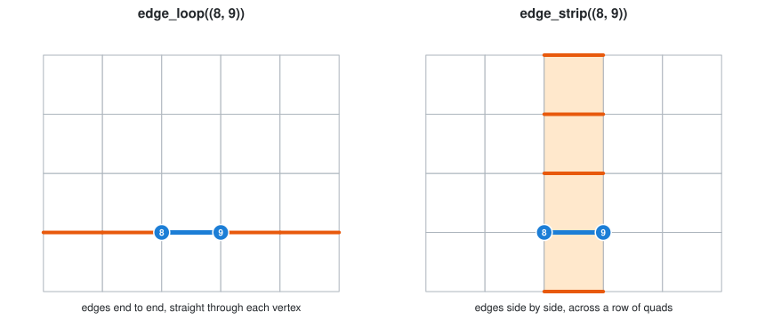

```python
mesh.edge_loop((8, 9))     # end to end, straight on through each 4-valent vertex
mesh.edge_strip((8, 9))    # side by side, crossing the opposite edge of each quad
```

Both stop at the boundary, and at triangles or irregular vertices where
"straight on" is undefined: one reason designers want clean quad meshes.

## 7. Attributes: data living on geometry

Every vertex, edge and face carries a **dictionary**.

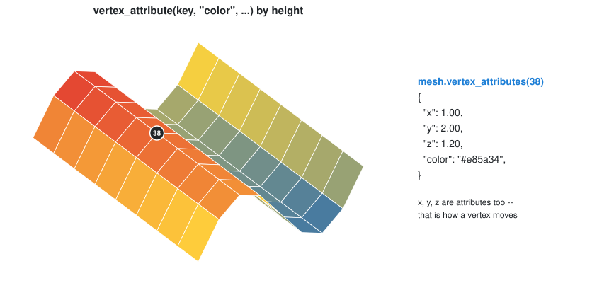

```python
mesh.vertex_attribute(v, "color", (255, 0, 0))    # set one
mesh.vertex_attribute(v, "color")                  # read it back
mesh.vertex_attributes(v)                          # all of them, as a dict

mesh.face_attribute(f, "material", "timber")
mesh.edge_attribute((u, v), "is_seam", True)
```

**Coordinates are attributes too**, so moving a vertex is just

```python
mesh.vertex_attribute(v, "z", 2.5)
```

### Defaults

Set a starting value once instead of checking for missing keys everywhere:

```python
mesh.update_default_vertex_attributes(load=0.0, is_support=False)
mesh.update_default_face_attributes(panel_id=None)
```

### Reading many at once, and querying

```python
mesh.vertices_attribute("z")                     # [z of every vertex]
mesh.vertices_attribute("z", keys=[0, 1, 2])     # ... of some of them

mesh.vertices_where(is_support=True)             # keys whose attribute matches
mesh.faces_where(material="glass")
mesh.vertices_where(z=(0.0, 1.5))                # a (min, max) range works too
```

`vertices_where` makes a mesh a small database: tag elements with what they
*are* (support, seam, glass) and query by meaning, not position.

📄 `mesh_examples/506-1_mesh_color.py`, `506-2_mesh_color_II.py`

## 8. Euler's formula: a free correctness check

For any single connected surface:

```
V - E + F = 2 - 2g - b        g = handles,  b = boundary loops (holes and open edges)
```

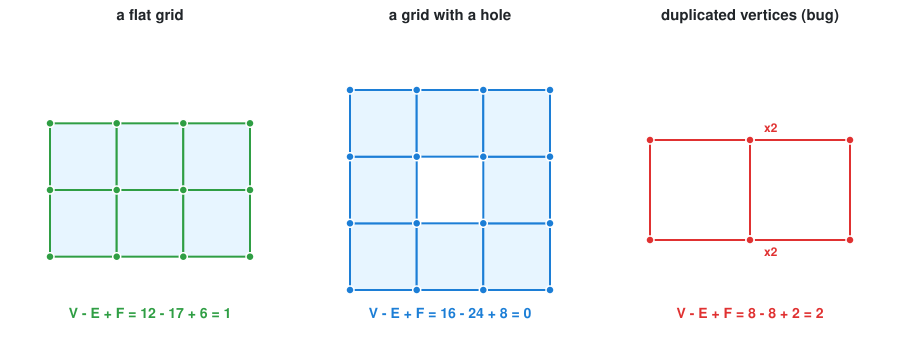

| Mesh | V − E + F |
| ---- | --------- |
| closed, sphere-like (a cube, a subdivided ball) | **2** |
| open, disc-like (a flat grid, a facade panel) | **1** |
| a disc with one hole | **0** |

The third panel looks like a 2×1 grid, but the middle vertices were added
twice: two separate pieces, Euler 2 instead of 1. **Nothing on screen tells
you; this integer does.**

```python
mesh.euler()
```

It catches duplicated vertices, missing faces and accidental holes, the bugs
that look fine in a viewer. Put it in your tests.

## 9. Changing a mesh

### Moving vertices: the topology stays

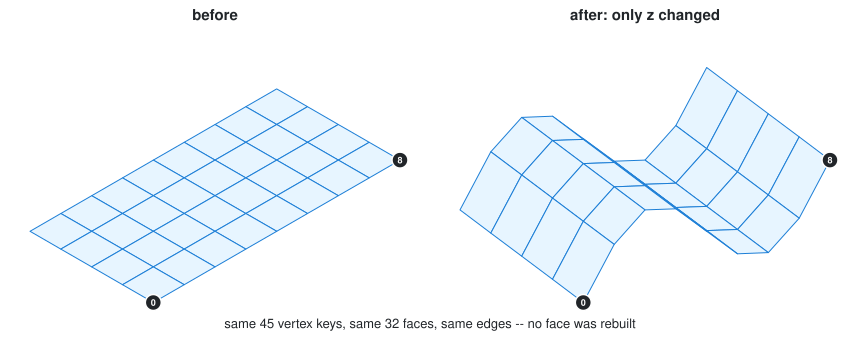

```python
for v in mesh.vertices():
    x, y, z = mesh.vertex_coordinates(v)
    mesh.vertex_attribute(v, "z", z + math.sin(x))
```

Every coordinate changed; no face, edge or key did. **Geometry and topology
are separate.** Form finding, smoothing, relaxation and attractor facades are
all "move the vertices". Checkpoint 4 proves it.

```python
mesh.smooth_centroid(fixed=list(mesh.vertices_where(is_support=True)), kmax=20)
```

### Operations that build a new mesh: the topology changes

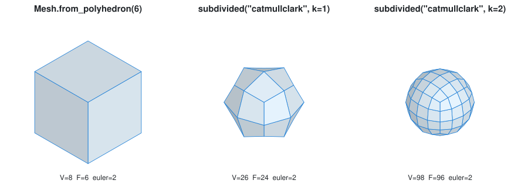

```python
mesh.subdivided("catmullclark", k=2)     # a NEW, smoother mesh (the -ed rule)
mesh.subdivide("catmullclark", k=2)      # ... or replace this one in place
```

Subdivision adds elements but not a new *kind* of surface: Euler stays 2 at
every level. If it changed, something is wrong.

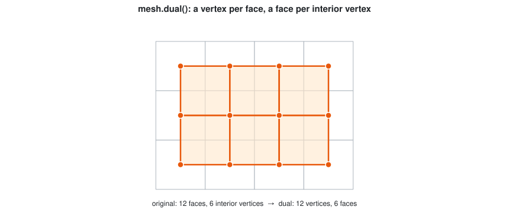

```python
dual = mesh.dual()        # a vertex per face, a face per interior vertex
```

The **dual** swaps faces and vertices: triangles become hexagons, panels
become structural nodes. More operations:

| | |
| --- | --- |
| `mesh_examples/562_mesh_subdivision_scheme.py` | every subdivision scheme side by side |
| `mesh_examples/557_conway_1.py` … `559_conway_3.py` | Conway operators: dual, kis, ambo, truncate … |
| `mesh_examples/554_mesh_booleans.py` | union / difference / intersection (CGAL) |

## 10. Saving

```python
import compas

compas.json_dump(mesh, "output/mesh.json")   # geometry AND attributes
mesh = compas.json_load("output/mesh.json")

mesh.to_obj("mesh.obj")        # for other software
mesh.to_stl("mesh.stl")        # for 3D printing
```

COMPAS JSON keeps attributes; OBJ and STL drop them (export, not save,
formats).

📄 `mesh_examples/505_mesh_to_file.py`

## 11. Seeing it

```python
from compas_viewer import Viewer

viewer = Viewer()
viewer.scene.add(mesh, show_points=True)
viewer.show()
```

Use the viewer to look, not to check. Every figure here came from a script
that never opened a window: read the mesh as data.

---

## 12. Mesh in architecture: four applications

Why the bookkeeping is worth it. Each application is a short script in
[`mesh_applications/`](mesh_applications/): a pure core plus a viewer, figures
drawn by the same core. **Not examined**; read at least one, they are the
shortest route to a final project.

The same ideas every time: **boundary** → supports, **edges** → members,
**attributes** → loads and results, **fixed topology** → only coordinates move.

### Form finding: let the forces choose the shape

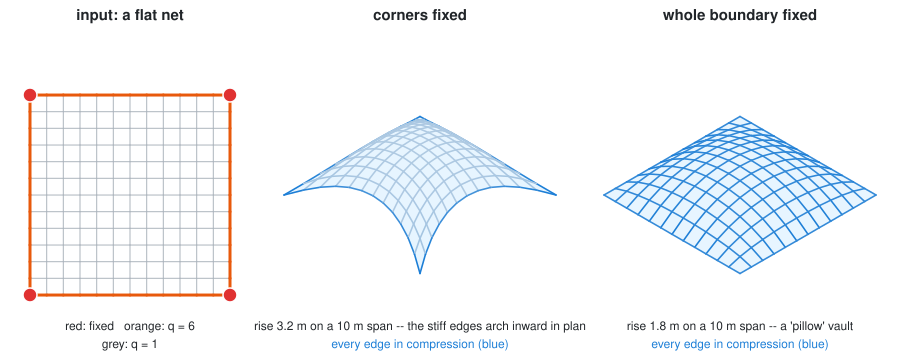

A hanging cable net is in pure tension; inverted, pure **compression**: a
shell that stands by shape, not stiffness (Gaudí's chains, Otto and Isler's
fabric). The **force density method** (Schek, 1974) does it in one linear solve:

| Mesh | Cable net |
| ---- | --------- |
| vertex | node; `fixed` ones are supports |
| edge | cable, with a force density `q` as an **edge attribute** |
| `vertex_area` | how much load each node collects |

```python
from form_finding import corner_supported_net, form_find

net, corners = corner_supported_net()     # stiffer edges: q = 6 on the boundary
shell = form_find(net, corners)           # a NEW mesh (the -ed rule, again)
shell.edges_attribute("force")            # all negative: all compression
```

The design levers are attributes: supports and per-edge `q`. Change `q` on the
boundary and the free edges arch more or less. Same topology, different shell.

📄 [`mesh_applications/form_finding.py`](mesh_applications/form_finding.py) ·
also `mesh_relaxation.py` (the same idea solved by repeated averaging) and
`mesh_pavilion.ipynb`

### Structural analysis: a mesh is a truss

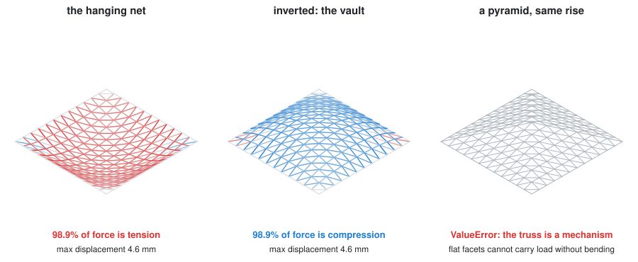

Edges as bars, vertices as pin joints: a triangulated mesh **is** a space
truss. The direct stiffness method (the core of FEM) solves `K u = f` for joint
displacements and bar forces:

```python
from structural_analysis import analyse_truss, summary

vault.quads_to_triangles()                 # a quad can shear: triangulate first
result = analyse_truss(vault, supports)    # forces on edges, displacements on vertices
summary(result)["compression_share"]       # 0.989
```

Hooke (1675), checked by computation: the hanging net is 98.9% tension,
inverted 98.9% compression. (Not 100%: triangulation diagonals share load.
Measure, don't assume.)

The third panel matters most. A pyramid of **flat facets** cannot carry vertical
load; the stiffness matrix is singular. `np.linalg.solve` would still return
~10¹⁵ m displacements that look like a result, so `analyse_truss` **raises**
instead. A solver that cannot fail loudly is not a verification tool.

📄 [`mesh_applications/structural_analysis.py`](mesh_applications/structural_analysis.py)

### From a LiDAR scan to a mesh, and back to the design

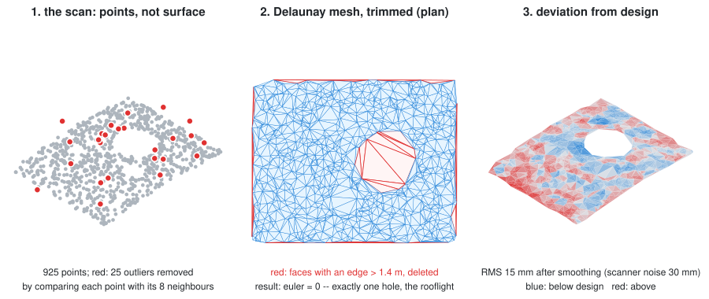

A scanner gives **points**: noisy, with outliers and holes. Meshing them starts
site models, as-built surveys, heritage work, and checking a pour against the
drawing. The script runs on a simulated scan, so the answer is checkable:

1. **clean**: drop points far from the median of their neighbours (`KDTree`)
2. **mesh**: Delaunay-triangulate in plan
3. **trim**: delete faces with an edge longer than 1.4 m, which bridge missing data
4. **smooth**: average each height with its `vertex_neighbors`
5. **compare**: store `scan − design` as a vertex attribute; colour it

**Euler picks step 3's threshold.** One real hole (a rooflight) means
`V − E + F = 0`. Trim at 0.9 m and you get −2: two false holes, invisible at a
glance.

📄 [`mesh_applications/scan_to_mesh.py`](mesh_applications/scan_to_mesh.py) ·
for full 3D scans, `compas_cgal.reconstruction` has outlier removal, normal
estimation and Poisson surface reconstruction.

### Physics: a mesh that moves

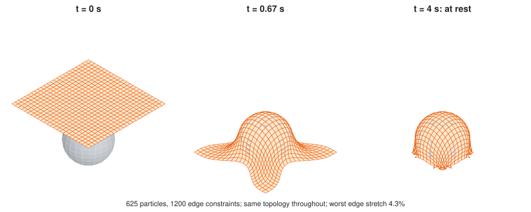

Fabric, membranes and tensile roofs: vertices are particles, edges are
length constraints. Each step applies gravity, restores edge lengths, and pushes
points out of the sphere: position-based dynamics (close to Kangaroo).

The mesh goes into numpy arrays (keys → rows) and back, the standard way to
make mesh code fast. The script also **measures** edge stretch: an unchecked
simulation is just an animation. Damp it heavily and run to rest, and it is
**dynamic relaxation**: the same equilibrium as form finding, by many small
steps instead of one solve.

📄 [`mesh_applications/cloth_simulation.py`](mesh_applications/cloth_simulation.py)

---

## Going further (not examined)

- **[Notebooks 01–02](/Lecture/notebooks/README.md)**: a mesh step by step;
  form finding one matrix at a time.
- **[Algorithms section](/Lecture/Algorithms/README.md)** (W10–12): this week's
  operations written from scratch and tested (smoothing, curvature, geodesics,
  subdivision, planarity, contouring, Delaunay/Voronoi), then simulation,
  optimization and learning.
- `mesh_examples_advanced/`: remeshing, Delaunay, Catmull-Clark by hand, and
  `556_compas_cgal_slicer.py` for fabrication.
- `mesh_applications/mesh_relaxation.py` and `mesh_pavilion.ipynb`: worked
  form-finding examples, good project starters.
- [compas.dev › Meshes](https://compas.dev/compas/latest/userguide/basics.datastructures.meshes.html):
  the same API, more on loops, strips and filtering.

---

## Checkpoints

```bash
uv run check.py 05
```

| # | Task | Exercises | Figure |
| - | ---- | --------- | ------ |
| 1 | `grid_mesh(nx, ny, spacing)` | building a mesh from scratch, shared vertex keys, winding | §2, §3 |
| 2 | `mesh_stats(mesh)` | counting, Euler, the boundary-cycle trap | §6, §8 |
| 3 | `colour_by_height(mesh)` | attributes: data living on geometry | §7 |
| 4 | `deform_by_wave(mesh, ...)` | moving vertices while topology stays put | §9 |
| 5 | `tag_supports(mesh)` | boundary queries + boolean attributes + `vertices_where` | §6, §7 |
| 6 | `vertex_ring(mesh, key, k)` | neighbours of neighbours: your first breadth-first search | §6 |

Checkpoint 1: build the grid by hand (not `from_meshgrid`), deciding which keys
form each face. Checkpoint 4: every coordinate changes, topology doesn't.
Checkpoint 6 bridges to next week: growing ring by ring is *breadth-first
search*, which works on any graph.

## Exercise

📝 [Mesh colouring and deformation](/Exercise/Lecture_05/README.md)

## Self-test

1. Why can a mesh answer "which faces touch this one?" when a list of triangles cannot?
2. What does the order of vertices in a face determine?
3. A boundary halfedge `(u, v)` has `halfedge_face((u, v)) is None`. What does that mean physically?
4. On a 4×4 grid, why are the diagonal corners of the middle vertex not its neighbours?
5. `len(mesh.vertices_on_boundary())` is 15 but there are 14 boundary vertices. Why?
6. A flat grid has `V - E + F == 1`. Yours gives 2. What kind of mistake is that?
7. You move every vertex of a mesh. How many faces do you have to rebuild?
8. Which file format keeps your vertex attributes: OBJ, STL, or COMPAS JSON?
9. In the form-finding script, which mesh features play the role of supports, cables and loads?
10. Why does a flat triangulated sheet fail as a truss, while the vault of the same plan does not?
