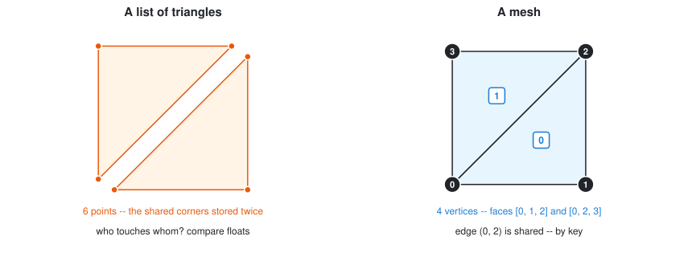
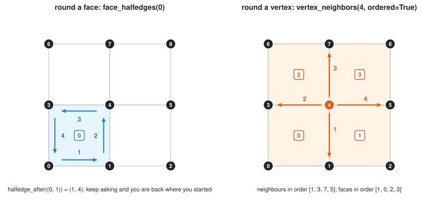
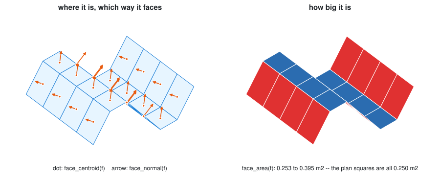
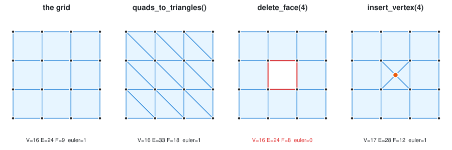
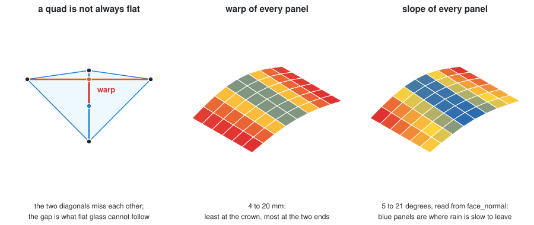
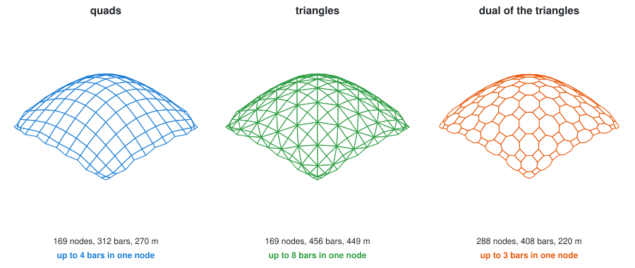
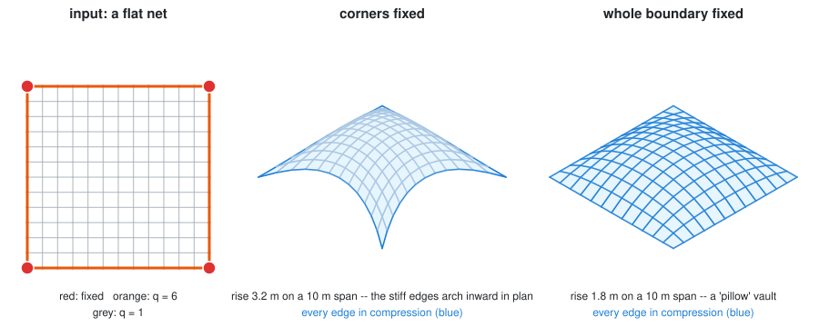
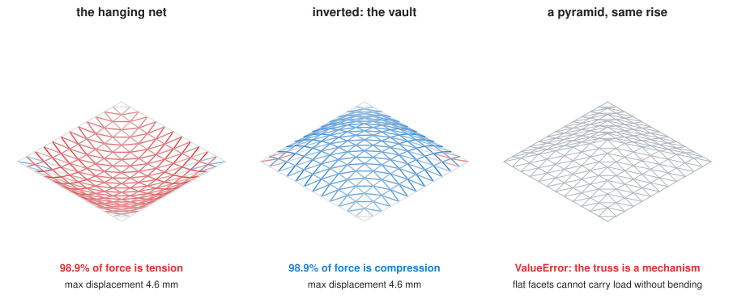
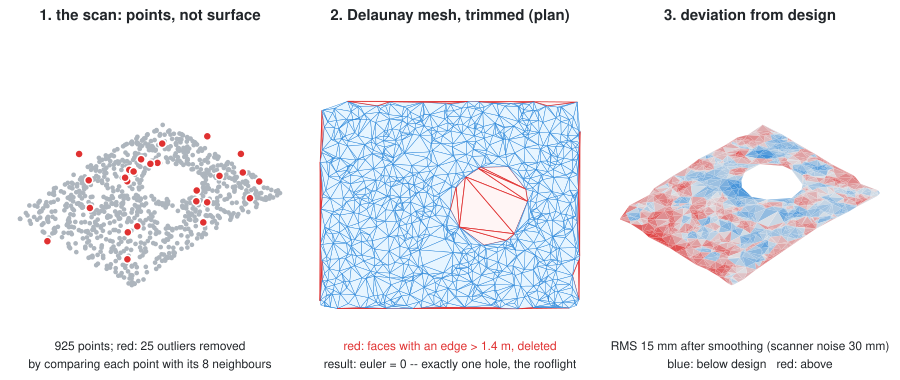
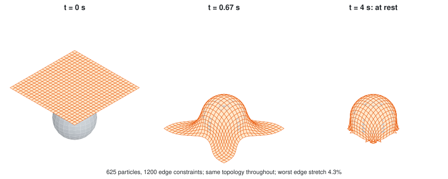

# Week 05 notebooks: the mesh

[Lecture](../README.md) · [how to run a notebook](../../README.md#how-to-run-a-notebook)

The pictures are the lecture's own figures, shown in each notebook at the step they explain.

**Fundamentals: do these four in order.**

| Preview | # | Notebook | What you watch happen |
| :-----: | - | -------- | --------------------- |
|  | 01 | [a mesh from scratch](01_mesh_from_scratch.ipynb) | why a list of polygons is not enough; vertices as keys; a face as a cycle; winding and the normal; a grid from a dictionary; constructors; Euler catching a broken mesh, and `weld` repairing it |
|  | 02 | [walking a mesh](02_walking_a_mesh.ipynb) | the halfedge table; round a face; across an edge; round a vertex; degree; the boundary and its trap; loops and strips; rings |
|  | 03 | [data on a mesh](03_data_on_a_mesh.ipynb) | areas, normals, lengths computed on demand; moving a vertex; attributes with defaults; bulk reads and queries; data to colour; edge data; what JSON keeps and OBJ loses |
|  | 04 | [changing a mesh](04_changing_a_mesh.ipynb) | in place or a new mesh; triangulate; open and close a hole; insert, split, collapse; subdivision schemes compared; the dual; join and weld, with Euler after every edit |

**Applications: from simple to advanced.**

| Preview | # | Notebook | What you watch happen |
| :-----: | - | -------- | --------------------- |
|  | 05 | [a canopy: panels, bars, a schedule](05_canopy_panels.ipynb) | glass area, a cutting list by tolerance, which panels warp, where rain ponds, attributes as a schedule |
|  | 06 | [from a surface to a structure](06_surface_to_structure.ipynb) | a cage and subdivision; quads, triangles and the dual on one shell, and what each costs; thickening into a solid |
|  | 07 | [form finding](07_form_finding.ipynb) | the force density method, one matrix at a time |
|  | 08 | [a mesh is a truss](08_mesh_as_truss.ipynb) | one bar, a tripod, then any mesh; hanging net, vault and a pyramid that is a mechanism |
|  | 09 | [from a scan to a mesh](09_scan_to_mesh.ipynb) | outliers by neighbours; Delaunay; trimming with Euler as the judge; smoothing that helps and then harms; deviation from the design, in square metres |
|  | 10 | [a cloth that falls](10_cloth_simulation.ipynb) | one particle, one thread, a mesh of threads; a sphere to land on; measuring the stretch; a canopy hung from four corners |
| *3D only* | 11 | [a volcano pavilion](11_volcano_pavilion.ipynb) | a worked design with compas_cgal: Delaunay with holes, lifting, relaxation, remeshing |
