# Week 06 — Graphs: connections without surfaces

> Self-contained. `uv run check.py 06` when you are ready. Every figure is
> drawn from a real COMPAS graph by [`figures/make_figures.py`](figures/make_figures.py).

Take a mesh and throw away its faces: what is left, points plus which points
are connected, is a **graph**, probably the most widely used data structure in
design computation:

| Things | Connections | Question you can now ask |
| ------ | ----------- | ------------------------ |
| rooms | doors | How far is the bedroom from the entrance? Can a wheelchair reach it? |
| bricks, beams, panels | contacts, joints | What does this element rest on? In what order can it be built? |
| street corners | streets | What is the shortest walk? Which areas are cut off? |
| nodes of a truss | bars | Is the structure one piece? Where are the loose ends? |
| mesh vertices | mesh edges | everything from Week 05, without the faces |

No surfaces, faces or normals: *only* connections, which is why it fits so many
problems.

> **`Graph` or `Network`?** Same class. `Network` is the old name, still used in
> `graph_examples/` and `compas_ipynb/`. Write `Graph` in new code.

---

## 1. A floor plan is a graph

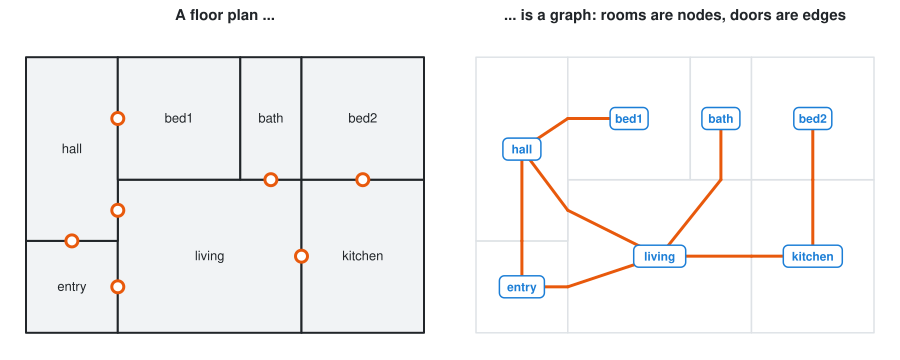

Rooms become **nodes**, doors become **edges**. Walls and room shapes are gone,
and none of them mattered for "how do I get from the entry to bed2?". As with
the mesh in Week 05, connections are stored, not worked out from coordinates.

## 2. Anatomy: nodes, edges, attributes

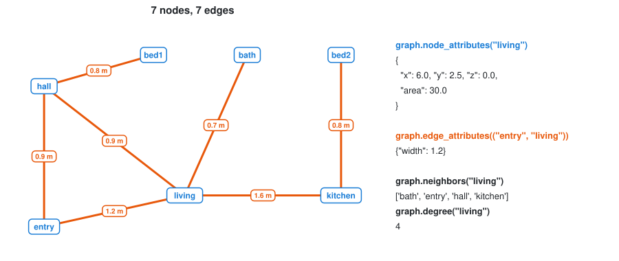

```python
from compas.datastructures import Graph

graph = Graph()

graph.add_node("entry", x=1.5, y=1.5, z=0, area=9.0)
graph.add_node("living", x=6.0, y=2.5, z=0, area=30.0)

graph.add_edge("entry", "living", width=1.2)
```

Three things differ from a mesh:

1. **Node keys can be anything hashable**: integers, names like `"kitchen"`,
   tuples like `(3, 4)`. Pick the one that makes your code readable.
2. **Edges are stored, not derived**: there are no faces, so you add each one.
3. **Position is optional**, but anything geometric (`node_coordinates`,
   `edge_length`, the viewer, `graph.shortest_path`) needs `x, y, z` on
   *every* node.

> ⚠️ **`add_edge` invents missing nodes, silently.**
>
> ```python
> graph.add_edge("hall", "atic")       # typo: "attic"
> ```
>
> silently creates a node `"atic"` with no coordinates. The `KeyError: 'x'`
> comes much later, far from the typo. Check inputs at the boundary
> (checkpoint 1).

### Attributes

As on a mesh: a Week 04 dictionary underneath.

```python
graph.node_attribute("living", "area")             # 30.0
graph.node_attributes("living")                    # the whole dict
graph.edge_attribute(("entry", "living"), "width") # 1.2

graph.update_default_node_attributes(area=0.0)
graph.update_default_edge_attributes(width=0.9)

graph.nodes_where(area=(15, 40))                   # rooms between 15 and 40 m²
graph.edges_where(width=(0, 0.85))                 # doors narrower than 0.85 m
```

### Why not just a list of pairs?

You could store the doors as a list and be done:

```python
doors = [("entry", "living"), ("entry", "hall"), ("hall", "living"), ...]

# "which rooms open off the living room?"
[b if a == "living" else a for a, b in doors if "living" in (a, b)]
```

It works, but reads **every door** to answer a question about one room. A graph
keeps each node's neighbours in a dictionary (`graph.adjacency`), so
`neighbors("living")` looks only at that room. Invisible for 7 rooms; the
difference between instant and unusable for a 600-beam pavilion.

Choose by the question: a **list** for a sequence, a **dict** for lookup by
name, a **graph** for *what is connected to what*.

### Edges have a direction (sort of)

Each edge is stored once, in the order you added it:

```python
graph.has_edge(("entry", "living"))                 # True
graph.has_edge(("living", "entry"))                 # False!
graph.has_edge(("living", "entry"), directed=False) # True -- either way round
```

For doors, streets and joints pass `directed=False`. `neighbors()` already
ignores direction.

📄 `graph_examples/031_compas_network_from_scratch.py`, `032_compas_network_node_attr.py`

## 3. A mesh is a graph

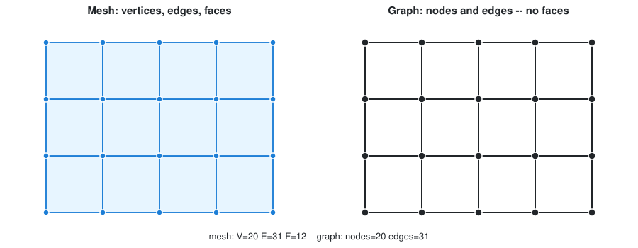

Copy a mesh's vertices and edges into a graph and every algorithm here works on
meshes too:

```python
graph = Graph()
for v in mesh.vertices():
    x, y, z = mesh.vertex_coordinates(v)
    graph.add_node(v, x=x, y=y, z=z)
for u, v in mesh.edges():
    graph.add_edge(u, v)
```

(Checkpoint 7. Keys stay the same, so results move back and forth.) Most graphs
are not meshes: **a mesh describes a surface; a graph describes relationships.**

### Two graphs of one frame: what is a node?

Week 05 said *a vertex is a point*. For building elements, *a node is an
element* is equally valid. One frame, two graphs:

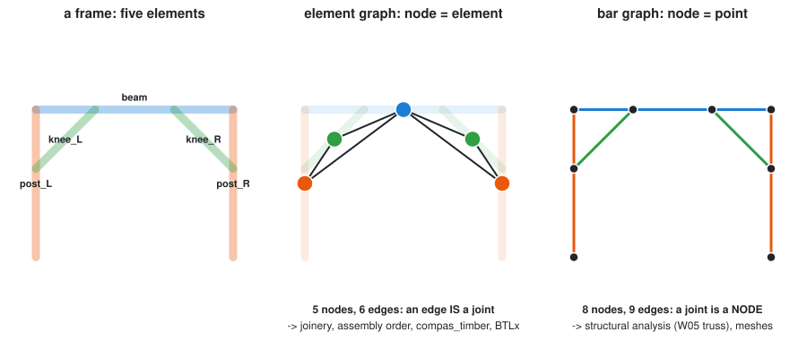

| | **Element graph** | **Bar graph** |
| --- | --- | --- |
| a node is | a beam, a brick, a panel | a point: a joint or a free end |
| an edge is | a **joint** between two elements | a straight piece of member between two points |
| one beam is | one node | as many edges as it has joints along it |
| this frame | 5 nodes, 6 edges | 8 nodes, 9 edges |
| asks well | *what joins what, with which joint? in what order can it be built?* | *what are the forces? where does it bend?* |
| used by | compas_timber, BTLx, assembly sequencing, the brick wall (§8) | structural analysis (W05 §12's truss), meshes |

Neither is "the" graph. A joint type (L, T, X) belongs on an element-graph
edge; a support reaction on a bar-graph node. **Picking the representation that
makes your question easy is the abstraction step**, the skill this course is
about. (Converting between them is close to the *line graph*, the same trade as
the mesh *dual*.)

## 4. Getting around

```python
graph.number_of_nodes()
graph.number_of_edges()

for node in graph.nodes():
    ...
for u, v in graph.edges():
    graph.edge_length((u, v))        # needs x, y, z on both ends

graph.neighbors("living")            # rooms one door away
graph.degree("living")               # how many doors
graph.leaves()                       # nodes with degree 1
graph.is_connected()                 # one piece, or several?
```

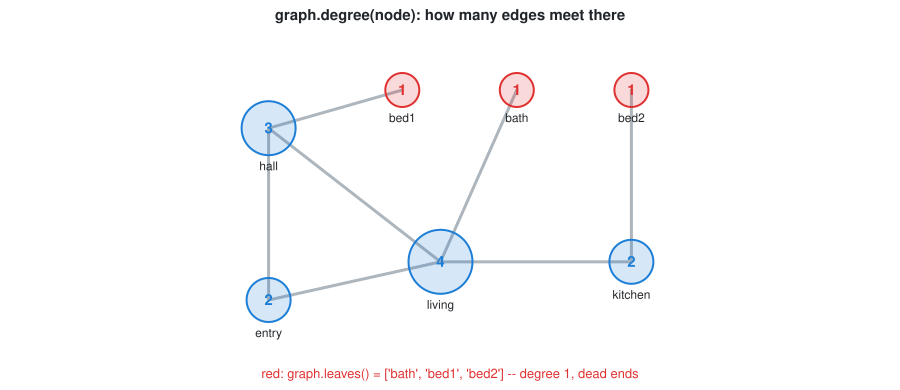

**Degree** already says something about a design: degree 1 is a dead end (fine
for a bedroom, not a corridor); a high degree is a hub, a circulation space
whether planned or not.

## 5. Breadth-first search

*"What can I reach from here, and how far is it?"* is answered by
**breadth-first search** (BFS). Know it by heart.

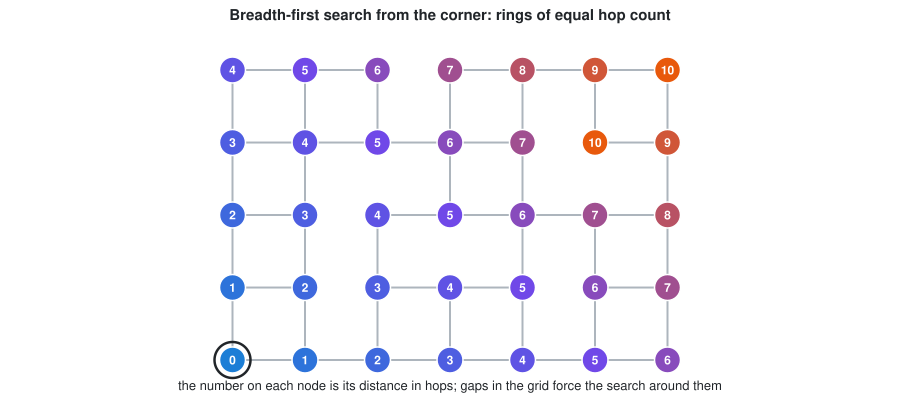

Visit everything one step away, then two, then three, like a ripple (you wrote
it last week as `vertex_ring`):

```python
from collections import deque

def hops_from(graph, start):
    hops = {start: 0}               # also our record of "already seen"
    queue = deque([start])          # rooms to explore, oldest first
    while queue:
        node = queue.popleft()
        for nbr in graph.neighbors(node):
            if nbr not in hops:     # first time we see it = shortest way
                hops[nbr] = hops[node] + 1
                queue.append(nbr)
    return hops
```

- **`popleft()`** takes the *oldest* node, so the search grows ring by ring.
- **`if nbr not in hops`** stops it circling forever round loops.
- **The first count is the smallest**, because everything closer was queued
  earlier.

In the figure, gaps force the search *around* them: close in space can be far in
hops. That is why a plan matters more than a footprint.

### Depth-first search, for contrast

Take the *newest* node instead (a **stack**) and you get **depth-first search**:
one corridor to the end, then back up.

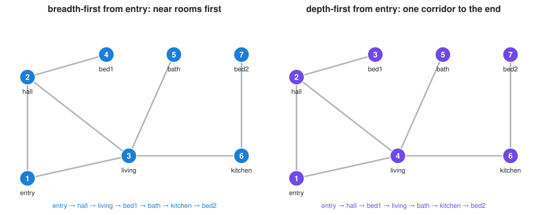

Both reach every room; only BFS does so in order of distance, so only BFS gives
hop counts. DFS suits *following* something down, like a load path (§8).

```python
from compas.topology import breadth_first_ordering, depth_first_ordering

breadth_first_ordering(graph.adjacency, "entry")
depth_first_ordering(graph.adjacency, "entry")
```

Use the library in real work, but write BFS yourself once (checkpoint 3).

### What BFS leaves behind: a tree

Record *which room you reached each room from*, and the search leaves a
**tree**:

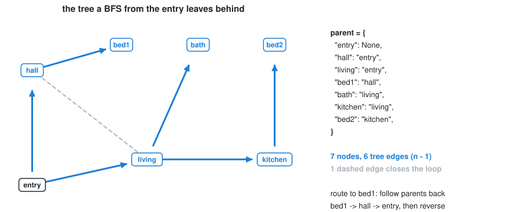

```python
parent = {start: None}
...
        if nbr not in parent:
            parent[nbr] = node          # the only new line
```

A **tree** is a graph with no loops: one parent per node, so *n* nodes have
*n − 1* edges (7 rooms, 6 doors; hall–living closes the loop). It gives you **the
route itself** (follow `parent` back from bed1 and reverse) and **hierarchies**
(assemblies, scene graphs, your file system).

## 6. Shortest paths: count, or measure?

*Fewest doors* and *shortest walk* are different questions:

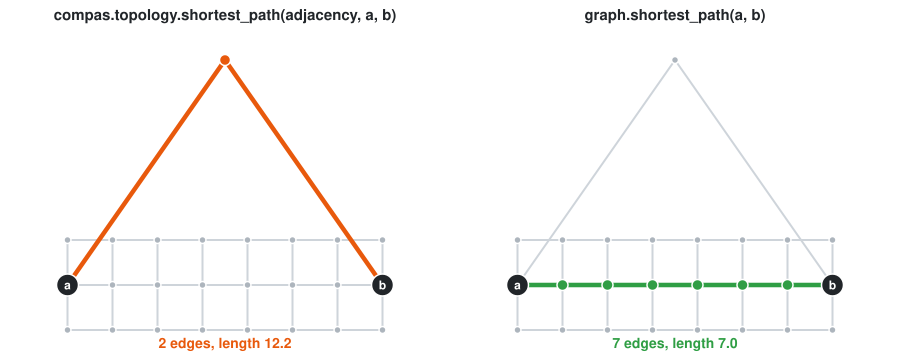

COMPAS answers both, **with two functions that have the same name**:

```python
from compas.topology import shortest_path

shortest_path(graph.adjacency, a, b)   # breadth-first: FEWEST EDGES
graph.shortest_path(a, b)              # A*, using node positions: SHORTEST LENGTH
```

> ⚠️ **Same name, different question.** In the figure one takes the ring road
> (2 edges, 12.2 m), the other the street (7 edges, 7.0 m). **Read the docstring
> of any function you trust.** Both return `None` when there is no path, and
> `graph.shortest_path(a, a)` returns `None` too.

For other weights (time, cost, any edge attribute), use Dijkstra:

```python
from compas.topology import dijkstra_path

weight = {}
for u, v in graph.edges():
    w = graph.edge_attribute((u, v), "time")
    weight[u, v] = weight[v, u] = w         # both directions!

dijkstra_path(graph.adjacency, weight, "entry", "bed2")
```

📄 `graph_examples/034_network_info_shortest_path.py`

## 7. Connected components: is it one piece?

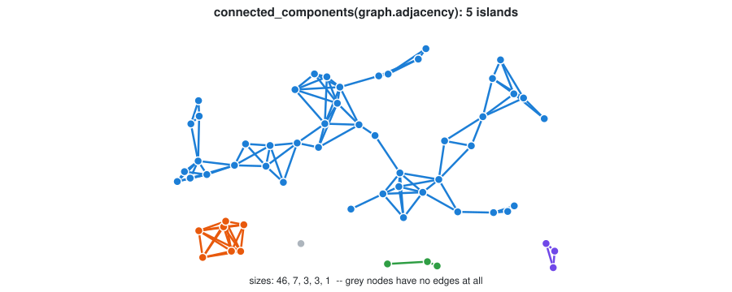

```python
from compas.topology import connected_components

graph.is_connected()                         # True / False
connected_components(graph.adjacency)        # [[nodes], [nodes], ...]
```

One BFS finds the piece a node belongs to; repeat from an unreached node for the
next. Keep only doors ≥ 0.9 m wide first, and more than one piece means **part
of the building cannot be reached in a wheelchair** (checkpoints 5 + 6).

## 8. Graphs of building elements

What touches what, and what rests on what, is a graph too: the one behind
assembly planning and robotic fabrication.

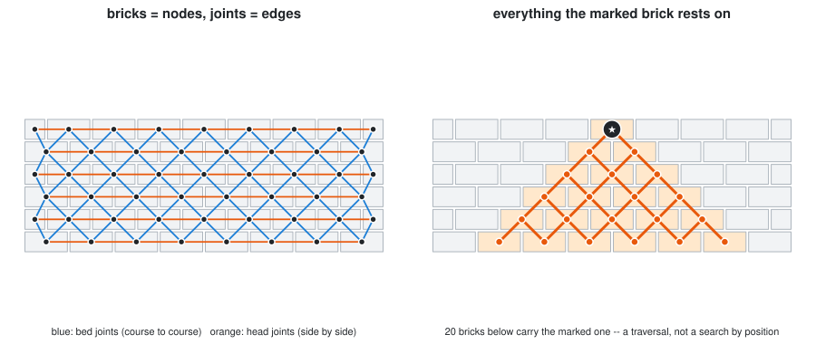

Bricks are nodes; joints are edges tagged *bed* (course to course) or *head*
(side by side). Following bed joints down from one brick finds its load cone,
with no coordinate comparisons. Store geometry as node/edge attributes and one
`compas.json_dump` saves the whole assembly.

📄 `compas_ipynb/1_basic_stack.ipynb` → `2_stack_with_graph.ipynb` (mortar as an
edge attribute) → `3_brickwall.py` → `4_brickwall_from_file.py` →
`5_brickwall_dfs.py` (a DFS to the ground); lighter: `graph_examples/4.2_brickwall.py`.

## 9. Saving and converting

```python
import compas

compas.json_dump(graph, "output/plan.json")   # nodes, edges AND attributes
graph = compas.json_load("output/plan.json")

nxg = graph.to_networkx().to_undirected()      # hand it to networkx -- see below
graph = Graph.from_networkx(nxg)               # ... and back
```

[networkx](https://networkx.org) (installed with COMPAS) has hundreds of
algorithms. Convert when you need one; keep design data in the COMPAS graph.

> ⚠️ **`to_networkx()` returns a *directed* graph**: every door becomes one-way,
> giving an error or, worse, quietly wrong numbers. Add `.to_undirected()`.

📄 `graph_examples/035_network_serialization.py`

## 10. Seeing it

```python
from compas_viewer import Viewer

viewer = Viewer()
viewer.scene.add(graph)        # nodes and edges, at their x, y, z
viewer.show()
```

---

## 11. Graphs in architecture: three applications

Runnable scripts in [`graph_applications/`](graph_applications/); the figures
call them. **Not examined**, but each is a possible final project.

### Reading a plan: integration, escape distance, critical doors

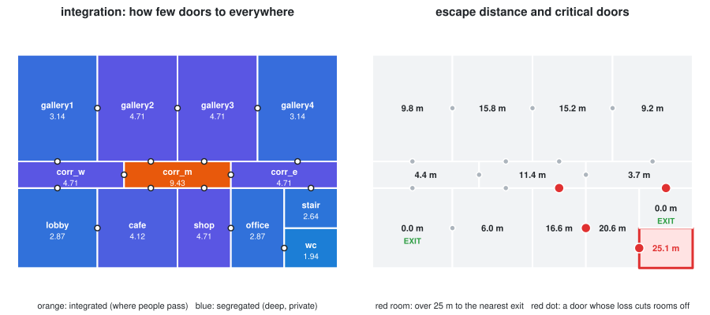

- **Integration** (space syntax; Hillier & Hanson, 1984): mean BFS depth per
  room. Shallow rooms are where people pass; deep ones are private or
  forgotten. Here **the main lobby is one of the least integrated** rooms:
  intent or problem? The number makes you ask.
- **Escape distance**: one Dijkstra started from **all exits at once**, edge
  lengths measured centre → door → centre. The WC is 25.1 m from an exit, 10 cm
  over a 25 m limit.
- **Critical doors**: remove each door and count islands (checkpoint 6). Four
  doors are single points of failure, one of them the only door to the
  **fire stair**.

📄 [`graph_applications/plan_analysis.py`](graph_applications/plan_analysis.py)

### A town: which streets carry the traffic?

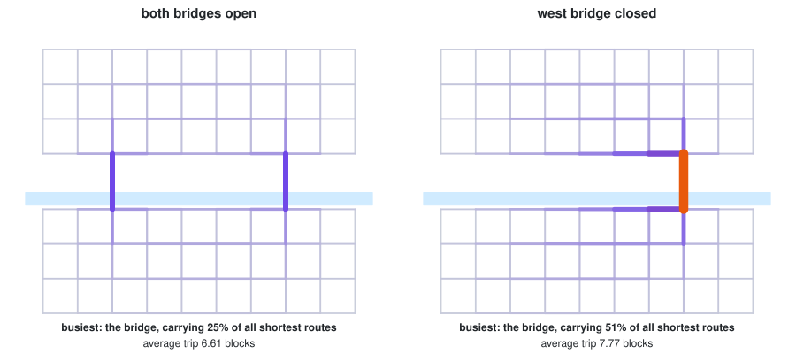

**Betweenness**: the share of all shortest routes that use each street, which
is where traffic, footfall and shops end up. Closing the west bridge doubles
the east bridge's share (25% → 51%) and lengthens the average trip by 18%. One
networkx call on the COMPAS graph (§9).

📄 [`graph_applications/street_network.py`](graph_applications/street_network.py)

### A timber frame is a graph (compas_timber)

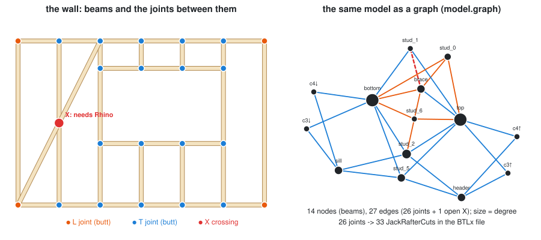

[compas_timber](https://gramaziokohler.github.io/compas_timber/latest/)
(Gramazio Kohler Research, ETH Zürich) keeps a timber model as a **graph**:
beams are nodes, joints are edges.

```python
from compas_timber.elements import Beam
from compas_timber.model import TimberModel

model = TimberModel(tolerance=Tolerance(unit="MM", absolute=1e-3))   # design in mm
for name, line in stud_wall().items():
    model.add_element(Beam.from_centerline(line, 60, 120, z_vector=[0, 1, 0]))

model.connect_adjacent_beams()     # find every pair of beams that touch ...
model.joint_candidates             # ... and HOW: L (ends meet), T (end on middle), X (cross)
```

How beams meet is topology; a rule (a dict) turns it into joints:

```python
JOINT_RULE = {JointTopology.TOPO_L: LButtJoint, JointTopology.TOPO_T: TButtJoint}
```

`process_joinery()` makes machining features and `BTLxWriter` writes **BTLx**
for CNC machines: 14 beams, 26 joints, 33 cuts (counted by parsing the file).
Checked on compas_timber 2.2.0:

| Headless (your uv environment) | Needs Rhino / Grasshopper |
| ------------------------------ | ------------------------- |
| beams, the model graph, joint detection (L/T/X) | lap, notch and dovetail joints (e.g. the brace crossing a stud, red in the figure) |
| butt, miter, tenon-mortise, French-ridge joints | the cut 3D geometry of a beam (`beam.geometry`) |
| BTLx fabrication files, COMPAS JSON | |

The right column needs Rhino's solid kernel: the Week 09 architecture in a real
tool (logic in Python, geometry kernel in the host). The script reports the X
crossing instead of crashing. It is an **optional extra**:

```bash
uv sync --extra timber
uv run --extra timber Lecture/Lecture_06/graph_applications/timber_frame.py
```

📄 [`graph_applications/timber_frame.py`](graph_applications/timber_frame.py) ·
then the compas_timber [tutorials](https://gramaziokohler.github.io/compas_timber/latest/) (in Grasshopper).

---

## Going further (not examined)

- **[Notebooks 03–04](/Lecture/notebooks/README.md)**: BFS one queue step at a
  time; the two graphs of §3, step by step.
- `graph_examples/301–305`: networkx on real data (random geometric graph,
  cholera map, NYC subway, a social network). They need `matplotlib`/`pandas`/
  `geopandas`, which are not installed; use a separate environment, never
  `uv add` here.
- Geodesics and Voronoi return in [W10](/Lecture/Algorithms/geometric/README.md);
  W11 simulations lean on neighbour search.
- [compas.dev › Graphs](https://compas.dev/compas/latest/userguide/basics.datastructures.graphs.html),
  [`compas.topology`](https://compas.dev/compas/latest/api/compas.topology.html).

---

## Checkpoints

```bash
uv run check.py 06
```

The running example is the apartment in the figures: predict the answers first.

| # | Task | Exercises | Figure |
| - | ---- | --------- | ------ |
| 1 | `plan_graph(rooms, doors)` | building a graph, keys that are names, the silent `add_edge` trap | §1, §2 |
| 2 | `dead_ends(graph)` | degree; a case the spec has to decide | §4 |
| 3 | `hops_from(graph, start)` | **breadth-first search, by hand** | §5 |
| 4 | `route(graph, start, goal)` | shortest path, and which "shortest" you mean | §6 |
| 5 | `accessible(graph, min_width)` | filtering on an edge attribute, without mutating the input | §2 |
| 6 | `islands(graph)` | connected components, from your own BFS | §7 |
| 7 | `mesh_to_graph(mesh)` | the bridge back to Week 05 | §3 |

Checkpoint 4 fails, with a pointed message, if you call the wrong
`shortest_path`. Checkpoints 5 + 6 answer *which rooms can a wheelchair user not
reach?*

## Exercise

📝 [Circulation graph](/Exercise/Lecture_06/README.md)

## Self-test

1. What does a mesh have that a graph does not? What does a graph allow that a mesh does not?
2. Draw the element graph and the bar graph of a simple table (four legs, a top). Which would you use to plan its assembly, and which to check it carries a load?
3. `graph.add_edge("hall", "atic")` runs without error. Why is that a problem, and where should you catch it?
4. Why does `graph.has_edge(("living", "entry"))` return `False` for an edge you added as `("entry", "living")`?
5. In BFS, what would go wrong if you removed the `if nbr not in hops` check?
6. BFS uses a queue; DFS uses a stack. Which one gives you hop counts, and why?
7. `compas.topology.shortest_path` and `Graph.shortest_path` return different routes on the same graph. Which is wrong?
8. How would you find out whether every room in a plan is reachable through doors at least 0.9 m wide?
9. How do you find every room's distance to its *nearest* exit with one Dijkstra run?
10. `graph.to_networkx()` gives "Graph is not strongly connected" on a connected plan. Why?
11. In compas_timber, what is a joint, in graph terms? What decides which kind of joint it becomes?
