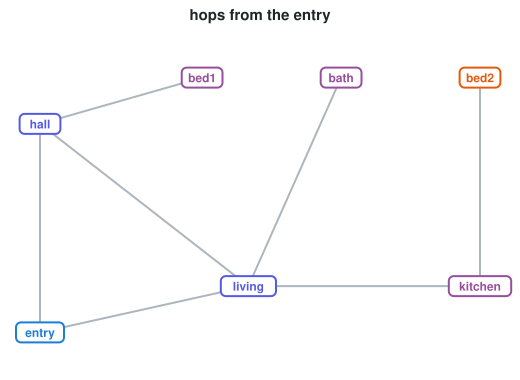
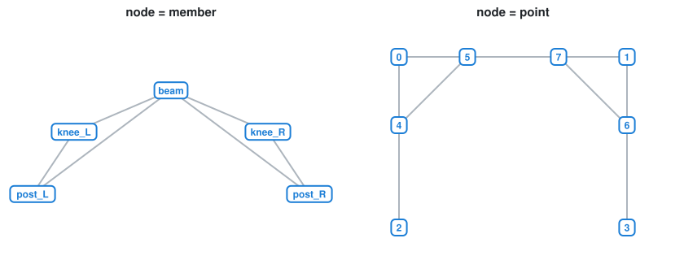
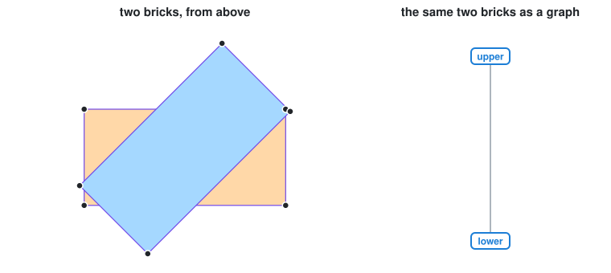
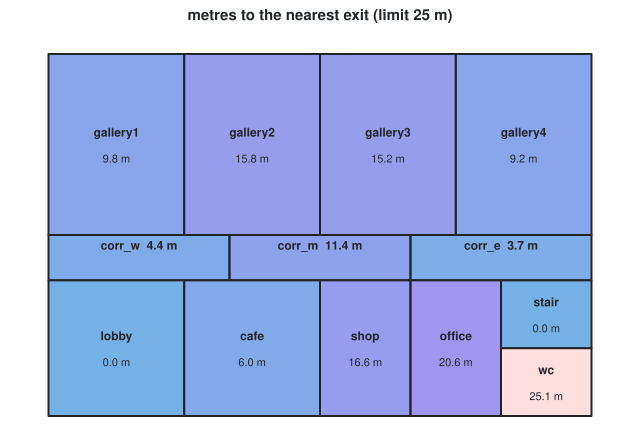
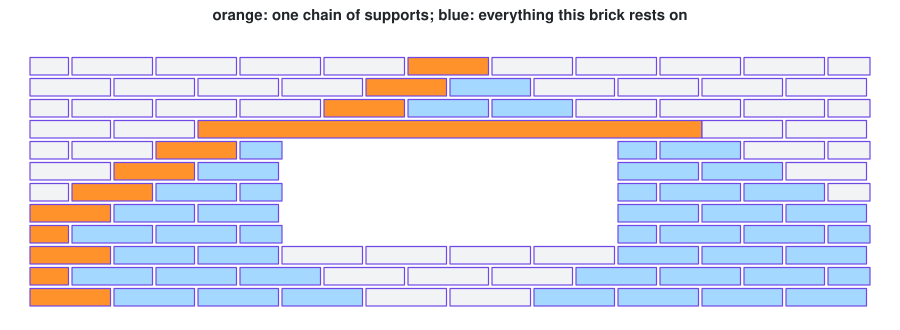
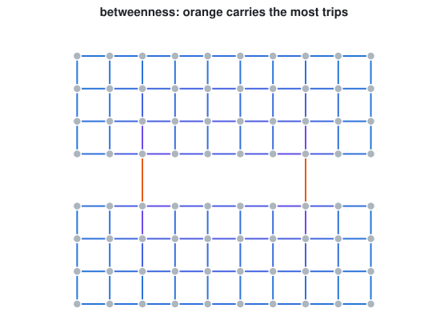

# Week 06 notebooks: graphs

[Lecture](../README.md) · [how to run a notebook](../../README.md#how-to-run-a-notebook)

**Fundamentals: do these three in order.**

| Preview | # | Notebook | What you watch happen |
| :-----: | - | -------- | --------------------- |
|  | 01 | [graph and BFS](01_bfs_and_paths.ipynb) | breadth-first search narrated step by step; the BFS tree; two `shortest_path`s disagreeing |
|  | 02 | [two graphs of one frame](02_two_graphs_of_one_frame.ipynb) | joints found from centrelines; element graph vs bar graph |
|  | 03 | [bricks and mortar](03_bricks_and_mortar.ipynb) | a brick as a node, a mortar joint (found by a mesh boolean) as an edge; a six-brick pier whose graph finds itself; quantities as loops |

**Applications.**

| Preview | # | Notebook | What you watch happen |
| :-----: | - | -------- | --------------------- |
|  | 04 | [reading a floor plan](04_floor_plan.ipynb) | rooms to graph; depth and the justified graph; integration; escape distance with Dijkstra; critical doors; one new door, measured |
|  | 05 | [a brick wall is a graph](05_brick_wall_assembly.ipynb) | *rests on* as a directed edge; a DFS to the ground and the load cone; a building sequence (Kahn); the load path round a window; what falls without the lintel; the wall as JSON |
|  | 06 | [a town is a graph](06_street_network.ipynb) | the `to_networkx()` one-way trap; betweenness counted by hand; closing a bridge; where to put a third |
