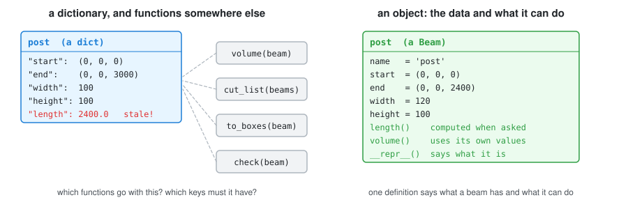
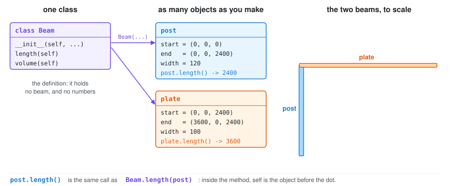
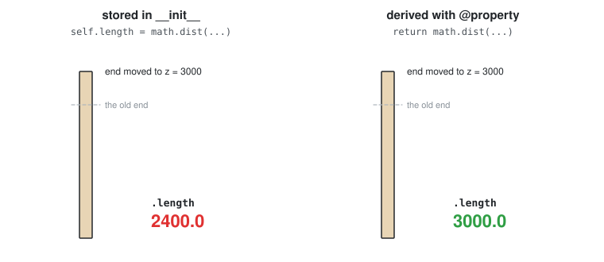
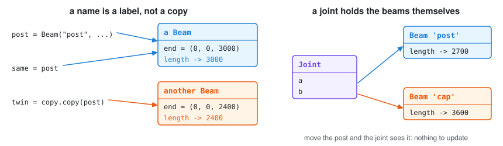
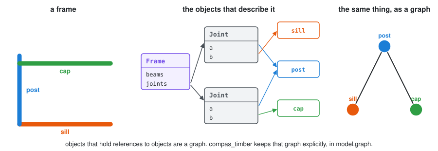
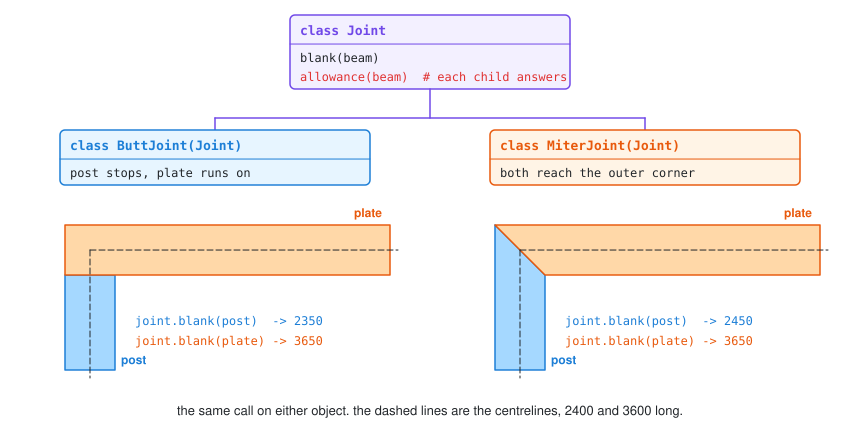
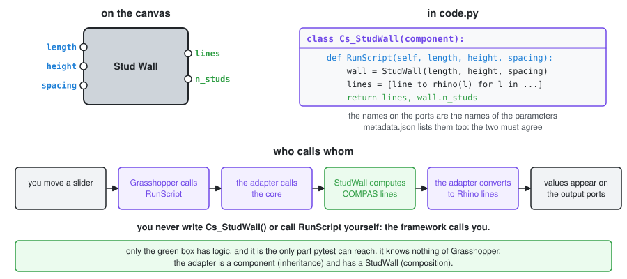

# Week 07 — Classes

> Self-paced on 2026.10.21, taught in class on 2026.11.04. Every figure is
> drawn from the classes in [`class_examples/`](class_examples/) by
> [`figures/make_figures.py`](figures/make_figures.py). Run each example when
> you reach it: `uv run Lecture/Lecture_07/class_examples/01_beam_as_dict.py`.

You have been using classes since Week 04:

| You typed | It is | Section |
| --------- | ----- | ------- |
| `beam.name = "post"` | an attribute | §2 |
| `model.add_element(beam)` | a method | §2 |
| `beam.length` | a property | §4 |
| `Beam.from_centerline(line, 60, 120)` | a second constructor | §5 |
| `model.graph` | an object held by another object | §6 |
| `LButtJoint`, `TButtJoint` | subclasses of `Joint` | §7 |

Next week you start writing one, because **every Grasshopper component is a
class**:

```python
class Mt_StudWall(component):
    def RunScript(self, length, height, spacing):
        ...
```

This page builds up to that, starting from a single beam.

---

## 1. Why classes



A dictionary and a few functions will get you a long way. Run
[`01_beam_as_dict.py`](class_examples/01_beam_as_dict.py) to see where they stop:

- **Two copies of one fact drift apart.** Move the end, and `"length"` is wrong.
- **Nothing refuses nonsense.** A beam with no length and a negative width goes
  through without complaint.
- **Nothing ties the parts together.** Which keys must a beam have? Which
  functions work on one? You find out by reading all of the code.

A **class** is one definition that holds the data and the operations on it.
What that buys you:

| A class gives you | So that |
| ----------------- | ------- |
| one place that says what a beam is | every beam has the same parts, and a reader knows where to look |
| a constructor that can refuse | a broken beam never exists, so no later code has to check for one |
| values derived on demand | nothing goes stale |
| the same call on different classes | a loop over joints needs no `if` per joint type, and a new type changes no loop |
| a shape a framework can call | Grasshopper can run code it has never seen, as long as it has a `RunScript` |

**Use a class when the data and the operations on it belong together. Otherwise,
use a function.** `running_bond_wall(length, height)` takes numbers, returns
boxes and remembers nothing: it should stay a function. A class that holds no
state is a module wearing a costume.

## 2. Class and object



```python
class Beam:
    def __init__(self, name, start, end, width, height):
        self.name = name                 # an attribute: stored on this object
        self.start = start
        self.end = end
        self.width = width
        self.height = height

    def length(self):                    # a method: a function that belongs to the class
        return math.dist(self.start, self.end)


post = Beam("post", (0, 0, 0), (0, 0, 2400), 100, 100)    # __init__ runs here
post.width                                                # 100
post.length()                                             # 2400.0
```

The **class** is the definition. An **object** (or *instance*) is one thing made
from it, with its own values. **`self`** is the object before the dot:
`post.length()` is `Beam.length(post)`, so you never pass it yourself.

> ⚠️ Forgetting `self.` is the first error everyone makes: `return
> math.dist(start, end)` gives `NameError: name 'start' is not defined`.

📄 [`02_beam_as_class.py`](class_examples/02_beam_as_class.py)

## 3. Printing and comparing

Methods with double underscores plug your class into Python's own syntax:

| Define | And this works |
| ------ | -------------- |
| `__repr__(self)` | `print(beam)`, and a readable list of beams |
| `__eq__(self, other)` | `a == b` compares values (without it: *is this the same object?*) |
| `__add__(self, other)` | `a + b` |

```python
def __repr__(self):
    return f"Beam({self.name!r}, {self.width}x{self.height})"
```

Without it you get `<__main__.Beam object at 0x103be3a10>`. **Write `__repr__`
on every class.** It takes one line and it is what you read when something goes
wrong.

📄 [`03_printing_and_comparing.py`](class_examples/03_printing_and_comparing.py)

## 4. Derive, don't store



A **property** is a method read like an attribute, with no parentheses:

```python
@property
def length(self):
    return math.dist(self.start, self.end)

beam.length          # 3000.0: computed now, from the current ends
```

If a value can be computed from others, compute it. Two copies of one fact will
disagree eventually, and nothing will tell you when.

📄 [`04_derive_dont_store.py`](class_examples/04_derive_dont_store.py)

## 5. Refuse nonsense, and offer other ways in

```python
class Beam:
    def __init__(self, name, start, end, width=100, height=100):
        if math.dist(start, end) == 0:
            raise ValueError(f"{name}: a beam needs two different ends")
        ...

    @classmethod
    def post(cls, name, x, y, height, section=100):
        return cls(name, (x, y, 0), (x, y, height), section, section)
```

A constructor that raises means an invalid object can never exist, so nothing
after it has to check. A **class method** receives the class (`cls`) rather than
an object, and is the usual way to offer a second constructor: `Beam.post("a",
0, 0, 2400)`. `Beam.from_centerline` and `Mesh.from_obj` are exactly this.

📄 [`05_refuse_and_construct.py`](class_examples/05_refuse_and_construct.py)

## 6. Objects hold objects



A Python name is a label on an object, not a copy of it. So a joint can simply
hold its two beams:

```python
class Joint:
    def __init__(self, a, b):
        self.a = a               # the beam itself, not a copy
        self.b = b
```

Move the post and the joint sees it, with nothing to update. This is
**composition**: a joint *has* two beams, and a frame *has* beams and joints.



Follow those references and you have the graph from
[Week 06](/Lecture/Lecture_06/README.md): objects are nodes, references are
edges. compas_timber keeps it explicitly as `model.graph`, with each node
pointing at a beam. See
[`10_timber_model_graph`](/Lecture/Lecture_06/notebooks/10_timber_model_graph.ipynb).

> ⚠️ **`def __init__(self, beams=[])`** makes one list, once, shared by every
> object. Week 03's trap, now harder to spot. Write `self.beams = []` in the
> body.

📄 [`06_objects_hold_objects.py`](class_examples/06_objects_hold_objects.py)

## 7. Inheritance



A subclass reuses its parent and changes what differs:

```python
class Joint:
    def __init__(self, a, b):
        self.a = a
        self.b = b

    def blank(self, beam):
        return beam.length + self.allowance(beam)      # written once, here

class MiterJoint(Joint):
    def allowance(self, beam):
        return self.other(beam).width / 2
```

`blank` is written once, in the parent, and calls whichever `allowance` the
object has. So this loop needs no `if`, and a new joint type changes nothing in
it. That is **polymorphism**:

```python
for joint in joints:
    print(joint.blank(post))
```

Use `super().__init__(...)` to run the parent's constructor when you add one of
your own. compas_timber's family trees are real examples, as printed at the end
of notebook 10:

```text
LButtJoint -> ButtJoint -> Joint -> Data -> object
Beam -> TimberElement -> Element -> Data -> ABC -> object
```

**Is-a, or has-a?** Inherit only when the child truly *is* a kind of the parent.

| | | |
| --- | --- | --- |
| a butt joint *is a* joint | inherit | `class ButtJoint(Joint)` |
| a frame *has* beams | hold them | `self.beams = []` |
| a wall *has* boxes, and is not a kind of box | hold them | `self.boxes = []` |

Most of the time you want has-a.

📄 [`07_inheritance.py`](class_examples/07_inheritance.py)

## 8. A class that travels

`json_dump` can save COMPAS objects but not your own class, unless the class
inherits from `Data` and says what to save. That is how an object reaches a
Week 09 artifact, and on to Rhino:

```python
from compas.data import Data

class Beam(Data):
    def __init__(self, length, width, name=None):
        super().__init__(name=name)
        self.length = length
        self.width = width

    @property
    def __data__(self):
        return {"length": self.length, "width": self.width}    # the names __init__ takes
```

To load it, the class has to be importable where you load it, so in a project
it lives in the core package.

📄 [`08_a_class_that_travels.py`](class_examples/08_a_class_that_travels.py)

## 9. A component is a class



All of the above meets here. The adapter inherits from Grasshopper's
`component` class and holds your core's object:

```python
from ghpythonlib.componentbase import executingcomponent as component
from compas_rhino.conversions import line_to_rhino
from compas_studio import StudWall


class Cs_StudWall(component):
    def RunScript(self, length, height, spacing):
        if not length or not height:
            return None, None
        wall = StudWall(length, height, spacing) if spacing else StudWall(length, height)
        return [line_to_rhino(line) for line in wall.lines().values()], wall.n_studs
```

You do not call it. Grasshopper makes the object and calls `RunScript` whenever
an input changes. The rules that follow from this:

- **The parameters of `RunScript` are the input ports**, by name, and they must
  match `metadata.json`.
- **What it returns fills the output ports**, in order: one value, or a tuple
  for several.
- **An unconnected input arrives as `None`.** Handle that first.
- **The class name matches the folder name** (`components/Cs_StudWall/`).

The same design appears as two classes, and they stay apart on purpose:

| | Core: [`StudWall`](/Lecture/Lecture_12/plugin_set/src/compas_studio/stud_wall.py) | Adapter: [`Cs_StudWall`](/Lecture/Lecture_12/plugin_set/components/Cs_StudWall/code.py) |
| --- | --- | --- |
| lives in | `src/` | `components/` |
| inherits from | nothing | Grasshopper's `component` |
| holds | the design and all the logic | no logic |
| runs on | any Python ≥ 3.9 | Rhino only |
| checked by | pytest | the build, then your eyes in Rhino |

```python
wall = StudWall(3.6, 2.4, spacing=0.6)     # numbers in; it refuses nonsense
wall                                       # StudWall(3.6 x 2.4 m, 7 studs)
wall.n_studs                               # 7: a property, so it follows any change
wall.lines()                               # {name: Line}: geometry on request
wall.graph()                               # the element graph: members and joints
```

> Rhino 8 runs **Python 3.9**, so that is what your core has to work on. Avoid
> `match` and `X | Y` type hints, which arrived in 3.10.

📄 [`09_a_component_is_a_class.py`](class_examples/09_a_component_is_a_class.py)
runs this chain without Rhino, using stand-ins. How the project around it is
organised comes next, in [Week 09 Part C](/Lecture/Lecture_09/README.md#part-c--a-project-that-can-hold-components).

---

## Going further

[`abm_examples/`](abm_examples/) has ants and drones: many small objects
following local rules. It is the most natural use of classes in design
computation, and a strong direction for a final project.

## Checkpoints

```bash
uv run check.py 07
```

| # | Task | Exercises |
| - | ---- | --------- |
| 1 | `Vector2D` | `__init__`, `__repr__`, `__add__`, `__eq__`, a property |
| 2 | `Rectangle` | properties, validation, a method taking another object |
| 3 | `Square(Rectangle)` | inheritance and `super()` |
| 4 | `Wall` | a class in the core layer, which stays pure |

## Exercises

📝 [Vector2D and Rectangle](/Exercise/Lecture_07/README.md) ·
📝 [Re-write to OOP](/Exercise/2_re-write_to_oop/README.md): turn the random
walker into a class.

## Self-test

1. What is `self`, and why do you never pass it in?
2. When should a value be a `@property` rather than set in `__init__`?
3. Why write `__repr__` on every class?
4. A `Wall` contains boxes. Should `Wall` inherit from `Box`? Why not?
5. What does `super().__init__(...)` do?
6. `joint.a` and `post` are the same beam. You change `post.end`. What does `joint.a.end` say, and why?
7. Why does a loop over joints need no `if` for each joint type?
8. In `Cs_StudWall`, which line runs because of you, and which runs because of Grasshopper?
9. Which class gets tests, `StudWall` or `Cs_StudWall`? Why?
10. Your core uses `match`. Which machine does it fail on, and which command would have told you first?
