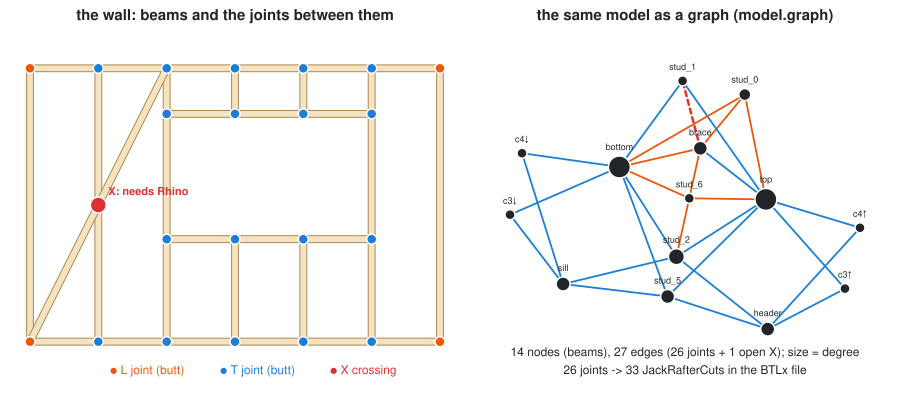
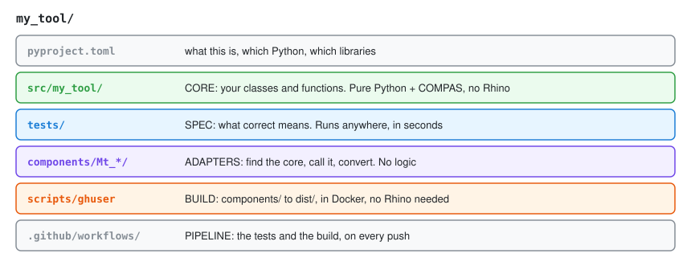
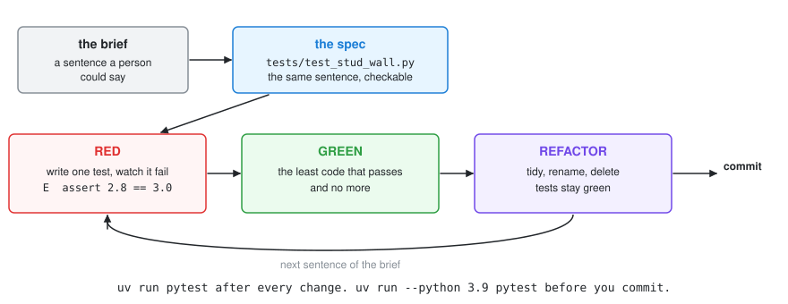
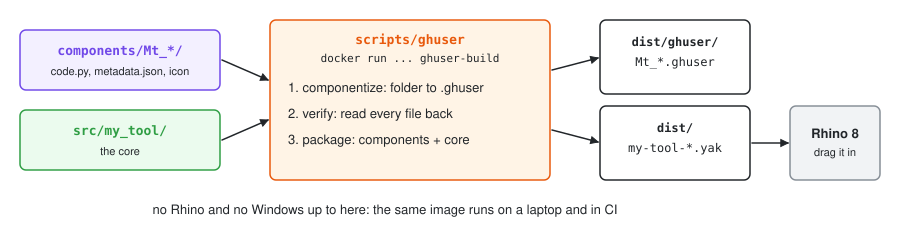

# Week 09 — The timber graph, classes, and a project that can hold components

> **Today, in this order:**
>
> 1. The timber model as a graph: [Part A](#part-a--the-timber-model), then notebook
>    [`04_timber_model_graph`](notebooks/04_timber_model_graph.ipynb)
>    (`uv run --extra timber jupyter lab`).
> 2. Classes: [Week 07](/Lecture/Lecture_07/README.md).
> 3. A project that can hold components: [Part D](#part-d--a-project-that-can-hold-components) below.
>
> Parts B and C are the ground Part D stands on. Read them this week if you
> have not: reading code and JSON (B), core → artifact → adapter (C). Then
> `uv run check.py 09`.

---

# Part A — The timber model

Two earlier weeks meet here. A beam is an object ([Week 07](/Lecture/Lecture_07/README.md)),
and the model is a graph of them ([Week 06](/Lecture/Lecture_06/README.md)).



[compas_timber](https://gramaziokohler.github.io/compas_timber/latest/)
(Gramazio Kohler Research, ETH Zürich) keeps a timber model as a **graph**:
beams are nodes, joints are edges.

```python
from compas_timber.elements import Beam
from compas_timber.model import TimberModel

model = TimberModel(tolerance=Tolerance(unit="MM", absolute=1e-3))   # design in mm
for name, line in stud_wall().items():
    model.add_element(Beam.from_centerline(line, 60, 120, z_vector=[0, 1, 0]))

model.connect_adjacent_beams()     # find every pair of beams that touch ...
model.joint_candidates             # ... and HOW: L (ends meet), T (end on middle), X (cross)
```

How beams meet is topology; a rule (a dict) turns it into joints:

```python
JOINT_RULE = {JointTopology.TOPO_L: LButtJoint, JointTopology.TOPO_T: TButtJoint}
```

`process_joinery()` makes machining features and `BTLxWriter` writes **BTLx**
for CNC machines: 14 beams, 26 joints, 33 cuts (counted by parsing the file).
Checked on compas_timber 2.2.0:

| Headless (your uv environment) | Needs Rhino / Grasshopper |
| ------------------------------ | ------------------------- |
| beams, the model graph, joint detection (L/T/X) | lap, notch and dovetail joints (e.g. the brace crossing a stud, red in the figure) |
| butt, miter, tenon-mortise, French-ridge joints | the cut 3D geometry of a beam (`beam.geometry`) |
| BTLx fabrication files, COMPAS JSON | |

The right column needs Rhino's solid kernel: the architecture of Part C in a real
tool (logic in Python, geometry kernel in the host). The script reports the X
crossing instead of crashing. It is an **optional extra**:

```bash
uv sync --extra timber
uv run --extra timber Lecture/Lecture_09/applications/timber_frame.py
```

📄 [`applications/timber_frame.py`](applications/timber_frame.py) ·
step by step in [`notebooks/`](notebooks/README.md) ·
then the compas_timber [tutorials](https://gramaziokohler.github.io/compas_timber/latest/) (in Grasshopper).

📝 [A timber frame of your own](/Exercise/Lecture_09/README.md)

---

# Part B — Reading code, and files

## B1. What an LLM actually is

**A language model predicts plausible continuations of text.** It is not executing
your code, checking your units, or reasoning about your wall. Three consequences:

1. **It is a function, not a colleague.** It has no memory of yesterday, and in a
   conversation it sees only what is on screen. If a constraint matters, it has to
   be in the prompt.
2. **Fluency is not correctness.** Tidy names and a well-formed docstring are
   properties of the writing, not evidence about the code.
3. **It fails silently and plausibly**, in the same confident voice it uses when
   right, including inventing methods that do not exist.

So it is strongest where a mistake is cheap and obvious (boilerplate, format
conversion, a first draft, explaining code) and weakest where a mistake is silent
(numeric detail, units, edge cases, anything about your project it cannot see).

### Asking well

| Instead of | Ask |
| ---------- | --- |
| "write a function for rooms" | "Write `summarise_rooms(rooms)` taking a list of dicts with `name` and `area` keys, returning the count, the total area, and the mean. Decide what an empty list should do and say why." |
| "fix this" | "This raises `KeyError: 'area'` on line 12. Here is the traceback and the input. What causes it?" |
| "is this good?" | "What happens for an empty list? For one item? For a negative area?" |
| "explain dictionaries" | "Explain line by line what `counts[word] = counts.get(word, 0) + 1` does." |

State the signature you want, paste the real error as text, ask one thing at a
time, and ask it to explain when you are trying to learn. More on the wiki:
[AI Assistants](https://kb.rccn.dev/computation/ai-assistants).

### Reviewing code you did not write

**Five places to look first:**

1. **Off-by-one.** `range(1, n)` vs `range(n)`; slice `stop` is excluded.
2. **Mutable default arguments.** `def f(items=[])` — Week 03's trap. Extremely
   common in generated code.
3. **Silent mutation.** A function that says it returns a new list but
   modifies the one you passed in.
4. **Floats compared with `==`.** Looks right, fails on real data.
5. **Confidently wrong constants and formulas.** Degrees where radians belong;
   a plausible-looking formula that is not the one you asked for.

**How to actually review**, in order:

1. Read the *signature and docstring* first. Is this even the function you
   asked for?
2. Read the body and say out loud what each line does. Anything you cannot
   explain is a finding — either the code is unclear or you do not yet
   understand the problem. Both are blockers.
3. Check the edges: empty input, one item, zero, negative numbers.
4. **Run it on an example where you already know the answer.** Not one it
   suggested — one you chose.

> "It ran without an error" is not evidence that it is correct.

## B2. Files

### Paths — use `pathlib`, always

```python
from pathlib import Path

folder = Path("data")
file = folder / "result.json"      # the / operator joins path parts

file.exists()
file.parent
file.name          # 'result.json'
file.stem          # 'result'
file.suffix        # '.json'
folder.mkdir(parents=True, exist_ok=True)   # create it, no error if present
```

Never build paths by gluing strings with `"/"` or `"\\"`: that breaks between
Windows and macOS.

**Where does a relative path point?** To your *current working directory* — the
folder your terminal is in, not the folder the script is in. To get a path
relative to the script itself:

```python
HERE = Path(__file__).parent
data = HERE / "data" / "input.json"
```

📄 `examples/01_path.py` … `05_pathlib.py`

### Reading and writing

```python
path = Path("notes.txt")

path.write_text("hello")        # simplest possible write
content = path.read_text()      # and read
```

For anything larger, or line by line, use `with`:

```python
with open(path, "w") as f:
    f.write("hello\n")

with open(path) as f:
    for line in f:
        print(line.rstrip())
```

`with` closes the file for you, **even if an error happens inside the block.**

Modes: `"r"` read (default), `"w"` write — **erases the file first** — `"a"`
append.

📄 `examples/06_write_file.py`, `07_with_statement.py`, `08_read_file.py`

## B3. JSON

JSON is a text format for structured data, and it is how your geometry travels
between your code, git and Rhino.

```python
import json
from pathlib import Path

data = {"name": "wall", "courses": 12, "heights": [0.1, 0.2, 0.3]}

Path("wall.json").write_text(json.dumps(data, indent=2))   # write
loaded = json.loads(Path("wall.json").read_text())          # read back
```

`indent=2` makes the file readable and diffable in git. Always use it.

What JSON can hold: `dict`, `list`, `str`, `int`, `float`, `bool`, `None`.
What it cannot: tuples (they come back as lists), sets, and your own classes.

> COMPAS has its own JSON layer — `compas.json_dump` / `compas.json_load` —
> which *can* store geometry objects, meshes and graphs. You met it in Week 04
> and used it on meshes and graphs in Weeks 05–06. Part C is built on it.

## B4. Handling errors on purpose

Week 03 covered reading a traceback. This is the other half: failure you
**expect**, and choose to handle.

```python
try:
    value = int(user_input)
except ValueError:
    print("That was not a number.")
```

Catch only what you can handle, and name it. A bare `except:` swallows everything,
including the typo you have not found yet.

- A missing key that means **your program is broken** should crash. Let it.
- A missing key that is **a normal situation** deserves `.get()` or a `try`.

📄 `examples/09_try_statement.py`


---

# Part C — The dual-mode architecture

## 1. The problem

Here is a script of the kind everyone writes at this point:

```python
from compas.geometry import Box, Frame
from compas_viewer import Viewer

viewer = Viewer()
for i in range(12):
    h = 0.1 + i * 0.05
    box = Box(1, 0.5, h, frame=Frame([0, 0, i * 0.3], [1,0,0], [0,1,0]))
    viewer.scene.add(box)
viewer.show()
```

It works, but the logic is welded to a window. You cannot test it without looking
at it, reuse it in Grasshopper, see what it produced in git, let an agent check its
own work, or run it anywhere without a screen. All of that follows from one mistake:
**the geometry logic and the program's contact with the outside world are tangled
together.**

## 2. The fix: three layers

```
┌────────────────────────────────────────────────────────────┐
│ 1. CORE      pure Python + COMPAS. Numbers in, geometry    │  tested by pytest
│              out. No viewer, no file IO, no print, no      │  written by you
│              Rhino. Runs anywhere.                         │  or by an agent
├────────────────────────────────────────────────────────────┤
│ 2. ARTIFACT  COMPAS JSON. The verified result, produced    │  committed to git
│              headlessly. Previewable without Rhino.        │  reviewable in a diff
├────────────────────────────────────────────────────────────┤
│ 3. ADAPTER   a thin script for Rhino 8 / Grasshopper that  │  thin on purpose
│              loads the artifact (or calls the core) and    │  contains NO logic
│              converts. Deleting it changes nothing.        │
└────────────────────────────────────────────────────────────┘
```

As files (this week's actual layout):

```
Lecture/Lecture_09/checkpoints/
├── core.py       # def stacked_wall(n_courses, length=2.0, thickness=0.3,
│                 #                   course_height=0.2, offset=0.1) -> list[Box]
│                 # def wall_height(n_courses, course_height=0.2) -> float
├── runner.py     # def build_artifact(path, n_courses=8, **kwargs)
│                 # — calls the core, writes output/wall.json
└── spec/
    └── test_tasks.py    # the checkpoint spec (READ ONLY)
```

The **artifact**, `output/wall.json`, is created the first time you run
`build_artifact`; commit it. Part D turns the **adapter** into a Grasshopper
component; the simplest one is [`rhino_load.py`](/Lecture/Lecture_09/examples/rhino_load.py).

**The one-sentence rule: keep the intelligence out of the host application.**
Rhino and Grasshopper only ever *receive* results.

### How to tell if you got it right

- Delete `adapters/` → everything still works.
- Uninstall Rhino → the tests still pass.
- `import core` on a machine with no screen → no error.
- Someone reviewing your pull request can see what the geometry *became*,
  because the artifact changed in the diff.

If any of those fail, a layer has leaked.

## 3. What "pure" means, exactly

A pure function:

- depends only on its arguments (no globals, no reading files, no clock, no
  unseeded randomness),
- returns its result rather than printing or drawing it,
- changes nothing outside itself (no writing files, no editing its inputs).

```python
# NOT pure -- reads a global, prints, draws
SPACING = 0.3
def make_wall(n):
    for i in range(n):
        print(f"course {i}")
        viewer.scene.add(Box(...))

# Pure -- everything it needs comes in; everything it does comes out
def make_wall(n_courses, spacing=0.3):
    """Return a list of Boxes, one per course."""
    return [Box(1, 0.5, 0.1, frame=Frame([0, 0, i * spacing], [1,0,0], [0,1,0]))
            for i in range(n_courses)]
```

> **Randomness and time are impurities too.** `random.random()` and
> `datetime.now()` make a function give different answers on different runs,
> which makes it untestable. Pass a `seed` in as an argument (Week 03) and
> the function becomes reproducible without becoming boring.

## 4. Artifacts

```python
import compas

compas.json_dump(boxes, "output/wall.json")   # write
boxes = compas.json_load("output/wall.json")  # read back, as real Boxes
```

Why not just re-run the script? The artifact is **evidence** of what you produced,
**reviewable** in a diff even when the code change looked harmless, and **portable**:
Rhino, a classmate and CI all read the same file. Commit it.

## 5. Git, at working strength

Use a branch, so you can be reckless there and safe on `main`:

```bash
git switch -c feature/wall-bond     # start a branch
# ... edit, run check.py, commit as you go ...
git add -A && git commit -m "wall: alternate course offset"
git push -u origin feature/wall-bond
```

Then open a **pull request** on GitHub. Even alone it is worth it: it is where you
re-read your own diff, and where CI reports whether the tests passed.

**Writing a commit message.** Say *why*, not *what* — the diff already shows
what.

```
bad:   "update"  /  "fixed stuff"  /  "changes to wall.py"
good:  "wall: offset odd courses by half a brick"
       "core: raise on zero-length walls instead of returning []"
```

**What not to commit:** `.venv/`, `__pycache__/`, `.env` files with API keys,
100MB meshes. Check `.gitignore` before your first big commit.

**When it goes wrong:**
```bash
git status              # always start here
git diff                # what changed, unstaged
git restore <file>      # throw away changes to one file
git log --oneline -10   # recent history
```

## 6. Environments, and why the lockfile matters

`uv.lock` records the exact version of every package, including the ones your
packages depend on. `uv sync` reproduces that set, on your machine, mine and CI's.

```bash
uv sync           # match the lockfile exactly
uv add numpy      # add a dependency -- and commit BOTH changed files
```

`pyproject.toml` and `uv.lock` are source code. Commit them together.

---

# Part D — A project that can hold components

From next week you write Grasshopper components in Python, and later package
them as a plugin. A loose script cannot do that, because other things now have
to find your code: pytest, the component, the build, a reviewer. This part sets
up the place they find it, and the four steps you repeat for every component.

The running example is `StudWall` from [Week 07 §9](/Lecture/Lecture_07/README.md#9-a-component-is-a-class).
The finished version is in the
[plugin set](/Lecture/Lecture_14/plugin_set/README.md): its
[core](/Lecture/Lecture_14/plugin_set/src/compas_studio/stud_wall.py),
[spec](/Lecture/Lecture_14/plugin_set/tests/test_stud_wall.py) and
[adapter](/Lecture/Lecture_14/plugin_set/components/Cs_StudWall/code.py).

## D1. Scaffold



The architecture of Part C, given addresses. Copy the
[template](/Lecture/Lecture_09/project_template/README.md) **out** of the course
repo, because a project is a repository of its own:

```bash
cp -R Lecture/Lecture_09/project_template ~/code/stud_kit
cd ~/code/stud_kit
uv sync
uv run pytest            # 9 passed: it works before you have written anything
git init && git add -A && git commit -m "scaffold: from the DCCG template"
```

Its README lists the four things to rename. Two choices in it are deliberate:

- **`src/`**: with the package one level down, you can only import it once it is
  installed, so tests run against what a user gets and not against whatever is
  in the current folder.
- **`requires-python = ">=3.9"`**: Rhino 8 runs Python 3.9, so that is where your
  core ends up, whatever your laptop has.

### From nothing, by hand

The [template](project_template/README.md) is this, plus a first test, a first
component and two CI workflows. Do it once by hand to see there is no magic in it:

```bash
uv init --lib my_tool            # pyproject.toml + src/my_tool/__init__.py
cd my_tool
uv add compas                    # a dependency: written to pyproject.toml, pinned in uv.lock
uv add --dev pytest              # a tool for you, not for your users
mkdir tests components
git init && git add -A && git commit -m "scaffold: empty project"
```

### What each file is for

| File | It answers | You touch it when |
| --- | --- | --- |
| `pyproject.toml` | what is this, which Python, which libraries | you add a dependency (`uv add`, never by hand) |
| `uv.lock` | *exactly* which versions, on every machine | never by hand. Commit it |
| `src/my_tool/__init__.py` | what does this package offer | you add a public function or class |
| `src/my_tool/*.py` | the logic | most of the time |
| `tests/test_*.py` | what does correct mean | **before** you touch `src/` ([Week 10 §14](/Lecture/Lecture_10/README.md#14-the-test-process)) |
| `components/*/code.py` | how does Grasshopper call it | you add a component |
| `components/*/metadata.json` | its name, inputs and outputs in Grasshopper | the same moment |
| `.github/workflows/test.yml` | run the tests on every push | once |
| `.github/workflows/build-ghuser.yml` | build the components; release on a tag | once ([Week 14](/Lecture/Lecture_14/README.md)) |

## D2. Spec

Start from a brief someone could say out loud:

> *A stud wall: two plates, a stud every `spacing`, studs at both ends. It
> refuses nonsense.*

Then write each sentence as a test, before the code, in `tests/test_stud_wall.py`:

```python
import pytest
from my_tool import StudWall


def test_a_stud_closes_both_ends():
    xs = StudWall(3.0, 2.4, spacing=0.7).stud_positions
    assert xs[0] == pytest.approx(0.0)
    assert xs[-1] == pytest.approx(3.0)


def test_no_bay_is_wider_than_the_spacing():
    xs = StudWall(3.0, 2.4, spacing=0.7).stud_positions
    assert all(b - a <= 0.7 + 1e-9 for a, b in zip(xs, xs[1:]))


def test_an_exact_fit_adds_no_extra_stud():
    assert StudWall(3.6, 2.4, spacing=0.6).n_studs == 7


@pytest.mark.parametrize("length, height, spacing", [(0, 2.4, 0.6), (3, 0, 0.6), (3, 2.4, 0), (-1, 2.4, 0.6)])
def test_rejects_nonsense_input(length, height, spacing):
    with pytest.raises(ValueError):
        StudWall(length, height, spacing)
```

The brief never said what happens when 3.0 m does not divide by 0.7 m. Writing
the test forced that decision: a stud still closes the end, and the last bay is
shorter. **If you cannot write the test, you have not finished the brief.**

## D3. Dev



Run the tests before there is any code. This is what happened, in order:

**Red.** There is no such class yet.

```text
E   ImportError: cannot import name 'StudWall' from 'my_tool'
```

**Green, for now.** Write the smallest class in `src/my_tool/stud_wall.py`, and
export it from `src/my_tool/__init__.py`:

```python
class StudWall:
    def __init__(self, length, height, spacing=0.6):
        self.length = length
        self.height = height
        self.spacing = spacing

    @property
    def stud_positions(self):
        full_bays = int(self.length / self.spacing)
        return [i * self.spacing for i in range(full_bays + 1)]

    @property
    def n_studs(self):
        return len(self.stud_positions)
```

**Red again**: no stud closes the far end.

```text
>       assert xs[-1] == pytest.approx(3.0)
E       assert 2.8 == 3.0 ± 3.0e-06
```

Add one with `if xs[-1] < self.length: xs.append(self.length)`. **Red again**,
and this one nobody would see in a viewer:

```text
>       assert StudWall(3.6, 2.4, spacing=0.6).n_studs == 7
E       assert 8 == 7
```

`6 * 0.6` is `3.5999999999999996`, so the wall looked unfinished and got a second
stud on top of the last one. Compare with a tolerance (Week 02). Then the
`ValueError` of Week 07 §5 turns the last test green, and the whole file passes.

**Refactor** now, with the tests as a safety net: rename, simplify, delete. Read
a failure before you touch the code. `>` is what was claimed and `E` is what
happened. Decide which of them is wrong; changing a test until it passes is not
testing.

## D4. Test

| When | Command | Catches |
| ---- | ------- | ------- |
| after every change | `uv run pytest` | the mistake you made a minute ago |
| before you commit | `uv run --python 3.9 pytest` | anything that does not run in Rhino's Python |
| on every push | the same, by `.github/workflows/test.yml` | "it works on my laptop" |

Good tests here share four habits: they check **properties, not pictures**
(counts, spans, connectivity); they use `pytest.approx`, never `==` on floats;
they test the **failure path**; and each one reads as a sentence of the brief.
Week 10 goes deeper.

The template also ships
[`tests/test_components.py`](/Lecture/Lecture_09/project_template/tests/test_components.py),
which checks that every component's `RunScript` and `metadata.json` name the same
inputs. The build does not compare them, so without this test a renamed input
stays hidden until you are in Grasshopper.

## D5. Next: the adapter and the build

Next week each core class gets a component. Copy
`components/Mt_ColumnGrid/` to a new folder, then change three things:

| File | Change |
| ---- | ------ |
| `code.py` | the class name (same as the folder), the import, the body of `RunScript` |
| `metadata.json` | the name, the inputs and outputs |
| `icon.png` | any 24 × 24 image |

Keep the block at the top of `code.py` as it is: it finds your core inside the
installed package. Later, you build all of them into a plugin:



```bash
scripts/ghuser           # components/ -> dist/ghuser/*.ghuser + dist/*.yak
```

Drag the `.yak` onto Rhino 8 and the components appear in the Grasshopper ribbon.
Full detail: [Week 14](/Lecture/Lecture_14/README.md).

**Before next week**, install Docker ([Docker Desktop](https://www.docker.com/products/docker-desktop/),
OrbStack or colima) and keep your project under your home folder, which Docker
shares by default. Read the line that says `(N components)` when you build: on
colima, a folder you have just added can take a minute to appear.

> **TBC before next week:** where to get the builder image. `scripts/ghuser` uses
> `git.rccn.dev:5050/libs/ghuser-builder:1.0.0`. To use another image, run
> `GHUSER_BUILDER_IMAGE=<name> scripts/ghuser`.

---

## Checkpoints

```bash
uv run check.py 09
```

This week you edit **two** files, because they are separate:

| File | May contain | May NOT contain |
| ---- | ----------- | --------------- |
| `checkpoints/answers_core.py` | geometry logic | viewer, file IO, `print`, Rhino |
| `checkpoints/answers_runner.py` | calling the core, writing the artifact | geometry logic |

(`core.py` and `runner.py` are the read-only starters; the first
`uv run check.py 09` copies them to the two `answers_*.py` files you edit.)

| # | Task |
| - | ---- |
| 1 | `core.stacked_wall(n_courses, ...)` — a real parametric element |
| 2 | `core.wall_height(...)` — a derived value, computed not measured |
| 3 | `core` stays pure — checked by reading your file, not by running it |
| 4 | `runner.build_artifact(path, ...)` — core → JSON, round-tripped |

Checkpoint 3 **parses your `core.py` and inspects its imports.** The forbidden
import must not be in the file at all. An architecture rule that something enforces
lasts longer than a good intention.

## Self-test

1. Name three bugs that AI-generated Python commonly contains.
2. Why is "it ran without an error" not evidence that code is correct?
3. Why is `Path("data") / "out.json"` better than `"data/" + "out.json"`?
4. What does `with open(...)` do that a plain `open(...)` does not?
5. Name three things a pure function may not do.
6. Why commit the artifact when the code that produced it is already committed?
7. Your `core.py` imports `compas_viewer`. Which of the five problems in §1 has
   come back?
8. What does `uv.lock` give you that `pyproject.toml` alone does not?
9. Someone hands you a project. What is the fastest check that its layering is
   real rather than aspirational?
10. Why does `src/my_tool/` make it harder to fool yourself than `my_tool/`?
11. Your first test fails with `ImportError`. Is that a bad start?
12. You rename an input in `code.py` and forget `metadata.json`. Which step catches it: the tests, the build, or Rhino?
