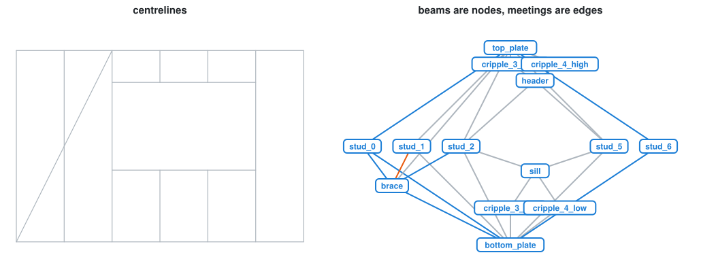
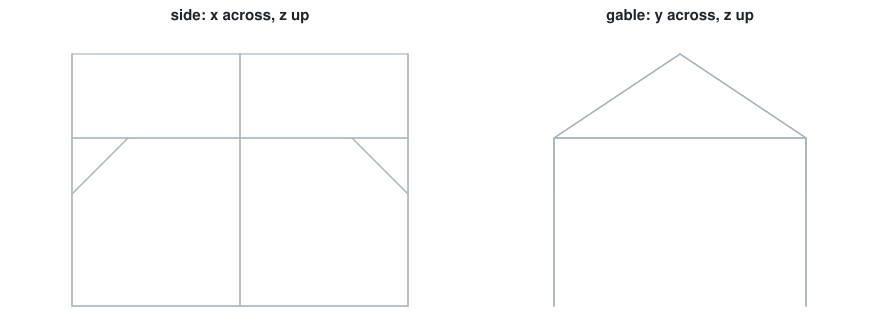

# Week 09 notebooks: the timber model

[Lecture](../README.md) · [how to run a notebook](../../README.md#how-to-run-a-notebook)

These need the `timber` extra: `uv run --extra timber jupyter lab`. Everything runs without Rhino; the notebooks say where that stops (lap joints, cut geometry).

| Preview | # | Notebook | What you watch happen |
| :-----: | - | -------- | --------------------- |
| *3D only* | 01 | [two beams and a joint](01_timber_beams_and_joints.ipynb) | a beam and its blank; L, T and X; the model graph; butt vs miter vs tenon; the T joint's order; BTLx read back |
|  | 02 | [a stud wall](02_timber_stud_wall.ipynb) | centrelines → roles → beams → topology → a rule → joints → BTLx; four design variants in one table |
|  | 03 | [a frame, from design to site](03_timber_frame_to_site.ipynb) | a 3D shed: crowded nodes, a rule of precedence that halves the cut list, weights, an erection sequence by BFS |
| *3D only* | 04 | [inside the timber model: the graph](04_timber_model_graph.ipynb) | what a node and an edge hold; the graph drawn inside the frame; crowded nodes as cliques; pick a beam, see what it touches; a route to the ground; stages on a slider; real triangles vs graph triangles; joints on edges, and the direction trap; the graph through JSON |
