# Week 10 — Algorithms, and how to test them

> ```bash
> uv run pytest Lecture/Lecture_10/tests -v      # 58 property tests
> uv run Lecture/Lecture_10/figures/make_figures.py
> ```

Part A: what an algorithm is, the classic ones in plain words, and where architecture
uses them. Each is written from scratch in [`examples/`](examples/), in plain Python,
30–100 lines. Part B: how to test them. The tests in
[`tests/test_algorithms.py`](tests/test_algorithms.py) check properties that hold for
every input, so they also catch mistakes in the library version you will ship, or an
AI's. Every figure is drawn by the same code ([`figures/make_figures.py`](figures/make_figures.py)).
The [notebooks](notebooks/README.md) go through four of them step by step.

| # | Algorithm | In architecture | The test that keeps it honest |
| - | --------- | --------------- | ----------------------------- |
| 1 | [What an algorithm is](#1-what-an-algorithm-is) | | |
| 2 | [Binary search](#2-binary-search-halve-what-is-left) | equal-length ribs; the smallest section that passes | at most log₂ n + 1 looks; ribs of equal length |
| 3 | [Divide and conquer](#3-divide-and-conquer-merge-sort) | cut lists; clash detection; rendering | sorted, nothing lost; at most n log₂ n comparisons |
| 4 | [Convex hull](#4-convex-hull-the-rubber-band) | collision meshes; footprints | every point inside; a box's hull is the box |
| 5 | [Nearest neighbours](#5-nearest-neighbours-pigeonholes) | clash checks; agents; point clouds | the same answers as brute force |
| 6 | [Curvature](#6-curvature-the-angle-defect) | which panels can be flat or bent | **Gauss–Bonnet**: Σ defects = 2π·χ |
| 7 | [Smoothing](#7-smoothing-laplacian-and-taubin) | cleaning scans; relaxing a form | rougher in, smoother out; fixed vertices stay |
| 8 | [Subdivision](#8-subdivision-catmullclark-by-hand) | SubD modelling | V′ = V + E + F; matches COMPAS |
| 9 | [Planar panels](#9-planar-panels) | flat glass on a curved roof | flatness drops 10×; fixed vertices stay |
| 10 | [Contouring](#10-contouring-slicing-a-mesh-with-planes) | site models, 3D printing, waffle ribs | every point at height *h*; loops close |
| 11 | [Geodesic distance](#11-geodesic-distance-on-the-surface) | paths and patterns on a shell | never shorter than a straight line |
| 12 | [Library tour](#12-library-tour-compas_cgal) | hip roofs, booleans, remeshing | |

---

# Part A — The algorithms

## 1. What an algorithm is

An algorithm is a recipe: exact steps that turn an input into an output and then
stop. "Sort these panels by size" is a problem; merge sort is one recipe for it,
insertion sort another. Both give the same answer, at very different cost.

**Cost** is how the work grows with the size of the input, *n*:

| Grows like | n = 1,000 | n = 1,000,000 | Example |
| ---------- | --------: | ------------: | ------- |
| log₂ n | 10 | 20 | binary search (§2) |
| n | 1,000 | 1,000,000 | look at every item once |
| n log₂ n | 10,000 | 20,000,000 | merge sort (§3), convex hull (§4) |
| n² | 1,000,000 | 1,000,000,000,000 | compare every pair |

Looking through a million numbers one by one takes 15 ms on a laptop. A million
squared steps at that pace takes four hours. Picking the recipe decides whether
the script finishes.

The classic algorithms below are not geometric: searching and sorting. Geometry
uses them all the time, and the geometric ones after them are built from the same
few ideas: halve the problem, split it and combine, put things in buckets, repeat a
local rule.

## 2. Binary search: halve what is left

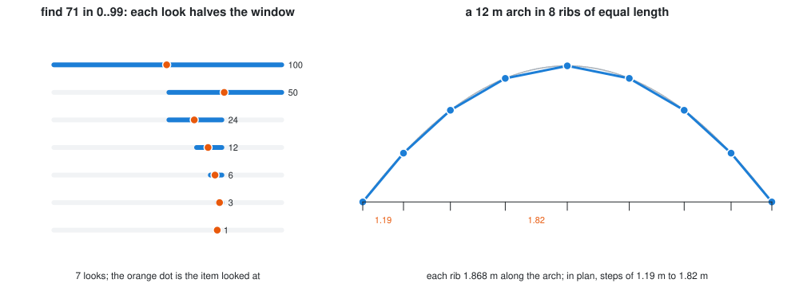

**Picture it.** Guess a number between 1 and 100. Each answer is "higher" or
"lower", so guess the middle: 50, then 25 or 75, and so on. Seven guesses are
always enough, because each one halves what is left.

**In code.** On a sorted list, look at the middle item and throw away the half the
target cannot be in. A million items need at most 20 looks:

```python
while left <= right:
    mid = (left + right) // 2
    if items[mid] == target:  return mid
    if items[mid] < target:   left = mid + 1
    else:                     right = mid - 1
```

Finding item 777,777 in a list of a million: 15 ms one by one, 3 µs by halving.
The list must be sorted; the halving is what costs log₂ n.

**Bisection** is the same idea on any yes/no question whose answer flips once.
In design that is common:

- **Divide a curve into equal lengths.** "Is the arc from the springing to *x*
  longer than one rib?" is no, then yes. Bisect on *x*. The figure's 12 m arch,
  4 m high, gets eight ribs of 1.868 m each; in plan they are 1.20 m apart at the
  springing and 1.82 m at the crown.
- **The smallest section that passes.** "Does a beam of depth *d* pass the
  deflection check?" flips once as *d* grows.
- **The point where a ray hits a surface**, the step a renderer repeats millions of times.

📄 [`examples/binary_search.py`](examples/binary_search.py) · tests: agrees with a
linear search; at most log₂ n + 1 looks; each look halves the window; bisection finds √2;
a test that never flips → `ValueError`; ribs of equal length, unequal in plan.
**Library:** `bisect` (Python's standard library), `scipy.optimize.brentq`.

## 3. Divide and conquer: merge sort

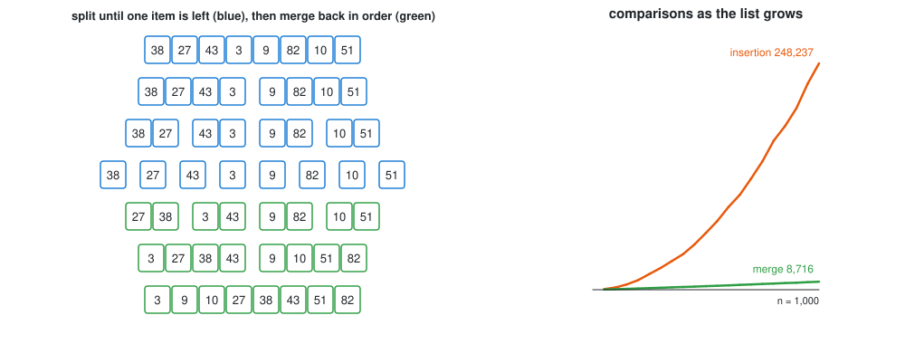

**Picture it.** Sort a pile of 64 drawings by date with friends. Split the pile in
two and hand each half to a friend, who splits theirs again, down to single
drawings: one drawing is already sorted. Then everyone merges back: two sorted
piles become one by repeatedly taking the earlier of the two top drawings.

That is **divide and conquer**: split the problem into smaller copies of itself,
solve those (recursion, [Week 08](/Lecture/Lecture_08/README.md)), combine the
answers. Merge sort makes log₂ n rounds of merging, each touching every item once:
n log₂ n comparisons. Insertion sort, which slides each item back into place,
needs up to n². For 4,096 numbers: 43,989 comparisons against 4,132,226.

**In architecture.** Sorting is everywhere: a cut list by length, panels by area,
points along a curve, events in time. The divide-and-conquer idea goes further
than sorting:

- **Clash detection** in a BIM model splits space in halves until each box holds a
  few elements, so two beams are only compared when they share a box.
- **Rendering**: a ray tracer (Rhino's Cycles) finds what a ray hits by descending
  a tree of boxes, not by testing every triangle.
- **Nearest-point queries**: `compas.geometry.KDTree` splits points in half along x,
  then y, then x again.

Merge sort is **stable**: equal items keep their order. Sort panels by type, then
stably by size, and each size stays grouped by type.

📄 [`examples/merge_sort.py`](examples/merge_sort.py) · tests: sorted, nothing lost or
added; the input unchanged; stable; at most n log₂ n comparisons, and fifty times fewer
than insertion sort at 4,096 items.
**Library:** `sorted()` (Timsort, a merge sort that spots runs already in order).

## 4. Convex hull: the rubber band

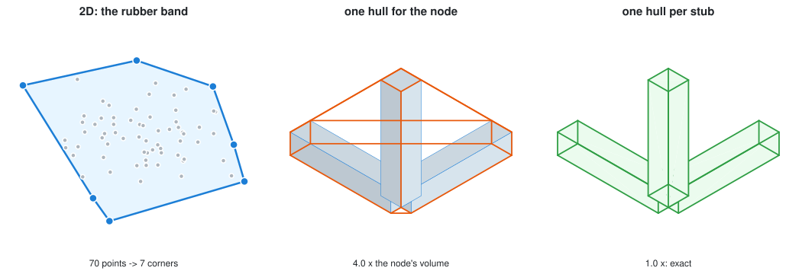

**Picture it.** Hammer nails into a board and stretch a rubber band around them:
the band is the **convex hull**. In 3D, shrink-wrap a chair: the wrap is its hull.

**In architecture and fabrication.**

- **Collision meshes.** A robot placing a timber node must not hit the frame. Checking
  the node's real mesh against the frame is slow, and concave shapes are hard: a point is
  inside a *convex* shape exactly when it is behind every face, one dot product each. So
  robot planners and physics engines are given simplified convex shapes; PyBullet, which
  COMPAS FAB can drive, needs them convex for anything that moves.
  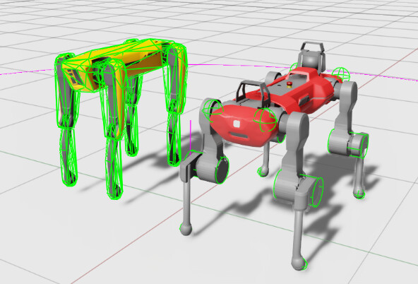
- **One hull or several.** The corner node's single hull is 4.0 times the node's volume:
  safe, but the robot would think it collides with things it misses. One hull per stub
  fits exactly. Splitting a shape into convex parts is what collision tools do
  (V-HACD, "convex decomposition").
- **Footprints and envelopes.** The outline of survey points, the smallest fence
  around a site's trees, the stock a part is cut from.

**The 2D recipe (monotone chain).** Sort the points by x, walk left to right and drop
the middle of any three points that turn *right*; walk back for the upper half. "Turns
right" is the sign of one cross product. The sort costs n log n; the walk, n. Trying
every pair of points as an edge costs n³: a billion tests for 1,000 points.

📄 [`examples/convex_hull.py`](examples/convex_hull.py) · tests: every point left of every
edge; counter-clockwise and convex; agrees with `compas.geometry.convex_hull_xy`; collinear
points → `ValueError`; the collision mesh holds every vertex; a box's hull is the box; one
hull for the node is more than 3× its volume, one per stub exact.
**Library:** `compas.geometry.convex_hull` (3D), `convex_hull_xy` (2D).

## 5. Nearest neighbours: pigeonholes

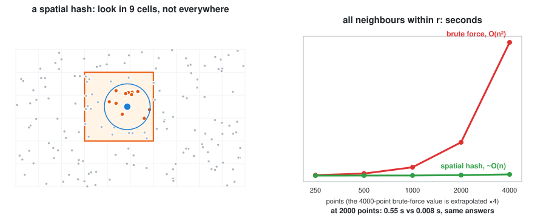

**Picture it.** Find everyone within one metre of you in a full hall. Asking all of
them is slow. If the floor is chalked into one-metre squares, you only ask the people
in your square and the eight around it.

**In architecture.** "Which columns are closer than 1 m?", "which agents can this boid
see?" ([Week 11](/Lecture/Lecture_11/README.md)), "which scan points belong to the same
wall?" are neighbour queries, the inner loop of clash checks, simulation and
point-cloud work.

**How.** A **spatial hash** files each point in a dictionary
([Week 04](/Lecture/Lecture_04/README.md)) under its square,
`(floor(x / r), floor(y / r))`. Brute force compares every pair, n². At 2,000 points:
over half a second against under 10 ms, with **identical answers**. `within()` raises if
the radius is bigger than a square, rather than silently missing neighbours.

📄 [`examples/nearest.py`](examples/nearest.py) · tests: the same results as brute force,
including negative coordinates and points exactly on square edges; too large a radius →
`ValueError`.
**Library:** `compas.geometry.KDTree`, better for uneven spreads and "k nearest".

## 6. Curvature: the angle defect

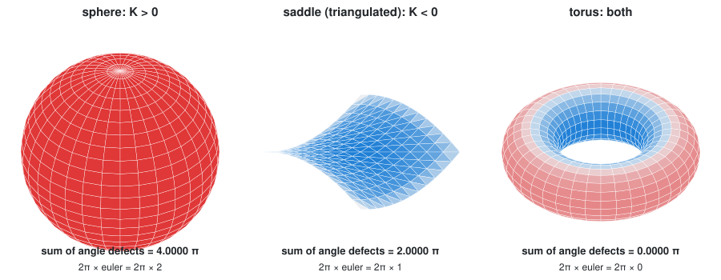

**Picture it.** Press a sheet of paper onto a ball: it creases, because there is too
little paper around each point. Onto a saddle: it ruffles, too much. Flat paper fits a
cylinder perfectly.

**In architecture.** That sorts the panels of a curved roof. **K = 0** (cylinders,
cones) unrolls flat: bent sheet. **K > 0** (domes) and **K < 0** (saddles, hypars)
need doubly curved, moulded or many small flat panels.

**How.** Add the face angles around a vertex: 360° on a flat sheet, less on a dome,
more on a saddle. The shortfall is the **angle defect**, discrete Gaussian curvature:

```python
K(v) = 2π - sum(face_angle(f, v) for f in mesh.vertex_faces(v))
```

On any closed mesh the defects add up to exactly `2π × euler`: 4π for anything
sphere-like, 0 for a torus (**Gauss–Bonnet**). It holds for every input, so it is the
test.

A hypar meshed along its straight lines has twisted quads whose angles still add up
to 360°: K = 0 on a curved surface. The angle defect only sees curvature through
**flat** faces; triangulate first (`test_saddle_curvature_is_negative_once_triangulated`).

📄 [`examples/curvature.py`](examples/curvature.py) · tests: Gauss–Bonnet on a box, a sphere,
a torus and an open surface; zero inside a flat grid; average K ≈ 1/r² on a sphere.
**Library:** `mesh.vertex_curvature()`.

## 7. Smoothing: Laplacian and Taubin

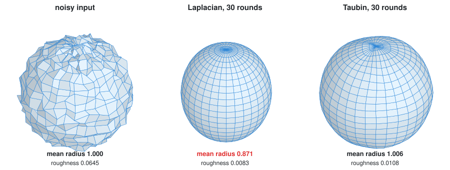

**Picture it.** Everyone in a crowd steps halfway towards the middle of their
neighbours. Bumps flatten out, and the crowd also huddles closer.

**In architecture.** Cleaning a noisy 3D scan; evening out a mesh before panelling it;
the first step of form-finding a shell.

**How.** Move each vertex towards the average of its neighbours:

```python
c = mean(neighbours of v)
v = v + w * (c - v)          # w = 0.5
```

**Laplacian smoothing** removes noise and **shrinks**: after 30 rounds the sphere has
lost 13% of its radius. **Taubin** (1995) follows each step with a slightly larger one
back (`w = -0.53`): both damp the noise, and the size comes back.

Compute **all** new positions from the **old** ones, then write them. Updating in
place makes the result depend on the order of the loop.

📄 [`examples/smoothing.py`](examples/smoothing.py) · tests: roughness goes down; fixed
vertices and topology unchanged; input not modified; Laplacian shrinks a sphere by more than
5%, Taubin by less than a third of that.
**Library:** `mesh.smooth_centroid()`, `mesh.smooth_area()`.

## 8. Subdivision: Catmull–Clark by hand

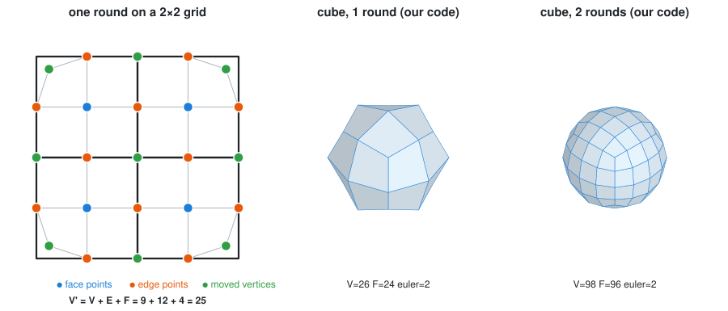

**Picture it.** Cut every face into four and round the corners off, again and again:
a box becomes a pebble.

**In architecture.** Rhino 8's SubD objects are Catmull–Clark: you shape a coarse
cage, the smooth surface follows. Subdivision also refines a coarse design mesh into
panels.

**How.** One round builds a new mesh from three dictionaries keyed as in
[Week 05](/Lecture/Lecture_05/README.md):

1. `face_point[f]`: the centroid of each face
2. `edge_point[(u, v)]`: the average of the edge's ends and its two face points (the midpoint on the boundary)
3. `vertex_point[v]`: the old vertex pulled towards its neighbourhood, `(F + 2R + (n − 3)P) / n`
4. each n-sided face becomes n quads: `[vertex, edge point, face point, previous edge point]`

The open grid's corners get cut off: plain Catmull–Clark has no corner rule
(exercise 2).

📄 [`examples/subdivision.py`](examples/subdivision.py) · tests: every face a quad;
**V′ = V + E + F**; Euler unchanged; every position identical to COMPAS's on a cube.
**Library:** `mesh.subdivided(scheme)` with `"catmullclark"`, `"loop"`, `"doosabin"`, `"quad"`, `"tri"`.

## 9. Planar panels

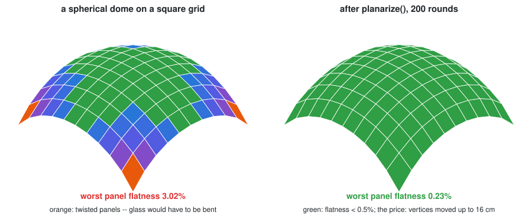

**Picture it.** A four-legged table on a curved floor wobbles: one leg is off the
plane of the other three. A quad panel on a curved roof does the same.

**In architecture.** Curved glass roofs are built from **flat** panels. A twisted panel
must be cold-bent (about 1–2% for glass), hot-bent (expensive) or split in two
triangles (twice the joints).

**Measure:** flatness = the distance between the two diagonals / their mean length. The
dome reaches 3%. **Fix** by projection:

```
repeat:
    for each face: fit a plane to its corners, project them onto it
    for each vertex: move to the average of where its faces asked it to go
```

After 200 rounds every panel is under 0.5%, and vertices have moved up to 16 cm.
Report both numbers: flatter panels cost fidelity to the design.

📄 [`examples/planarity.py`](examples/planarity.py) · tests: a flat grid → 0; triangles → 0;
flatness drops at least 10×; fixed vertices stay; pentagons → `ValueError`.
**Library:** `mesh.face_flatness()`, which divides by edge length, not diagonals: check
which definition a number uses before comparing.

## 10. Contouring: slicing a mesh with planes

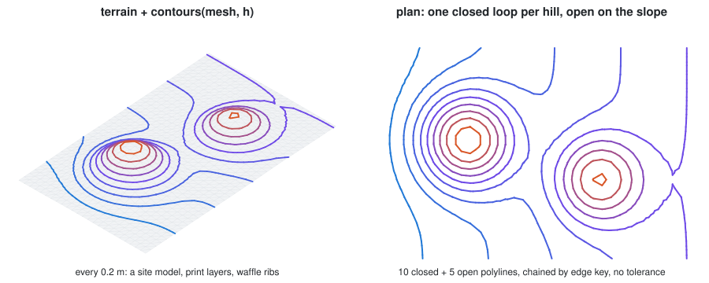

**Picture it.** Lower a hill into water a step at a time and draw the shoreline each
time.

**In architecture.** Cardboard site models, the layers of a 3D print, waffle ribs, CNC
paths: all are slices.

**How.**

```
for every triangle and every height h:
    an edge with one end above h and one below is crossed: interpolate the point
    a triangle is crossed by 0 or 2 edges: 0 or 1 segment
```

Two segments connect exactly when they cross **the same mesh edge**, so they chain by
edge key (integers), not by matching float endpoints. Loops come back closed, lines
open: 10 closed and 5 open in the figure. A quad can be crossed on all four edges,
which is ambiguous, so `contours()` refuses quads.

📄 [`examples/contouring.py`](examples/contouring.py) · tests: every point at height h; a
sphere cut at the equator → one closed loop ≈ 2π long; a slope → one open line; two hills →
two loops; quads → `ValueError`.
**Library:** `compas_cgal.slicer.slice_mesh`, `compas_cgal.isolines.isolines`.

## 11. Geodesic distance: on the surface

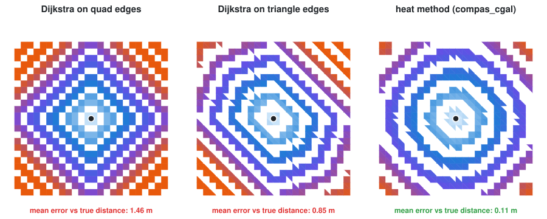

**Picture it.** An ant walking on a roof cannot cut through the air; its distance is
measured on the surface.

**In architecture.** Routing a path or a cable on a shell, spacing a pattern evenly
over a curved surface, finding the shortest strip for a cladding board.

**How.** Dijkstra on edge lengths ([Week 06](/Lecture/Lecture_06/README.md)) gives the
shortest path *along edges*. On a flat sheet the true distance bands are circles, but
edge paths turn only at vertices:

- on **quads** they measure |dx| + |dy|: diamonds, up to 41% too far
- on **triangles** there is one more direction, so the bands stretch along the diagonal
- the **heat method** (Crane et al., 2013) crosses faces instead of following edges

The mean errors in the figure are 1.46 m, 0.85 m and 0.11 m. Dijkstra is correct: it
answers "shortest along edges", not "shortest on the surface". A test pins the diamond
result so the two are not confused.

📄 [`examples/geodesics.py`](examples/geodesics.py) · tests: never shorter than the straight
line; exactly |dx| + |dy| on a grid; the heat method closer on a known case; unknown source →
`ValueError`.
**Library:** `compas_cgal.geodesics.heat_geodesic_distances`, `geodesic_isolines`.

## 12. Library tour: compas_cgal

Some algorithms are too long to write in a week. [CGAL](https://www.cgal.org) is the
standard C++ geometry library; `compas_cgal` (installed) wraps it.

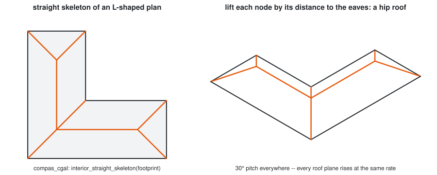

**Straight skeleton → hip roof.** Shrink a footprint inward at equal speed; the corners
trace the *straight skeleton*. Lift each node by its distance to the eaves: a
constant-pitch hip roof for any footprint.

```python
from compas_cgal.straight_skeleton_2 import interior_straight_skeleton
graph = interior_straight_skeleton(footprint)     # a COMPAS Graph (Week 06)
```

| Module | What it does | Typical use |
| ------ | ------------ | ----------- |
| `booleans` | union / difference / intersection of closed meshes | massing, cutting openings |
| `meshing.trimesh_remesh` | even out triangle sizes | before simulation or fabrication |
| `slicer.slice_mesh` | robust contouring (§10) | 3D printing, waffle structures |
| `reconstruction` | outlier removal, normals, Poisson surface | full 3D scans |
| `geodesics` | heat-method distances and isolines (§11) | patterns, paths on surfaces |
| `skeletonization` | the medial "stick figure" of a closed mesh | structure for organic forms |
| `straight_skeleton_2` | skeletons and offsets of polygons | roofs, setbacks, inset paths |
| `triangulation` | constrained Delaunay | meshing a plan with holes |

Worked scripts: [`Lecture_05/examples/cgal/`](/Lecture/Lecture_05/examples/cgal/)
(`01_remesh.py`, `03_delaunay_with_holes.py`, `04_booleans.py`, `07_slice_for_printing.py`).

---

# Part B — Testing

Every algorithm above is a worked example.

## 13. Testing geometry with pytest

```bash
uv run pytest Lecture/Lecture_14/plugin_set/tests -q      # the plugin set's specs
uv run pytest Lecture/Lecture_13/test_wall.py -v          # one file, verbose
```

[`staircase.py`](/Lecture/Lecture_14/plugin_set/src/compas_studio/staircase.py) is a
**pure function**: numbers in, geometry out ([Week 09](/Lecture/Lecture_09/README.md)).
That makes it testable, and lets the same code become a Grasshopper component
([§16](#16-practice-one-algorithm-one-component)). Three habits, all visible in
[`plugin_set/tests/`](/Lecture/Lecture_14/plugin_set/tests/):

- **Test properties, not pictures.** "Looks like a staircase" cannot be asserted; the
  step count, a steady climb, the total run, nothing floating can. If every property
  holds, the picture follows.
- **Never `==` on floats.** Computed geometry carries rounding noise: use
  `pytest.approx` or a tolerance.
- **Test the failure path.** A function given nonsense should raise, not return junk.
  Every core in the plugin set has a `test_rejects_nonsense_input`.

## 14. Tests are an executable spec

[`plugin_set/tests/test_wall.py`](/Lecture/Lecture_14/plugin_set/tests/test_wall.py)
specifies a running-bond wall: units, counts, offsets and tolerances, pinned down as a
written brief never manages. A brief you can turn into tests is a finished brief. Each
checkpoint's `spec/test_tasks.py` was one; now you write them.

## 15. The test process

```
   RED               GREEN              REFACTOR
write one test  ─►  write just enough ─►  tidy the code,   ─► next test
that fails          code to pass it       tests stay green
```

1. **Red.** Write one test for the next thing the function should do, and **run it to
   see it fail**. A test that has never failed may pass for the wrong reason.
2. **Green.** Write the least code that passes it.
3. **Refactor.** Rename, simplify, delete. Green tests mean the behaviour did not change.

| When | Command | Catches |
| --- | --- | --- |
| after every change | `uv run pytest -q` | the mistake of a minute ago |
| before you commit | `uv run pytest -q`, everything saved | the file you forgot |
| on every push (your project's `test.yml`) | the same, on a fresh machine, by CI | "it works on my laptop" |

When a test fails, read the failure before touching the code:

```
>       assert len(bricks) == 12
E       assert 13 == 12
```

The `>` line is the claim; the `E` line is what happened. Decide which is wrong, the
code or the claim, before changing either. A bug found later goes the same way: first
the test that would have caught it (red), then the fix (green).

## 16. Practice: one algorithm, one component

Take one algorithm from Part A into your project
([Week 09 Part D](/Lecture/Lecture_09/README.md#part-d--a-project-that-can-hold-components)):
the function in `src/`, its property tests in `tests/`, then a component that calls it
([D5](/Lecture/Lecture_09/README.md#d5-next-the-adapter-and-the-build)). Packaging comes
in [Week 14](/Lecture/Lecture_14/README.md).

---

## Exercises: extend one

Pick one. **Write the test first**, and say in one sentence which property it checks.

1. **Loop subdivision** for triangle meshes. Test: V′ = V + E, every face a triangle,
   χ unchanged.
2. **A corner rule** for `catmull_clark` that keeps the corners of an open grid in
   place. Test: corner vertices do not move.
3. **Divide a polyline** into pieces of equal length with `bisect`. Test: equal pieces,
   the ends kept.
4. **A quadtree**: split a square in four until each holds at most 4 points, then answer
   radius queries. Test: the same answers as `nearest.within_brute`.
5. **Planarize with closeness**: pull vertices back towards the original surface and
   plot flatness against drift as the pull grows. That curve is a design tool.
6. **Waffle structure**: contour a shell in x and in y, then cut half-depth slots where
   ribs cross. Test: every slot pair adds up to the full rib depth.
7. **Have an AI assistant write one of these**, then run the tests here against it.
   Which property fails first? (Week 13 in miniature.)

## Self-test

1. Binary search needs at most 20 looks for a million items. How many for a billion?
2. Merge sort and insertion sort give the same output. When does the choice matter?
3. A single convex hull of a robot's gripper reports a collision that does not happen.
   Why, and what fixes it?
4. State Gauss–Bonnet in one line. Why is it a better test than a picture?
5. Why does Laplacian smoothing shrink a closed surface, and what does Taubin change?
6. Planarization brought every panel under 0.5%. What else must you report?
