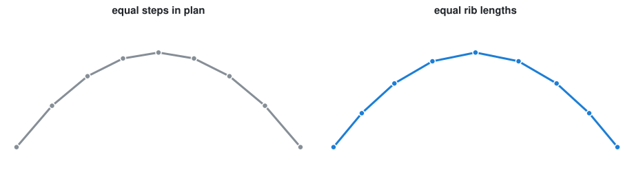
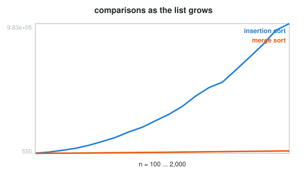
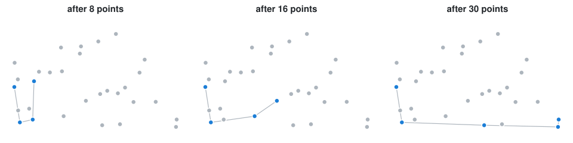
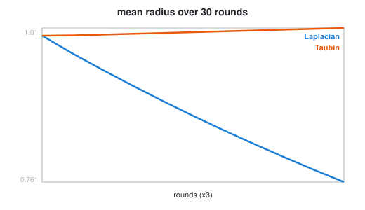

# Week 10 notebooks: algorithms, step by step

[Lecture](../README.md) · [how to run a notebook](../../README.md#how-to-run-a-notebook)

Each notebook runs one algorithm from [`examples/`](../examples/) a step at a time. The text
before each cell says what it does and what to look at.

| Preview | # | Notebook | What you watch happen |
| :-----: | - | -------- | --------------------- |
|  | 01 | [binary search](01_binary_search.ipynb) | the window halving; a million items in 20 looks; an arch split into equal ribs by bisection |
|  | 02 | [merge sort](02_merge_sort.ipynb) | two piles merged; eight numbers split and merged back; comparisons against insertion sort; a cut list |
|  | 03 | [convex hull and collision meshes](03_convex_hull.ipynb) | the turn test; the chain built point by point; a timber node's collision mesh, one hull or three |
|  | 04 | [curvature and smoothing](04_curvature_smoothing.ipynb) | one angle defect by hand; Gauss–Bonnet; Laplacian shrinking against Taubin |
