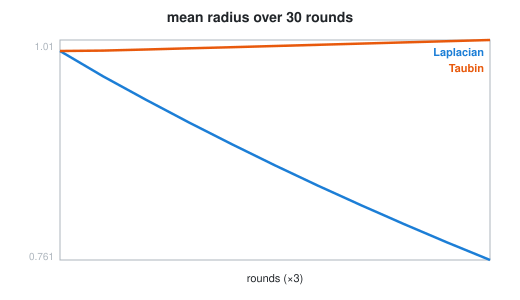
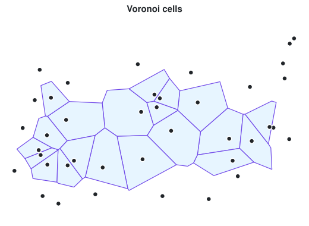

# Week 10 notebooks: geometric algorithms

[Lecture](../README.md) · [how to run a notebook](../../README.md#how-to-run-a-notebook)

Each notebook unpacks one algorithm step by step, then calls the tested module in [`examples/`](../examples/) to confirm.

| Preview | # | Notebook | What you watch happen |
| :-----: | - | -------- | --------------------- |
|  | 01 | [curvature and smoothing](01_curvature_smoothing.ipynb) | one angle defect by hand; Gauss–Bonnet; Laplacian shrinking vs Taubin |
|  | 02 | [Delaunay → Voronoi → Lloyd](02_voronoi_lloyd.ipynb) | the empty circle; cells from circumcentres; Lloyd round by round |
| *random data* | 03 | [convex hull in 2D](03_convex_hull_2d.ipynb) | Graham scan, step by step |
| *random data* | 04 | [convex hull in 3D](04_convex_hull_3d.ipynb) | Quickhull through scipy, then COMPAS |
| *random data* | 05 | [convex hull, COMPAS only](05_convex_hull_compas_only.ipynb) | the Graham scan again, without matplotlib |
