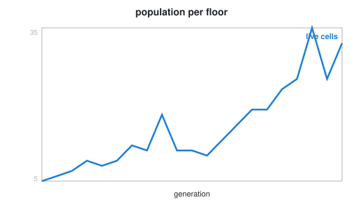

# Week 11 notebooks: simulation

[Lecture](../README.md) · [how to run a notebook](../../README.md#how-to-run-a-notebook)

| Preview | # | Notebook | What you watch happen |
| :-----: | - | -------- | --------------------- |
|  | 01 | [cellular automata](01_cellular_automata.ipynb) | neighbour counts as an array; the rule; a glider; a tower |
