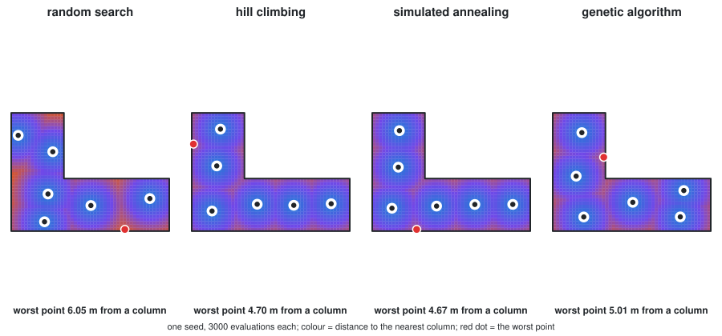
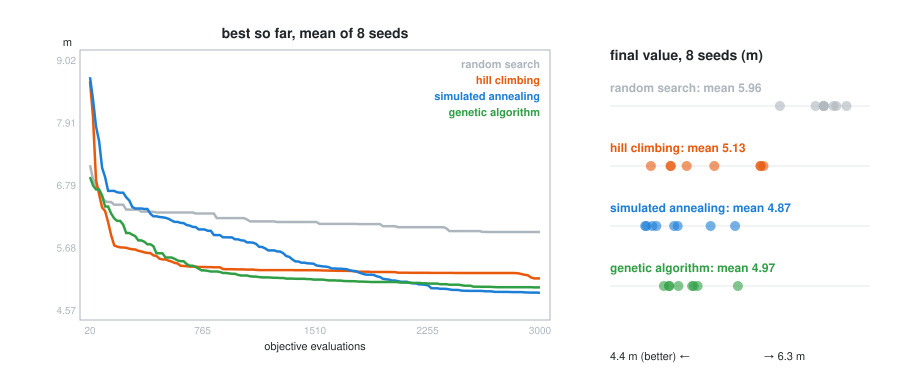
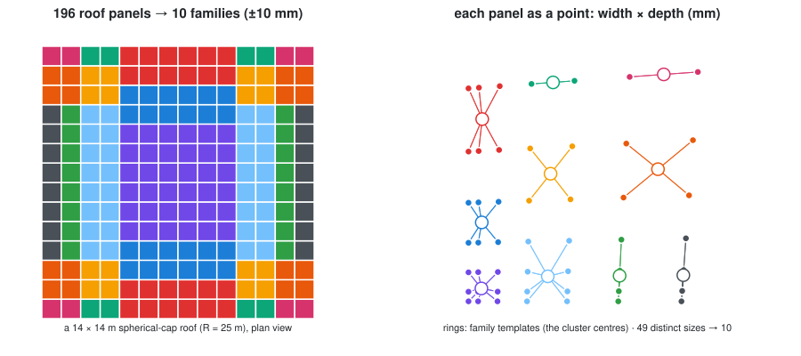
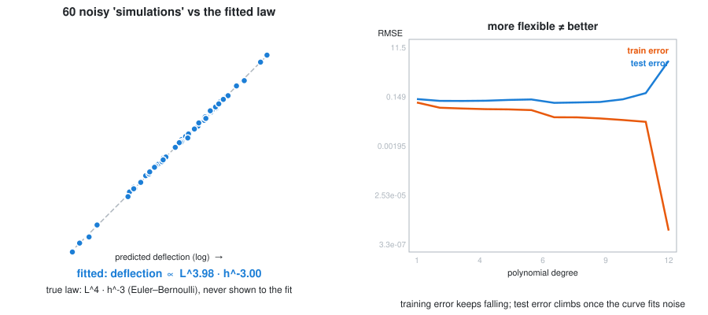

# Week 12 — Optimization and learning

> ```bash
> uv run Lecture/Lecture_12/examples/search.py      # the comparison, ~10 s
> uv run pytest Lecture/Lecture_12/tests -v         # 31 tests
> uv run Lecture/Lecture_12/figures/make_figures_optimization.py
> uv run Lecture/Lecture_12/figures/make_figures_learning.py
> ```

# Part A — Optimization: letting the computer choose

## 1. The idea

So far you have *generated* geometry. Optimization *chooses* geometry: you
describe what "good" means as a number, and an algorithm searches for the
inputs that make that number best.

Three ingredients, and naming them is most of the work:

- **Variables** — what you are allowed to change (beam width, column spacing,
  panel angle).
- **Objective** — the single number to minimise or maximise (weight, cost,
  deflection, daylight).
- **Constraints** — what must stay true regardless (deflection < 5 mm,
  every part fits on the sheet, cost < budget).

If you cannot write the objective as a function that returns one number, you
cannot optimise yet — you are still deciding what you actually want. That is
the same lesson as the executable spec in Week 10, wearing engineering clothes.

## 2. Optimization *is* the dual-mode architecture

This is why the topic sits here and not in a vacuum. An objective function is a
**pure core function**: numbers in, one number out, no viewer, no files. The
optimiser calls it thousands of times, so it *must* be pure and fast — any
printing, drawing, or file IO inside it would be a disaster.

```python
def beam_weight(width, height):
    """Pure: dimensions in, one number out. The optimiser calls this a lot."""
    return width * height * LENGTH * DENSITY
```

Everything you learned in Week 09 about keeping the core clean pays off
directly here. The optimiser is just a very persistent caller.

## 3. Four searches, written from scratch

Before reaching for a library, write the search yourself once. The problem:
**place 6 columns in an L-shaped plan so that no point of the floor is far
from a column**. The objective is the largest distance from any floor point to
its nearest column, a stand-in for the longest span the slab has to make.

```python
def objective(layout):           # 12 numbers in, one number out: pure
    d = distances(floor_samples, columns(layout))
    return d.min(axis=1).max()   # worst point's distance to its nearest column
```

It is cheap to evaluate, impossible to solve with calculus (that `max` of
`min`s is jagged), and full of local optima, which is exactly what these
algorithms are for.



| Method | Idea | Weakness |
| --- | --- | --- |
| **random search** | try random layouts, keep the best | blind: the baseline every other method must beat |
| **hill climbing** | nudge one column; keep the move only if it helps | greedy: stops at the first local optimum |
| **simulated annealing** | ... but *sometimes* accept a worse move, less often as the "temperature" falls | needs a cooling schedule, which is a tuning decision |
| **genetic algorithm** | a population of layouts; good ones breed (swap columns) and mutate (nudge) | many parameters; slow to get started |

### The comparison has rules

Two rules make the comparison honest, and both are enforced in code:

1. **The same budget.** Every method gets 3,000 objective evaluations. A
   `Budget` object counts every call and raises when the budget is spent, so no
   method can quietly cheat by evaluating more. A test checks it with
   `monkeypatch`.
2. **Several seeds.** A random method run once is an anecdote. Each method runs
   with 8 seeds, and we compare the spread, not one lucky number.



On this problem simulated annealing has the best mean (4.87 m), the genetic
algorithm is close (4.97 m), hill climbing gets stuck (5.13 m) with a wide
spread, and random search trails (5.96 m). Note hill climbing's curve: the
fastest start, then flat, which is the local-optimum trap drawn as a line.
**None of this generalises.** On another problem, with another budget, the
order can change. What generalises is the procedure: same budget, several
seeds, and look at the spread.

📄 [`examples/search.py`](examples/search.py) · tests: budgets respected; columns stay inside the
plan; the reported value is the real objective of the reported layout; best-so-far never gets
worse; reproducible per seed; every guided method beats random search on average.

## 4. With libraries

Run them from the repo root:

```bash
uv run Lecture/Lecture_12/applications/beam_optimization_scipy.py
uv run --with pymoo Lecture/Lecture_12/applications/beam_optimization_pymoo.py
```

### [`beam_optimization_scipy.py`](applications/beam_optimization_scipy.py) — one objective

Find the lightest rectangular beam that carries a 500 kg load without
deflecting more than 5 mm.

- **Library**: `scipy.optimize` (standard scientific Python)
- **Method**: SLSQP (Sequential Least SQuares Programming)
- **Shape**: one objective, one answer

### [`beam_optimization_pymoo.py`](applications/beam_optimization_pymoo.py) — competing objectives

Real design rarely has one goal. Here, *light* and *stiff* pull against each
other: the lightest beam is floppy, the stiffest is heavy. There is no single
winner — there is a **Pareto front** of the best available compromises, and
choosing among them is a design decision the maths deliberately leaves to you.

- **Library**: `pymoo` (multi-objective optimization)
- **Method**: NSGA-II (a genetic algorithm)

> The takeaway is not the algorithm. It is that "optimal" is only meaningful
> once you have said *optimal for what*, and that when goals conflict the
> computer hands the trade-off back to you rather than resolving it.

`scipy` is already installed (COMPAS depends on it). `uv run --with pymoo` fetches
`pymoo` for that one run and leaves your project as it is.

## 5. Packing parts on a sheet

Bin packing asks the same question with a heuristic instead of a search: how
much sheet does this order of parts waste? Notebooks
[`02_bin_packing_2d_shelf`](notebooks/02_bin_packing_2d_shelf.ipynb),
[`03_bin_packing_2d_guillotine`](notebooks/03_bin_packing_2d_guillotine.ipynb) and
[`04_bin_packing_3d`](notebooks/04_bin_packing_3d.ipynb). Not examined, but it has
real fabrication uses.

## Using it in a final project

The cleanest way to make optimization part of a project:

1. Write your objective as a pure function in your **core** layer.
2. Let the optimiser find the best variables (this replaces you turning
   sliders by hand).
3. Feed those variables back into your normal geometry core to build the
   winning design, and save it as your **artifact**.

The optimiser chooses the numbers; your tested core turns them into geometry.
Same architecture, one new caller.

---

# Part B — Learning from data: clustering and regression

"Machine learning" in design practice is mostly two humble things: **grouping**
(which of these hundreds of things are really the same?) and **predicting**
(what will this cost, weigh or deflect, without computing it the slow way?).
This page writes both from scratch in numpy, a few dozen lines each, on
architectural problems, so that the library versions stop being magic.

One rule runs through both halves: **test a learning method where you already
know the answer.** Plant clusters and check they are found; generate data from
a physical law and check the law comes back. A method that cannot recover a
known answer will not find an unknown one either.

For trained models as design *ingredients* (diffusion rendering, CLIP image
search), see the optional [AI in design](/Lecture/Lecture_15/neural/README.md) page.

---

## 1. Clustering: how many different panels does the roof need?



A shallow spherical roof on a 1 m grid has 196 panels, in 49 distinct sizes
(symmetry repeats the rest). Making 49 kinds of panel means 49 templates or
jigs. One kind is impossible. The fabricator's question: **what is the fewest
families of panel, if each panel may deviate from its family template by at
most a tolerance?**

That is clustering, and **k-means** is the algorithm. It is Lloyd's algorithm
([W10 §10](/Lecture/Lecture_10/README.md#10-lloyd-relaxation-even-but-not-regular)),
run on panels instead of on a site:

1. **assign** every panel to its nearest family template;
2. **update** every template to the mean of its panels;
3. repeat until nothing moves.

Each panel is described by **features**: numbers we chose to measure, here its
width and depth. Choosing features is the modelling decision. The algorithm
cannot tell you whether you measured the right thing; a twisted panel with the
right side lengths would fool this one.

What the tests pin down:

- **Inertia never increases** within a run, so k-means always stops. It stops at
  a *local* optimum that depends on the start, so we use careful starts
  (k-means++) and keep the best of several.
- **More clusters always fit better.** So "the best k" is not a statistics
  question. It is the tolerance question: `families_needed()` returns the
  smallest k whose worst panel is within tolerance. At ±10 mm this roof needs
  **10 families**, at ±20 mm only 4. That trade-off is a conversation with the
  fabricator, and the code makes it a one-line experiment.

📄 [`examples/kmeans.py`](examples/kmeans.py)

## 2. Regression: rediscovering the beam law



A structural engineer has run 60 simulations of timber beams with different
spans *L* and depths *h*, and recorded each mid-span deflection. Can we predict
the next beam without another simulation? That is a **surrogate model**, the
most common machine learning in engineering design.

We happen to know the true law: deflection ∝ *L*⁴ *h*⁻³ (Euler–Bernoulli).
Take logs and it is a straight line,

```
log(deflection) = c + 4·log(L) − 3·log(h)
```

so ordinary least squares on log-features (`np.linalg.lstsq`) should **recover
the exponents from noisy data alone**. It finds *L*^3.98 · *h*^-3.00. The test
checks both within ±0.15, and checks predictions on beams held back from the
fit. Trying a method where the answer is known is the most honest way to learn
what it does.

### The warning: more flexible is not better

Fit polynomials of rising degree to 18 noisy samples of a smooth curve. Error
on the points you fitted (training error) keeps falling, and at degree 12 the
curve passes through every training point. Error on points held back (test
error) does not follow: once the curve starts fitting the *noise*, it climbs.
The model has memorised instead of learned.

The only defence is to **keep data back and test on it** (`split()`). It is
Week 10's lesson again: you do not grade your own homework, and a model does
not get to grade itself on data it has already seen.

📄 [`examples/regression.py`](examples/regression.py)

---

## Exercises

1. **A better feature.** Add panel *twist* (the diagonal-distance flatness from
   [W10 §5](/Lecture/Lecture_10/README.md#5-planar-panels)) as a third
   feature. Does the family count change at ±10 mm? Which panels move family?
2. **Elbow vs tolerance.** Plot inertia against k (the textbook "elbow") next to
   `families_needed` at 5, 10 and 20 mm. Which would you show a fabricator, and why?
3. **A surrogate you can't write down.** Use the Week 05 truss analysis
   ([`structural_analysis.py`](/Lecture/Lecture_05/applications/structural_analysis.py)) as the "expensive simulation": sample rise and
   grid density, fit max displacement. How many samples until test R² > 0.95?
4. **Have an AI write k-means for you**, then run these tests against it. Which
   property fails first?

## Self-test

1. Why does k-means always stop, and why might two runs stop in different places?
2. Inertia always falls as k grows. So how do you choose k for a roof?
3. Why fit `log(deflection)` instead of `deflection`?
4. A degree-12 polynomial has the lowest training error. Why is it the worst model?
5. What is the minimum evidence you'd want before trusting a surrogate model in a design decision?
