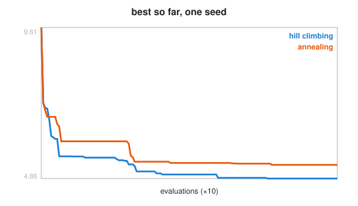
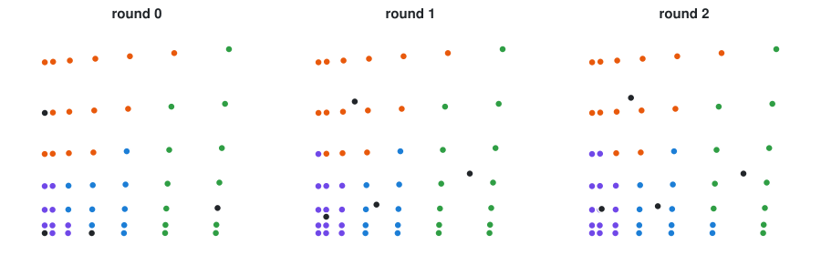

# Week 12 notebooks: optimization and learning

[Lecture](../README.md) · [how to run a notebook](../../README.md#how-to-run-a-notebook)

**Optimization**

| Preview | # | Notebook | What you watch happen |
| :-----: | - | -------- | --------------------- |
|  | 01 | [simulated annealing](01_simulated_annealing.ipynb) | one move; the acceptance rule; why one run is an anecdote |
| *random data* | 02 | [bin packing: shelves](02_bin_packing_2d_shelf.ipynb) | the shelf heuristic, snapshot by snapshot |
| *random data* | 03 | [bin packing: guillotine](03_bin_packing_2d_guillotine.ipynb) | free rectangles and splits |
| *random data* | 04 | [bin packing in 3D](04_bin_packing_3d.ipynb) | layers of boxes |

**Learning**

| Preview | # | Notebook | What you watch happen |
| :-----: | - | -------- | --------------------- |
|  | 05 | [k-means by hand](05_kmeans.ipynb) | assign / update, round by round; families per tolerance |
