# Notebooks

A notebook sits between a lecture and its scripts: it **unpacks one idea at a
time**, prints every intermediate result and draws the data at each step, so
you watch a mesh, a graph or a timber frame being built instead of reading
the result.

**The notebooks live with their week**, in a `notebooks/` folder beside that
week's README, examples and figures. This page is the map, and this folder
holds only what they share: the drawing helper [`viz.py`](viz.py), the copy
script and the tests.

| Week | Folder | What is in it |
| ---- | ------ | ------------- |
| 04 | [`Lecture_04/notebooks/`](../Lecture_04/notebooks/) | COMPAS core: frames, transformations, local coordinates |
| 05 | [`Lecture_05/notebooks/`](../Lecture_05/notebooks/) | the mesh: four notebooks of fundamentals, then seven applications |
| 06 | [`Lecture_06/notebooks/`](../Lecture_06/notebooks/) | graphs and search; plans, frames, walls, streets; compas_timber |
| 08 | [`Lecture_08/notebooks/`](../Lecture_08/notebooks/) | recursion, convex hulls, bin packing |
| 10–12 | [`Algorithms/*/notebooks/`](../Algorithms/README.md) | geometry processing, simulation, search, learning |

A notebook is one file, the `.ipynb`. Inside a folder the numbers run **from
simple to complex**: start at 01.

How to open and run them: [below](#how-to-run-them).

## Week 05 · the mesh

[Lecture](../Lecture_05/README.md) · the pictures are the lecture's own
figures, drawn from real meshes by
[`Lecture_05/figures/make_figures.py`](../Lecture_05/figures/make_figures.py),
and the notebooks show them at the step they explain.

**Fundamentals: do these four in order.**

| Preview | # | Notebook | What you watch happen |
| :-----: | - | -------- | --------------------- |
| <a href="../Lecture_05/notebooks/01_mesh_from_scratch.ipynb"></a> | 01 | [a mesh from scratch](../Lecture_05/notebooks/01_mesh_from_scratch.ipynb) | why a list of polygons is not enough; vertices as keys; a face as a cycle; winding and the normal; a grid from a dictionary; constructors; Euler catching a broken mesh, and `weld` repairing it |
| <a href="../Lecture_05/notebooks/02_walking_a_mesh.ipynb">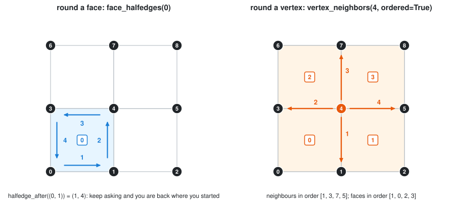</a> | 02 | [walking a mesh](../Lecture_05/notebooks/02_walking_a_mesh.ipynb) | the halfedge table; round a face; across an edge; round a vertex; degree; the boundary and its trap; loops and strips; rings |
| <a href="../Lecture_05/notebooks/03_data_on_a_mesh.ipynb">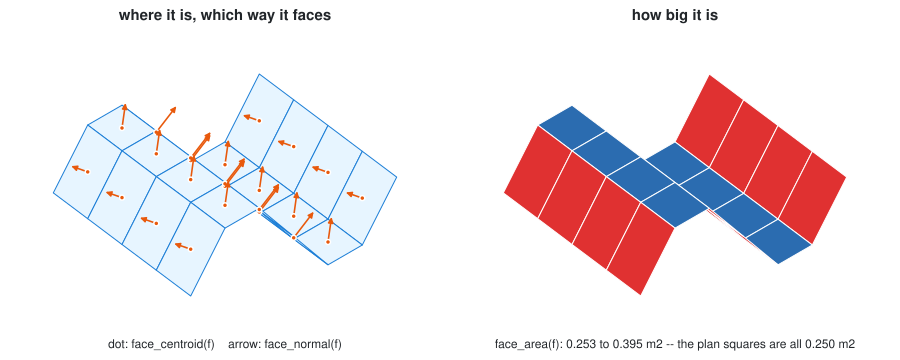</a> | 03 | [data on a mesh](../Lecture_05/notebooks/03_data_on_a_mesh.ipynb) | areas, normals, lengths computed on demand; moving a vertex; attributes with defaults; bulk reads and queries; data to colour; edge data; what JSON keeps and OBJ loses |
| <a href="../Lecture_05/notebooks/04_changing_a_mesh.ipynb">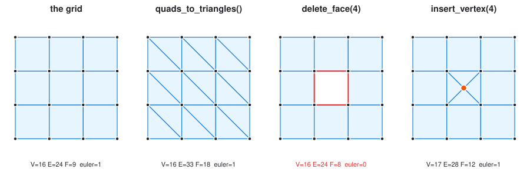</a> | 04 | [changing a mesh](../Lecture_05/notebooks/04_changing_a_mesh.ipynb) | in place or a new mesh; triangulate; open and close a hole; insert, split, collapse; subdivision schemes compared; the dual; join and weld, with Euler after every edit |

**Applications: from simple to advanced.**

| Preview | # | Notebook | What you watch happen |
| :-----: | - | -------- | --------------------- |
| <a href="../Lecture_05/notebooks/05_canopy_panels.ipynb">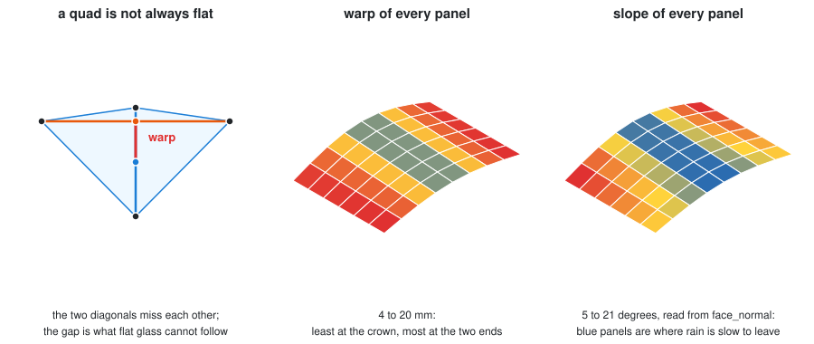</a> | 05 | [a canopy: panels, bars, a schedule](../Lecture_05/notebooks/05_canopy_panels.ipynb) | glass area, a cutting list by tolerance, which panels warp, where rain ponds, attributes as a schedule |
| <a href="../Lecture_05/notebooks/06_surface_to_structure.ipynb">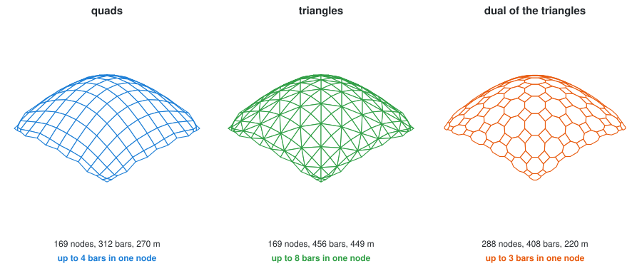</a> | 06 | [from a surface to a structure](../Lecture_05/notebooks/06_surface_to_structure.ipynb) | a cage and subdivision; quads, triangles and the dual on one shell, and what each costs; thickening into a solid |
| <a href="../Lecture_05/notebooks/07_form_finding.ipynb"></a> | 07 | [form finding](../Lecture_05/notebooks/07_form_finding.ipynb) | the force density method, one matrix at a time |
| <a href="../Lecture_05/notebooks/08_mesh_as_truss.ipynb"></a> | 08 | [a mesh is a truss](../Lecture_05/notebooks/08_mesh_as_truss.ipynb) | one bar, a tripod, then any mesh; hanging net, vault and a pyramid that is a mechanism |
| <a href="../Lecture_05/notebooks/09_scan_to_mesh.ipynb"></a> | 09 | [from a scan to a mesh](../Lecture_05/notebooks/09_scan_to_mesh.ipynb) | outliers by neighbours; Delaunay; trimming with Euler as the judge; smoothing that helps and then harms; deviation from the design, in square metres |
| <a href="../Lecture_05/notebooks/10_cloth_simulation.ipynb"></a> | 10 | [a cloth that falls](../Lecture_05/notebooks/10_cloth_simulation.ipynb) | one particle, one thread, a mesh of threads; a sphere to land on; measuring the stretch; a canopy hung from four corners |
| *3D only* | 11 | [a volcano pavilion](../Lecture_05/notebooks/11_volcano_pavilion.ipynb) | a worked design with compas_cgal: Delaunay with holes, lifting, relaxation, remeshing |

## Week 06 · graphs

[Lecture](../Lecture_06/README.md)

| Preview | # | Notebook | What you watch happen |
| :-----: | - | -------- | --------------------- |
| <a href="../Lecture_06/notebooks/01_bfs_and_paths.ipynb">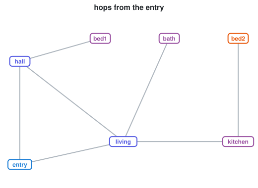</a> | 01 | [graph and BFS](../Lecture_06/notebooks/01_bfs_and_paths.ipynb) | breadth-first search narrated step by step; the BFS tree; two `shortest_path`s disagreeing |
| <a href="../Lecture_06/notebooks/02_floor_plan.ipynb">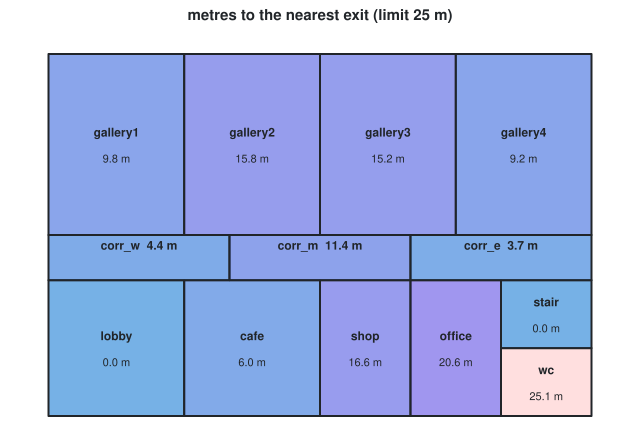</a> | 02 | [reading a floor plan](../Lecture_06/notebooks/02_floor_plan.ipynb) | rooms to graph; depth and the justified graph; integration; escape distance with Dijkstra; critical doors; one new door, measured |
| <a href="../Lecture_06/notebooks/03_two_graphs_of_one_frame.ipynb">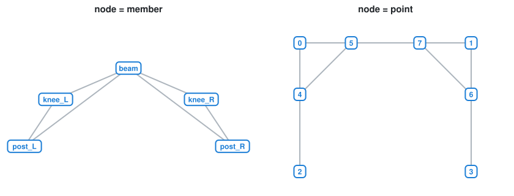</a> | 03 | [two graphs of one frame](../Lecture_06/notebooks/03_two_graphs_of_one_frame.ipynb) | joints found from centrelines; element graph vs bar graph |
| <a href="../Lecture_06/notebooks/04_bricks_and_mortar.ipynb">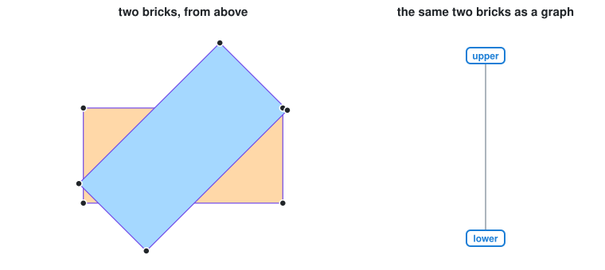</a> | 04 | [bricks and mortar](../Lecture_06/notebooks/04_bricks_and_mortar.ipynb) | a brick as a node, a mortar joint (found by a mesh boolean) as an edge; a six-brick pier whose graph finds itself; quantities as loops |
| <a href="../Lecture_06/notebooks/05_brick_wall_assembly.ipynb">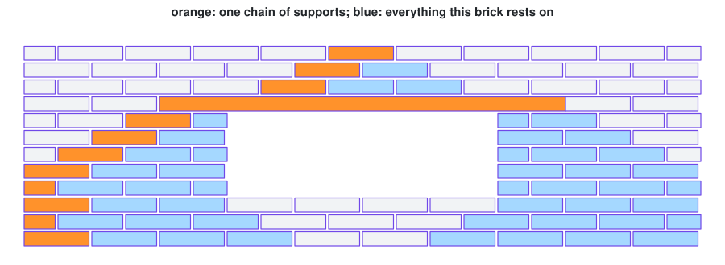</a> | 05 | [a brick wall is a graph](../Lecture_06/notebooks/05_brick_wall_assembly.ipynb) | *rests on* as a directed edge; a DFS to the ground and the load cone; a building sequence (Kahn); the load path round a window; what falls without the lintel; the wall as JSON |
| <a href="../Lecture_06/notebooks/06_street_network.ipynb">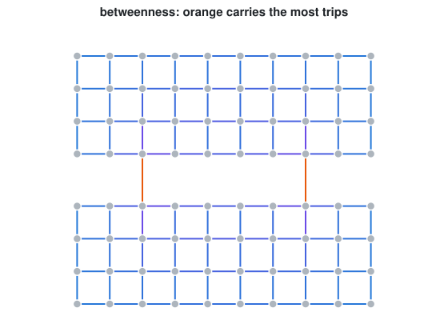</a> | 06 | [a town is a graph](../Lecture_06/notebooks/06_street_network.ipynb) | the `to_networkx()` one-way trap; betweenness counted by hand; closing a bridge; where to put a third |

**compas_timber** (the `timber` extra: start Jupyter with
`uv run --extra timber jupyter lab`). Everything runs without Rhino; the
notebooks say where that stops (lap joints, cut geometry).

| Preview | # | Notebook | What you watch happen |
| :-----: | - | -------- | --------------------- |
| *3D only* | 07 | [two beams and a joint](../Lecture_06/notebooks/07_timber_beams_and_joints.ipynb) | a beam and its blank; L, T and X; the model graph; butt vs miter vs tenon; the T joint's order; BTLx read back |
| <a href="../Lecture_06/notebooks/08_timber_stud_wall.ipynb">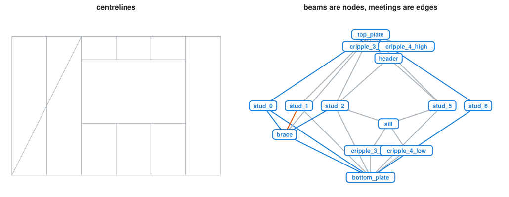</a> | 08 | [a stud wall](../Lecture_06/notebooks/08_timber_stud_wall.ipynb) | centrelines → roles → beams → topology → a rule → joints → BTLx; four design variants in one table |
| <a href="../Lecture_06/notebooks/09_timber_frame_to_site.ipynb">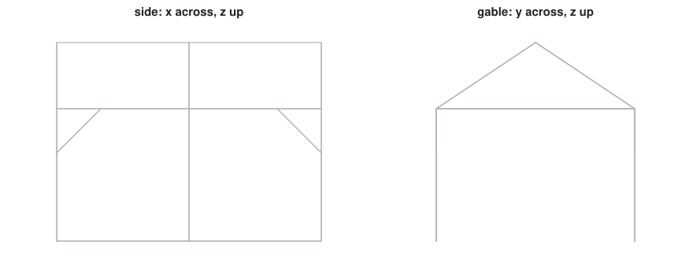</a> | 09 | [a frame, from design to site](../Lecture_06/notebooks/09_timber_frame_to_site.ipynb) | a 3D shed: crowded nodes, a rule of precedence that halves the cut list, weights, an erection sequence by BFS |

## Week 04 · COMPAS core

[Lecture](../Lecture_04/README.md) · all four draw in the interactive 3D viewer.

| # | Notebook | What it covers |
| - | -------- | -------------- |
| 01 | [notebook basics](../Lecture_04/notebooks/01_notebook_basics.ipynb) | cells, and a point in the 3D viewer |
| 02 | [frames](../Lecture_04/notebooks/02_frames.ipynb) | a frame as a coordinate system; geometry built on a frame |
| 03 | [transformations](../Lecture_04/notebooks/03_transformations.ipynb) | translation, rotation, scale as 4 × 4 matrices, and their order |
| 04 | [local frames](../Lecture_04/notebooks/04_local_frames.ipynb) | placing timber on a ring of frames; local ↔ world |

## Week 08 · recursion and classic algorithms

[Lecture](../Lecture_08/README.md) · these plot random data with matplotlib,
different on every run, so there is no fixed preview.

| # | Notebook | What you watch happen |
| - | -------- | --------------------- |
| 01 | [recursion: heightmap subdivision](../Lecture_08/notebooks/01_recursion_heightmap.ipynb) | a quadtree that refines where the terrain bends |
| 02 | [convex hull in 2D](../Lecture_08/notebooks/02_convex_hull_2d.ipynb) | Graham scan, step by step |
| 03 | [convex hull in 3D](../Lecture_08/notebooks/03_convex_hull_3d.ipynb) | Quickhull through scipy, then COMPAS |
| 04 | [convex hull, COMPAS only](../Lecture_08/notebooks/04_convex_hull_compas_only.ipynb) | the Graham scan again, without matplotlib |
| 05 | [bin packing: shelves](../Lecture_08/notebooks/05_bin_packing_2d_shelf.ipynb) | the shelf heuristic, snapshot by snapshot |
| 06 | [bin packing: guillotine](../Lecture_08/notebooks/06_bin_packing_2d_guillotine.ipynb) | free rectangles and splits |
| 07 | [bin packing in 3D](../Lecture_08/notebooks/07_bin_packing_3d.ipynb) | layers of boxes |

## Weeks 10–12 · algorithms

[Section README](../Algorithms/README.md) · each notebook sits beside the
tested `tutorials/` module it unpacks.

| Preview | Part | Notebook | What you watch happen |
| :-----: | ---- | -------- | --------------------- |
| <a href="../Algorithms/geometric/notebooks/01_curvature_smoothing.ipynb">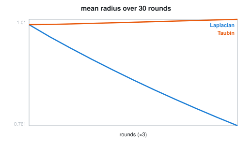</a> | [W10 geometric](../Algorithms/geometric/README.md) | [curvature and smoothing](../Algorithms/geometric/notebooks/01_curvature_smoothing.ipynb) | one angle defect by hand; Gauss–Bonnet; Laplacian shrinking vs Taubin |
| <a href="../Algorithms/geometric/notebooks/02_voronoi_lloyd.ipynb">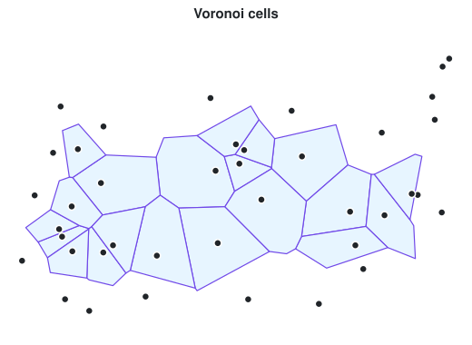</a> | W10 geometric | [Delaunay → Voronoi → Lloyd](../Algorithms/geometric/notebooks/02_voronoi_lloyd.ipynb) | the empty circle; cells from circumcentres; Lloyd round by round |
| <a href="../Algorithms/simulation/notebooks/01_cellular_automata.ipynb">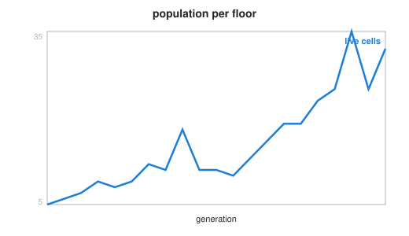</a> | [W11 simulation](../Algorithms/simulation/README.md) | [cellular automata](../Algorithms/simulation/notebooks/01_cellular_automata.ipynb) | neighbour counts as an array; the rule; a glider; a tower |
| <a href="../Algorithms/optimization/notebooks/01_simulated_annealing.ipynb">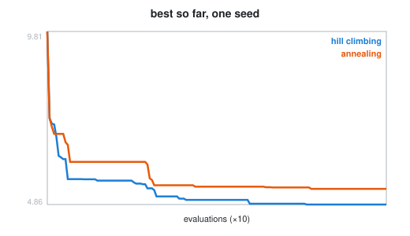</a> | [W12 optimization](../Algorithms/optimization/README.md) | [simulated annealing](../Algorithms/optimization/notebooks/01_simulated_annealing.ipynb) | one move; the acceptance rule; why one run is an anecdote |
| <a href="../Algorithms/learning/notebooks/01_kmeans.ipynb">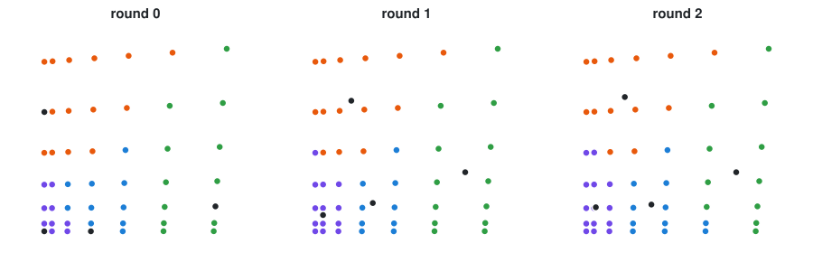</a> | [W12 learning](../Algorithms/learning/README.md) | [k-means by hand](../Algorithms/learning/notebooks/01_kmeans.ipynb) | assign / update, round by round; families per tolerance |

---

## How to run them

**Once per clone**, so notebook outputs never end up in your commits:

```bash
uv run nbstripout --install
```

**Each time:**

```bash
uv run Lecture/notebooks/copy_to_mywork.py 05      # copy Week 05's notebooks into MyWork/
uv run jupyter lab MyWork/notebooks                 # opens them in your browser
```

Open a notebook and run the cells from the top, one at a time, with
`Shift` + `Enter`. When you are done, stop the server with `Ctrl` + `C` in the
terminal.

Good to know:

- **Work on the copies in `MyWork/notebooks/`**, not the originals: those are
  updated by the instructor, and editing them causes merge conflicts on
  `git pull upstream main`. Copy one notebook with `05/02`, everything with
  `all`. A copy brings its pictures with it. It is never overwritten, unless
  you add `--force` (do that to pick up the instructor's updates; your edits
  in that copy are lost). The copies are not committed: `MyWork/notebooks/`
  is in `.gitignore`.
- **The compas_timber notebooks** (Week 06, 07–09) need
  `uv run --extra timber jupyter lab MyWork/notebooks`.
- **VS Code** works too: open the `.ipynb` and choose this project's `.venv`
  as the kernel. If a 3D view stays blank there, use the browser. Zed does not
  open notebooks.

---

## Three kinds of figure

| | **Drawn figures** (in the text) | **Diagrams** (`draw_mesh`, `draw_graph`, `chart` …, SVG) | **3D views** (`view3d`, compas_notebook) |
| --- | --- | --- | --- |
| what | designed explanations with labels and captions, made in advance by a week's `figures/make_figures.py` from real data | flat drawings of *your* data, made when you run a cell | interactive three.js: orbit, zoom |
| best for | the idea: what a halfedge is, what warp means | the result: which key is where, what a step did, a number over time | the geometry itself: a shell, a frame, a shape changing |
| you see it | as soon as the notebook opens, and on GitHub | after running the cell | after running the cell, in JupyterLab (verified) or VS Code (needs widget scripts) |

The Week 05 notebooks use all three. A drawn figure explains a step before
you run it; the cell's own diagram then shows the same thing on your data.

`compas_viewer`, the desktop viewer used in the lecture scripts, opens its own
window and **does not render inside a notebook**. **compas_notebook** is the
COMPAS project's notebook viewer: the same `scene.add(...)` idea, drawn with
three.js in the page. `view3d()` in [`viz.py`](viz.py) wraps it with two
fixes that matter in class:

- **Framing.** compas_notebook always looks at the origin from (0, −10, 5),
  so anything large or far from the origin starts off-screen. `view3d` aims the
  camera at the bounding box of what you pass.
- **Isolation.** compas_notebook's `Config` shares one view setting between all
  viewers by default; `view3d` gives each viewer its own.

```python
view3d(mesh)                                              # just look
view3d((mesh, {"facecolor": colours, "show_edges": True}),  # with options
       frame, (graph, {"nodesize": 0.2}))
```

Options are compas_notebook's, and they are **not** always compas_viewer's.
Meshes take `facecolor` (one colour or `{face: colour}`), `show_edges`,
`edgecolor`. Shapes such as `Box` take `color`, not compas_viewer's
`surfacecolor`, which compas_notebook silently ignores (found the hard way:
every box came out black). For hundreds of small pieces, build **one** mesh,
not hundreds of shapes: the cellular-automata tower (Week 11) and the brick
wall (Week 06, notebook 05) do this, because hundreds of boxes
render slowly and one of them was drawn at the origin by mistake.

The older notebooks (Week 04, and the volcano pavilion in Week 05) use
compas_notebook's `Viewer` directly, and the Week 08 ones plot with matplotlib. They run with the same
`uv run jupyter lab`.

---

## For the instructor

```bash
uv run python -m pytest Lecture/notebooks -q                    # compas_timber notebooks are skipped
uv run --extra timber python -m pytest Lecture/notebooks -q     # everything
```

Edit the `.ipynb` directly, in JupyterLab. [`test_notebooks.py`](test_notebooks.py)
collects every `Lecture/Lecture_NN/notebooks/*.ipynb` and
`Lecture/Algorithms/*/notebooks/*.ipynb` and fails if one has outputs or
execution counts in it, if a picture its text points at is missing, if a
notebook sits outside a `notebooks/` folder, or if one no longer runs top to
bottom in a kernel.

To add a notebook: save it as `NN_name.ipynb` in its week's `notebooks/`
folder, give it the setup cell of its neighbours if it draws with `viz.py`,
and add a row to this page.

**Pictures.** A *drawn figure* belongs to the week: add a function to that
week's `figures/make_figures.py` and show it in a markdown cell with
``. The *previews* on this page for
Week 06 and the algorithms are instead the notebooks' own output, saved by
[`figures/make_figures.py`](figures/make_figures.py) (add a line to `PICK`:
the notebook, and a few words from the title of the figure to show):

```bash
uv run Lecture/Lecture_05/figures/make_figures.py                  # Week 05's drawn figures
uv run --extra timber Lecture/notebooks/figures/make_figures.py    # previews from notebook output
```
