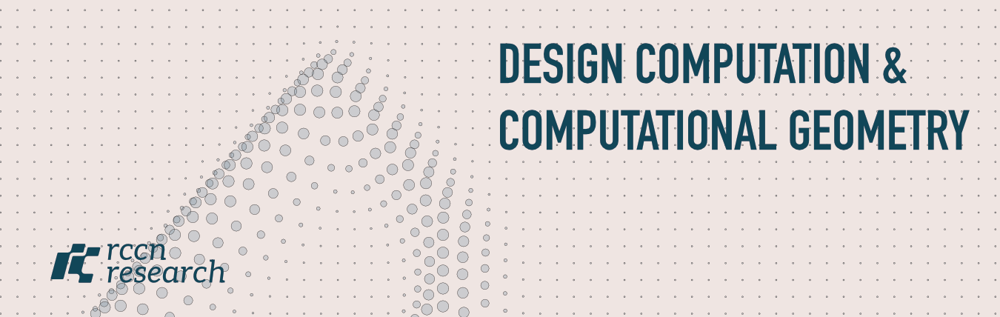

# ARCH3045 Design Computation and Computational Geometry

The intersection of computational design and digital fabrication has changed how
we design, analyze, and construct our built environment. Computational geometry
is at the core of that — from initial form-finding to actual construction — and
this course explores the algorithms, data structures, geometric operations, and
design-to-fabrication workflows that let you create high-performance designs,
intricate geometries, and lightweight parts with minimal material.

The newer shift the course takes seriously: **we embrace agentic development —
building software with AI coding assistants — but we insist on using them
professionally.** A model can write most of the code now; the scarce skill has
moved from *typing* it to *specifying, reading, verifying, and owning* it. So
alongside geometry, you learn the software engineering that keeps AI-written code
honest: tests, review, version control, and reproducible pipelines. Every week
the same question returns: *how do you know this is right?*

**By January you build** a small, tested Python + COMPAS design tool that runs
with or without Rhino — the same core logic usable headlessly, in CI, and inside
Rhino 8 / Grasshopper through a thin adapter.

* E7-125 / E735400 / ARCH3045 · **WED 13:10–15:00** · Computer lab (5102)
* First session **2026.09.09** · Office hour Wed 15:10–17:00 · ccyen @ gs.ncku.edu.tw
* **New here? → [Setup](SETUP.md)** · stuck? → [Troubleshooting](TROUBLESHOOTING.md)
* **Working in this repo:** your own notes and practice live in [`MyWork/`](MyWork/README.md) (tracked, instructor-never-touches). The instructor's updates arrive weekly via `git pull upstream main` — full setup in [SETUP ▸ Git for this course](SETUP.md#git-for-this-course), failure catalogue on the [wiki](https://kb.rccn.dev/computation/development-environment/version-control/coursework-git).

## Schedule, 2026 Fall

🎬[Slide Streaming](https://slide-stream.rccn.dev/) — the slides, live during class.
📑[Decks](https://slides.rccn.dev/courses/DCCG/) — to read again afterwards.

The slides are the room; this repo is the course. If you only do one, read the
week's lecture — it is searchable, runnable, and available at 3am.

### Part I — Literacy: read, run, debug (W01–W04)

| Week | Date | Session | Practice |
| ---- | ---------- | ------- | -------- |
| 01 | 2026.09.09 | **Introduction & Toolchain** — how the course works; Python, git/GitHub, Zed, `uv`, and an AI assistant. 👉[Lecture](/Lecture/Lecture_01/README.md) · 🎬[Slides](https://slides.rccn.dev/courses/DCCG/DCCG-W01/) | Setup + first commit (**A0**, local) · fork the course before W02 |
| 02 | 2026.09.16 | **Python I** — values, types, lists, functions. Reading code, not only writing it. 👉[Lecture](/Lecture/Lecture_02/README.md) · 🎬[Slides](https://slides.rccn.dev/courses/DCCG/DCCG-W02/) | 10-min git housekeeping: fork + push **A0** · 📝[Exercise](/Exercise/Lecture_02/README.md) |
| 03 | 2026.09.23 | **Python II** — control flow, modules; reading a traceback and debugging what doesn't crash. 👉[Lecture](/Lecture/Lecture_03/README.md) · 🎬[Slides](https://slides.rccn.dev/courses/DCCG/DCCG-W03/) | 📝[Exercise](/Exercise/Lecture_03/README.md) |
| 04 | 2026.09.30 | **Python III + COMPAS core** — dictionaries and tuples; Point, Vector, Frame, Box; transformations; geometry as a pure function. 👉[Lecture](/Lecture/Lecture_04/README.md) · 🎬[Slides](https://slides.rccn.dev/courses/DCCG/DCCG-W04/) | 📝[Rotating boxes](/Exercise/Lecture_04/README.md) |

### Part II — Geometry as data (W05–W09)

| Week | Date | Session | Practice |
| ---- | ---------- | ------- | -------- |
| 05 | 2026.10.07 | **Mesh** — vertices, faces, halfedges; neighbours and boundaries; attributes as dictionaries; Euler as a free test. 👉[Lecture](/Lecture/Lecture_05/README.md) · 🎬[Slides](https://slides.rccn.dev/courses/DCCG/DCCG-W05/) | 📝[Mesh exercise](/Exercise/Lecture_05/README.md) |
| 06 | 2026.10.14 | **Graphs** — nodes and edges; breadth-first search; shortest paths; connected components; a floor plan and a brick wall as graphs. 👉[Lecture](/Lecture/Lecture_06/README.md) · 🎬[Slides](https://slides.rccn.dev/courses/DCCG/DCCG-W06/) | 📝[Circulation graph](/Exercise/Lecture_06/README.md) |
| 07 | 2026.10.21 | 🚫 self-paced · **OOP** — classes, attributes, methods; a design element as an object. 👉[Lecture](/Lecture/Lecture_07/README.md) · 🎬[Slides](https://slides.rccn.dev/courses/DCCG/DCCG-W07/) | 📝[OOP exercises](/Exercise/Lecture_07/README.md) |
| 08 | 2026.10.28 | 🚫 self-paced · **Recursion** — base cases, depth, self-similar geometry; AI as a tutor. 👉[Lecture](/Lecture/Lecture_08/README.md) · 🎬[Slides](https://slides.rccn.dev/courses/DCCG/DCCG-W08/) | 📝[Branching tree](/Exercise/Lecture_08/README.md) |
| 09 | 2026.11.04 | **Debrief + Software Engineering I — the dual-mode architecture** ⭐ — peer review of the self-paced weeks; files, JSON, reviewing AI code; core → artifact → adapter; the `uv` lockfile; git branches and PRs. 👉[Lecture](/Lecture/Lecture_09/README.md) · 🎬[Slides](https://slides.rccn.dev/courses/DCCG/DCCG-W09/) | Refactor a script into core + runner |

### Part III — Algorithms: the core, filled (W10–W12)

| Week | Date | Session | Milestone |
| ---- | ---------- | ------- | --------- |
| 10 | 2026.11.11 | **Geometric algorithms + testing** — smoothing, curvature, geodesics, subdivision, planar panels, contouring, Voronoi, hull, neighbour search; `pytest`, properties not pictures, theorems as tests. 👉[Algorithms](/Lecture/Algorithms/geometric/README.md) · 👉[Testing](/Lecture/Lecture_12/README.md#part-a--testing-week-10) · 🎬[Slides](https://slides.rccn.dev/courses/DCCG/DCCG-W10/) | 🎓 **Final project brief released** |
| 11 | 2026.11.18 | **Simulation** — cellular automata, boids, growth; global form from local rules; testing what you cannot predict. 👉[Lecture](/Lecture/Algorithms/simulation/README.md) · 🎬[Slides](https://slides.rccn.dev/courses/DCCG/DCCG-W11/) | — |
| 12 | 2026.11.25 | **Optimization + learning** — hill climbing, annealing, genetic search under equal budgets; k-means panel families; regression surrogates and overfitting. 👉[Optimization](/Lecture/Algorithms/optimization/README.md) · 👉[Learning](/Lecture/Algorithms/learning/README.md) · 🎬[Slides](https://slides.rccn.dev/courses/DCCG/DCCG-W12/) | 🎓 **Proposal + pitch** |

### Part IV — Engineering the workflow with AI (W13–W14)

| Week | Date | Session | Milestone |
| ---- | ---------- | ------- | --------- |
| 13 | 2026.12.02 | **Code review + LLM-assisted workflow** — the agent loop (build the harness yourself), coder/reviewer with a human gate, pytest as the un-arguable reviewer, PR-based review of each other's projects. 👉[Agents](/Lecture/Lecture_11/README.md) · 👉[Review](/Lecture/Lecture_12/README.md#part-b--review-and-the-test-driven-agent-week-13) · 🎬[Slides](https://slides.rccn.dev/courses/DCCG/DCCG-W13/) | 📝 [Agentic lab](/Assignment/6_agentic_workflow/README.md) opens |
| 14 | 2026.12.09 | **Deploy: Grasshopper components, built in Docker** ⭐ — components without `rhinoscriptsyntax`; the componentizer in a container; the same build on your laptop, under `act`, and in CI. 👉[Lecture](/Lecture/Lecture_12/README.md#part-c--deploy-shipping-a-grasshopper-plugin-set-week-14) · 📦[Plugin set](/Lecture/Lecture_12/plugin_set/README.md) · 🎬[Slides](https://slides.rccn.dev/courses/DCCG/DCCG-W14/) | 🎓 **Project iteration 1** |

### Part V — Build (W15–W18)

| Week | Date | Session | Milestone |
| ---- | ---------- | ------- | --------- |
| 15 | 2026.12.16 | **Project work** — studio session; one-on-ones by register. Optional: [AI models as design ingredients](/Lecture/Lecture_10/README.md) (diffusion, CLIP). | 📝 Agentic lab due |
| 16 | 2026.12.23 | **Final Project — help desk** (register-based one-on-ones). 🎬[Slides](https://slides.rccn.dev/courses/DCCG/DCCG-W16/) | 🎓 **Project iteration 2** |
| 17 | 2026.12.30 | **Final Project — packaging clinic.** Feature freeze: README, install, tests green, artifact committed, adapter verified. 🎬[Slides](https://slides.rccn.dev/courses/DCCG/DCCG-W17/) | 🎓 **Feature freeze** |
| 18 | 2027.01.06 | 🎓 **Final Presentations** — live demo: the same core, headless *and* in Rhino/Grasshopper. 🎬[Slides](https://slides.rccn.dev/courses/DCCG/DCCG-W18/) | 🎓 **Repo due 2027.01.10 23:59** |

## Grading

**The final project is your grade — 100%.**

The one thing you must do to get there is complete the **Weeks 01–09
checkpoints**. They aren't scored — `uv run check.py` turns them green and you're
done — but they are a required completion gate: they are how you actually become
able to build the project. So the course really has just two things, checkpoints
and the final.

The project's criteria are in its
[brief](/Assignment/5_Final_Project/README.md#assessment) — the theme throughout
is **process is worth more than the artifact.** Everything else is optional
preparation: the [A0 setup](/Assignment/0_copilot/README.md), the
[agentic-workflow lab](/Assignment/6_agentic_workflow/README.md) (a dry run of
the project loop), and the weekly exercises.

## AI usage

A course should state its AI policy plainly and say *why* it holds ([MIT Ad Hoc
Committee on AI Use in Teaching, Learning, and Research Training](https://aihub.mit.edu),
Aug 2026 — report in [`Reference/`](/Reference/AI-Committee-Final-Report.pdf)).
In that report's terms, this course is **Required use**: you are *expected* to
build with AI assistants, including on the final project — with two deliberately
**AI-free** carve-outs.

**Why required, not merely allowed.** A model can write most of this code now,
so the skill being taught — and assessed — is not typing it but *specifying,
reading, verifying, and owning* it. Forbidding AI would train the wrong thing;
using it carelessly would teach nothing. Three rules keep it honest:

1. **Explain every line you submit.** "The AI wrote it" is not an answer — and
   at the final demo you will be asked to, live.
2. **Disclose** — keep meaningful prompts in comments or a `log.md`, and commit
   as you go: your git history is part of the evidence.
3. **Verify, don't trust** — LLMs fabricate facts, cite things that do not
   exist, and emit code that is subtly wrong or insecure. Tests and an inspected
   artifact are evidence; "it looked right in the viewer" is not. You own every
   line you submit, including anything the AI got wrong.

**The AI-free parts.** In the agentic lab, the brief, log, and reflection are
written **by you, not an LLM** — that reflection *is* the learning. And the
final **live demo is an oral defense**: no assistant, just you and your code.
